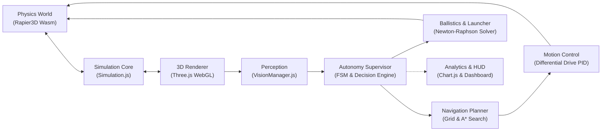
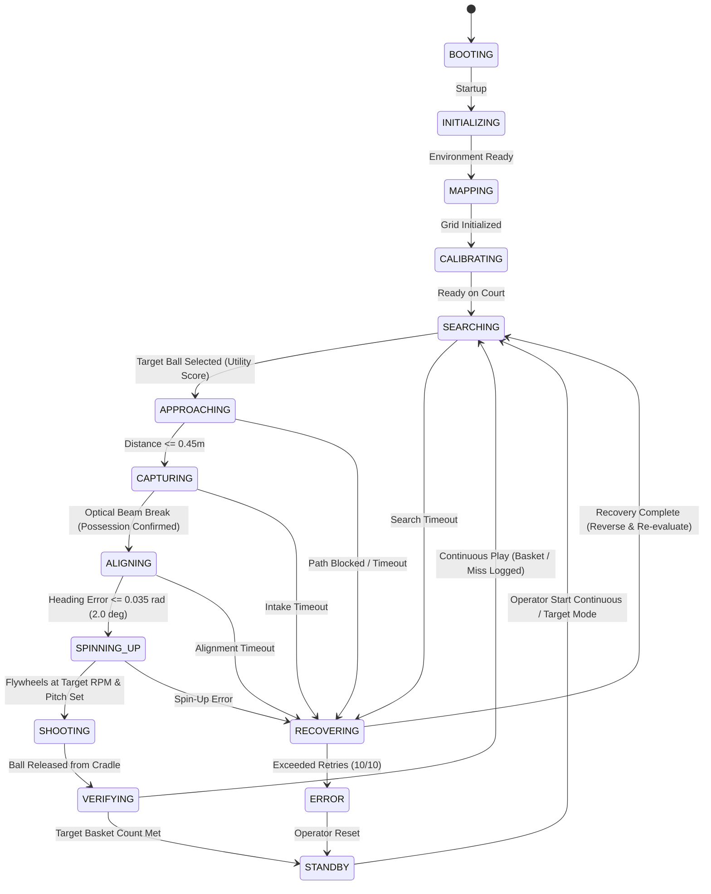

# SMART-BASKETBOT Simulator
### Autonomous Basketball-Playing Mobile Robot Cyber-Physical Simulation & Performance Analytics Platform

[](https://vitejs.dev/)
[](https://threejs.org/)
[](https://rapier.rs/)
[](https://vitest.dev/)
[](docs/TESTING_AND_VALIDATION.md)
[](https://opensource.org/licenses/MIT)

---

## 1. Project Title & Overview

**SMART-BASKETBOT** is an engineering-grade, browser-based 3D mobile robotics digital twin modeling an autonomous basketball-playing robot. Developed under the Vertically Integrated Projects (VIP) academic framework, the simulator integrates rigid-body dynamics, differential-drive kinematics, PID closed-loop motion control, 2D occupancy grid mapping with 8-connected A\* search and raycast string-pulling smoothing, a simulated geometric computer vision pipeline with line-of-sight raycasting, a high-velocity dual-flywheel launcher with apparent rim aperture optimization, and a 14-state hierarchical autonomous finite state machine with automatic recovery routines.

The entire application executes client-side within standard modern web browsers via WebGL 2.0 and WebAssembly, maintaining a deterministic 60 Hz physics update loop without requiring backend servers, native driver installations, or discrete workstation GPUs.

```
+---------------------------------------------------------------------------------------+
|                               SMART-BASKETBOT PLATFORM                                |
+---------------------------------------------------------------------------------------+
                                           |
          +--------------------------------+--------------------------------+
          |                                                                 |
          v                                                                 v
+-----------------------------------+             +-------------------------------------+
|        VIRTUAL ENVIRONMENT        |             |        AUTONOMOUS INTELLIGENCE      |
|  - Three.js WebGL 3D Scene Graph  |             |  - 14-State Finite State Machine    |
|  - Rapier3D Wasm Rigid Bodies     |== Sensor ==>|  - Multi-Factor Utility Selection   |
|  - 16-Segment Hoop Rim Colliders  |  Telemetry  |  - 8-Connected A* + String Pulling  |
|  - Synthetic Camera Frustum       |             |  - Newton-Raphson Ballistic Solver  |
|  - Optical Beam-Break Sensor Gate |<== Action ==|  - Closed-Loop Heading PID Alignment|
+-----------------------------------+   Commands  +-------------------------------------+
                                           |
                                           v
                          +----------------------------------+
                          |      HUD & ANALYTICS ENGINE      |
                          |  - Real-Time 60Hz Telemetry Gauges |
                          |  - 2D Court Radar Display        |
                          |  - Dynamic Chart.js Analytics    |
                          |  - JSON / CSV Dataset Export     |
                          +----------------------------------+
```

> **Important Technical Clarification:**  
> SMART-BASKETBOT is a software cyber-physical digital twin and robotics simulation platform. No physical robot chassis was fabricated, and no physical camera hardware was deployed. Perception is achieved through a simulated geometric computer vision pipeline (3D frustum projection and raycast occlusion testing) rather than a trained deep-learning convolutional neural network. Decision-making is governed by a deterministic, rule-based finite state machine with mathematical utility scoring.

---

## 2. Key Features

- **Client-Side High Performance:** Sustained 60 FPS rendering in modern web browsers via Three.js (WebGL 2.0) and Rapier3D (WebAssembly).
- **Accurate Physics & Contact Mechanics:** Fixed 60 Hz physics step loop ($\Delta t = 16.667\text{ ms}$) with a sub-step accumulator, Continuous Collision Detection (CCD), and a **16-segment compound rotated rim collider ring** ($0.45\text{m}$ inner diameter).
- **Differential-Drive Kinematics & PID:** Forward and inverse kinematics for a two-wheel differential drive with dual independent PID velocity loops and anti-windup clamping.
- **Autonomous Navigation & Path Smoothing:** 2D court occupancy grid ($0.25\text{m}$ resolution) with $0.42\text{m}$ obstacle inflation, 8-connected A\* graph search, and raycast string-pulling smoothing that prunes over 70% of intermediate waypoints.
- **Simulated Geometric Vision & Tracking:** Elevated virtual camera mast ($75^\circ$ horizontal FOV) with frustum culling, line-of-sight raycasting occlusion checks, and Kalman-filtered multi-target tracking.
- **Damped Ballistic Trajectory Calculation:** Non-linear projectile flight modeling with linear air drag ($\gamma = 0.08\text{ s}^{-1}$), solved via Newton-Raphson numerical root finding with a strict entry angle constraint ($\theta_{\text{entry}} \ge 32^\circ$).
- **Autonomous Gameplay Supervisor:** 14-state hierarchical finite state machine orchestrating continuous cycles of ball searching, approach, intake, heading alignment, flywheel spin-up, shooting, scoring verification, and edge-of-court fault recovery.
- **Comprehensive Interactive HUD & Analytics:** 2D court radar, targeting reticles, real-time Chart.js performance graphs, and one-click session dataset export to CSV and JSON.
- **100% Automated Test Coverage:** **18 test suites and 302 unit and integration tests** passing in Vitest with zero regressions.

---

## 3. Technologies & Frameworks

| Subsystem / Layer | Technology | Version | Engineering Role |
| :--- | :--- | :--- | :--- |
| **Language** | JavaScript (ESM) | ES2022 | Modular subsystem architecture, algorithms, state machines |
| **Build & Bundler** | Vite | ^8.3.5 | Fast Hot Module Replacement (HMR) and optimized Rollup production builds |
| **3D Rendering** | Three.js | ^0.187.0 | WebGL 2.0 scene graph, court textures, materials, lighting, cameras |
| **Physics Simulation** | @dimforge/rapier3d-compat | ^0.21.0 | WebAssembly rigid-body dynamics, colliders, contact manifolds |
| **Data Visualization** | Chart.js | ^4.6.1 | Real-time HUD charts (shooting accuracy, launch velocity scatter plots) |
| **Automated Testing** | Vitest | ^5.0.5 | Unit, integration, regression, and full lifecycle test execution |

---

## 4. System Architecture Summary

The codebase is organized into decoupled, highly cohesive subsystems under `src/`:

```
src/
├── analytics/         # Session performance monitoring, statistics, metrics, export
├── autonomy/          # 14-state finite state machine supervisor, target utility engine
├── environment/      # FIBA 28x15m court, 16-segment rim collider, basketball, lighting
├── navigation/       # 2D occupancy grid, 8-connected A* search, raycast string pulling
├── robot/            # Kinematics, dual PID velocity loops, intake, shooter, trajectory solver
├── simulation/       # Simulation coordinator, Rapier3D Wasm wrapper, fixed-step clock
├── ui/               # Cockpit HUD overlays, controls toolbar, Chart.js telemetry graphs
└── vision/           # Synthetic camera frustum, raycast occlusion, Kalman object tracking
```

### Dataflow Architecture


For complete architectural contracts and subsystem dataflow diagrams, refer to [**`docs/SYSTEM_ARCHITECTURE.md`**](docs/SYSTEM_ARCHITECTURE.md).

---

## 5. Autonomous Gameplay State Machine

Continuous autonomous gameplay is governed by a 14-state hierarchical state machine:



---

## 6. Installation & Quickstart

### Prerequisites
- [Node.js](https://nodejs.org/) v18.0.0 or higher
- [npm](https://www.npmjs.com/) v9.0.0 or higher
- Modern web browser with WebGL 2.0 and WebAssembly enabled

### Installation
```bash
# Clone the repository
git clone https://github.com/NeilGogy06/smart-basketbot-simulator.git
cd smart-basketbot-simulator

# Install dependencies
npm install
```

### Launch Development Server
```bash
npm run dev
```
Open your browser and navigate to the displayed local server address (typically `http://localhost:5173/`).

### Production Build & Preview
```bash
# Build optimized production bundle
npm run build

# Preview production build locally
npm run preview
```

---

## 7. Controls & Operation Guide

The simulator supports both manual teleoperation and fully autonomous gameplay:

### 7.1 Verified Keyboard Teleoperation Controls

| Key / Shortcut | Subsystem Actuated | Operational Behavior |
| :---: | :--- | :--- |
| **`W` / `Up Arrow`** | Differential Drive Base | Drive forward at linear speed ($1.6\text{ m/s}$). |
| **`S` / `Down Arrow`** | Differential Drive Base | Drive in reverse at linear speed ($-1.6\text{ m/s}$). |
| **`A` / `Left Arrow`** | Differential Drive Base | Turn counter-clockwise (left) in place at $2.4\text{ rad/s}$. |
| **`D` / `Right Arrow`** | Differential Drive Base | Turn clockwise (right) in place at $2.4\text{ rad/s}$. |
| **`Space`** | Emergency Stop | **Emergency Stop (E-Stop):** Instantly zeroes drive velocity commands. |
| **`F`** | Shooting Mechanism | **Fire Shooter:** Spins up flywheels and launches basketball toward target hoop. |
| **`I`** | Intake Mechanism | **Toggle Intake:** Cycles roller state (Intake Forward $\to$ Off $\to$ Reject). |
| **`P`** | Simulation Clock | **Play / Pause:** Toggles fixed 60 Hz physics stepping. |
| **`R`** | Lifecycle Coordinator | **Reset All:** Resets robot, basketball, colliders, and state machine. |
| **`B`** | Environment Subsystem | **Reset Ball:** Teleports basketball to its initial court coordinates. |
| **`T`** | Physics Test Harness | **Drop Test:** Drops basketball from $3.2\text{m}$ elevation to test Rapier restitution. |
| **`Y`** | 3D Trajectory Ribbon | **Toggle Trajectory Line:** Shows or hides the real-time 3D ball flight path. |
| **`X`** | 3D Trajectory Ribbon | **Clear Trajectory Path:** Clears all recorded 3D flight waypoints. |
| **`1`** | Camera System | **Camera Preset 1:** Switches to Court Perspective Overview. |
| **`2`** | Camera System | **Camera Preset 2:** Switches to Robot Orbit Follow View. |
| **`3`** | Camera System | **Camera Preset 3:** Switches to Target Hoop Focus View. |
| **`4`** | Camera System | **Camera Preset 4:** Switches to Tactical Orthogonal Top-Down View. |

### 7.2 Running Autonomous Gameplay
1. Click **Start** on the top toolbar (or press `P`) to ensure the physics simulation is running.
2. In the right-hand HUD Autonomy card, click **Start Continuous**.
3. The robot will autonomously search for basketballs, navigate across the court along an optimal A\* path, intake the ball, align with the hoop, compute the ballistic trajectory, spin up its flywheels, score through the hoop, and repeat indefinitely.
4. To stop autonomy at any moment, click **Stop Autonomy** or press any driving key (`W/A/S/D`) for instant manual override.

For complete operating instructions and feature walkthroughs, refer to [**`docs/USER_GUIDE.md`**](docs/USER_GUIDE.md).

---

## 8. Automated Testing & Verification

The codebase includes an extensive Vitest automated test suite:

```bash
# Execute all automated test suites
npm test
```

### Test Suite Execution Summary
```text
Test Files  18 passed (18)
     Tests  302 passed (302)
  Duration  2.10s
```

All 302 unit and integration tests pass with zero failures:
- `tests/analytics.test.js` (26 tests): Performance monitoring, metrics, and dataset export.
- `tests/autonomousEndToEnd.test.js` (15 tests): Full autonomous ball acquisition and shooting cycles.
- `tests/autonomousRemediation.test.js` (19 tests): Core autonomous supervisor state machine transitions.
- `tests/autonomy.test.js` (26 tests): Decision engine utility scoring and timeout guards.
- `tests/ballTrajectoryTracking.test.js` (19 tests): 3D trajectory sampling and ribbon visualization.
- `tests/continuousGameplay.test.js` (11 tests): Dynamic court shooting feasibility and reacquisition.
- `tests/differentialDrive.test.js` (10 tests): Differential drive velocity control and trajectory following.
- `tests/intermittentNavigationFix.test.js` (14 tests): Target lock persistence and edge-of-court recovery.
- `tests/kinematics.test.js` (13 tests): Forward and inverse kinematic equations and RPM conversions.
- `tests/navigation.test.js` (16 tests): Occupancy grid, obstacle inflation, and 8-connected A\* search.
- `tests/physicsCorrections.test.js` (13 tests): 16-segment compound rotated rim collider geometry.
- `tests/pid.test.js` (14 tests): PID control response, anti-windup clamping, and angular wrapping.
- `tests/runtimeStability.test.js` (16 tests): Subsystem interfaces, SVG render safety, and error handling.
- `tests/shooting.test.js` (32 tests): Roller intake, optical beam-break sensor, and dual-flywheel firing.
- `tests/shootingController.test.js` (28 tests): Damped ballistic trajectory solver and adaptive shot bias.
- `tests/simulation.test.js` (9 tests): Simulation configuration and Rapier3D physics world setup.
- `tests/systemIntegration.test.js` (8 tests): Application bootstrap, reset consistency, and 60 Hz sync.
- `tests/vision.test.js` (13 tests): Synthetic camera frustum, raycast occlusion, and Kalman tracking.

For full testing methodology, build verification logs, and test categories, refer to [**`docs/TESTING_AND_VALIDATION.md`**](docs/TESTING_AND_VALIDATION.md).

---

## 9. Project Directory Structure

```text
smart-basketbot-simulator/
│
├── README.md                                  # Primary repository entry point & overview
├── REPORT_EVIDENCE_AND_VERIFICATION_LOG.md    # Academic evidence register & test verification log
├── REPORT_MISSING_INFORMATION.md              # Academic institutional placeholders checklist
├── SMART_BASKETBOT_DESIGN_EXPERIENCE_...docx  # Full Design Experience academic report (Word)
├── SMART_BASKETBOT_DESIGN_EXPERIENCE_...pdf   # Full Design Experience academic report (PDF)
├── index.html                                 # WebGL canvas container and HUD overlay markup
├── package.json                               # NPM dependencies and project scripts
├── vite.config.js                             # Bundler configuration (Wasm & top-level await)
│
├── docs/                                      # Comprehensive project documentation
│   ├── PROJECT_OVERVIEW.md                    # Problem statement, objectives, scope, concept
│   ├── SYSTEM_ARCHITECTURE.md                 # Architecture, subsystem contracts, dataflow, FSM
│   ├── TECHNICAL_IMPLEMENTATION.md            # Mathematical formulations, kinematics, ballistics
│   ├── TESTING_AND_VALIDATION.md              # 302 Vitest tests audit, categories, build results
│   ├── USER_GUIDE.md                          # First-time operator guide, verified controls, HUD
│   ├── KNOWN_LIMITATIONS.md                   # Modeling assumptions, boundaries, sim-to-real gap
│   │
│   └── development-history/                   # Preserved engineering milestones & technical audits
│       ├── MILESTONE_4_IMPLEMENTATION.md      # Intake & shooter mechanism milestone report
│       ├── MILESTONE_5_IMPLEMENTATION.md      # Ballistic optimization & closed-loop shooting report
│       ├── MILESTONE_6_IMPLEMENTATION.md      # Synthetic vision perception milestone report
│       ├── MILESTONE_7_IMPLEMENTATION.md      # Autonomous intelligence & FSM milestone report
│       ├── MILESTONE_8_IMPLEMENTATION.md      # Performance analytics & Chart.js milestone report
│       ├── MILESTONE_9_IMPLEMENTATION.md      # Final system integration & lifecycle report
│       ├── PHASE_1_PHYSICS_REPORT.md          # 16-segment rim collider engineering report
│       ├── PHASE_1_RUNTIME_STABILITY_REPORT.md# Runtime stability remediation report
│       ├── AUTONOMOUS_GAMEPLAY_REMEDIATION.md # End-to-end autonomous remediation report
│       ├── COMPLETE_REMEDIATION_REPORT.md     # Unified subsystem remediation report
│       ├── RUNTIME_PHYSICS_DIAGNOSTIC.md      # Runtime diagnostic investigation
│       └── SMART_BASKETBOT_COMPREHENSIVE_...  # 22-chapter comprehensive technical audit
│
├── src/                                       # Source code
│   ├── main.js                                # Application bootstrap & initialization
│   ├── style.css                              # Responsive UI styling & cockpit HUD CSS
│   ├── analytics/                             # Simulation performance monitoring & data export
│   ├── autonomy/                              # Autonomous supervisor & state machine
│   ├── environment/                           # Court geometry, 16-segment rim, ball, lighting
│   ├── navigation/                            # Occupancy grid, A* search, string-pulling smoother
│   ├── robot/                                 # Kinematics, PID controllers, intake, launcher
│   ├── simulation/                            # Simulation loop, Rapier3D Wasm physics wrapper
│   ├── ui/                                    # Interactive toolbar, cockpit HUD, Chart.js views
│   └── vision/                                # Synthetic camera frustum, raycast occlusion, tracker
│
└── tests/                                     # Automated test suites (302 tests across 18 files)
    ├── analytics.test.js
    ├── autonomousEndToEnd.test.js
    ├── autonomousRemediation.test.js
    ├── autonomy.test.js
    ├── ballTrajectoryTracking.test.js
    ├── continuousGameplay.test.js
    ├── differentialDrive.test.js
    ├── intermittentNavigationFix.test.js
    ├── kinematics.test.js
    ├── navigation.test.js
    ├── physicsCorrections.test.js
    ├── pid.test.js
    ├── runtimeStability.test.js
    ├── shooting.test.js
    ├── shootingController.test.js
    ├── simulation.test.js
    ├── systemIntegration.test.js
    └── vision.test.js
```

---

## 10. Known Limitations & Future Work

While the simulator achieves high fidelity in kinematics, contact mechanics, and autonomous logic, several physical boundaries remain:
- **Kinematic Wheel Traction:** Differential drive kinematics assume ideal non-slipping planar wheel contact; odometry drift from physical tire slip is not modeled.
- **Static Occupancy Grid:** The navigation grid inflates static obstacles; dynamic obstacle avoidance (e.g. moving defenders) is handled via periodic re-planning rather than dynamic costmaps.
- **Linearized Ballistics:** Projectile equations model linear drag ($\gamma = 0.08\text{ s}^{-1}$); lateral curve deviations from the rotational Magnus effect are not computed.
- **Sim-to-Real Transfer:** Physical deployment would require multi-sensor state estimation (EKF fusing wheel encoders, IMU, and 2D LiDAR), edge-accelerated deep-learning vision models (YOLOv8), and CAN-bus brushless motor control.

For the full sim-to-real transfer gap taxonomy and future roadmap, refer to [**`docs/KNOWN_LIMITATIONS.md`**](docs/KNOWN_LIMITATIONS.md).

---

## 11. Documentation Directory Index

| Documentation File | Summary of Contents |
| :--- | :--- |
| [**`docs/PROJECT_OVERVIEW.md`**](docs/PROJECT_OVERVIEW.md) | Problem statement, background, 9 core engineering objectives, concept, and scope. |
| [**`docs/SYSTEM_ARCHITECTURE.md`**](docs/SYSTEM_ARCHITECTURE.md) | High-level architecture, module responsibilities, 60 Hz loop, dataflow, and FSM diagrams. |
| [**`docs/TECHNICAL_IMPLEMENTATION.md`**](docs/TECHNICAL_IMPLEMENTATION.md) | Detailed mathematical models, kinematics, PID, A\* smoothing, ballistics, and utility equations. |
| [**`docs/TESTING_AND_VALIDATION.md`**](docs/TESTING_AND_VALIDATION.md) | Complete Vitest test audit (302 tests across 18 suites), build results, and test categories. |
| [**`docs/USER_GUIDE.md`**](docs/USER_GUIDE.md) | First-time operator guide, installation, verified controls, HUD walkthrough, and troubleshooting. |
| [**`docs/KNOWN_LIMITATIONS.md`**](docs/KNOWN_LIMITATIONS.md) | Modeling boundaries, simulation assumptions, sim-to-real transfer analysis, and future scope. |
| [**`docs/development-history/`**](docs/development-history/) | Preserved engineering history: Milestones M4–M9 reports, remediation logs, and technical audits. |

---

## 12. License & Author

**Author & Developer:** Neil George  
**Program:** Bachelor of Technology in Artificial Intelligence  
**Department:** Department of Computer Engineering  
**Institution:** Mukesh Patel School of Technology Management & Engineering (MPSTME), SVKM’s NMIMS, Mumbai  
**License:** Distributed under the [MIT License](LICENSE).
