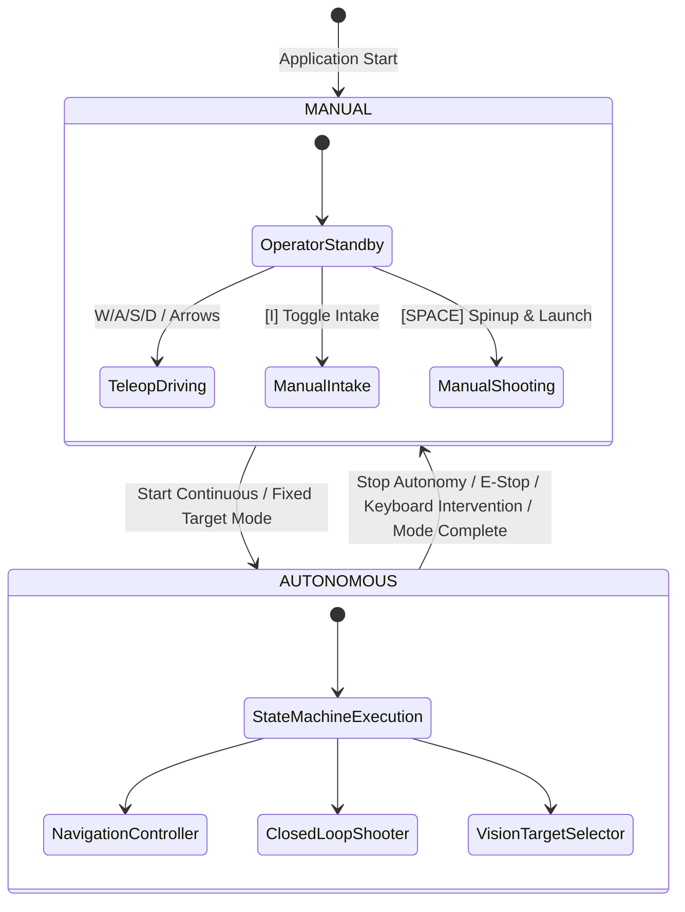
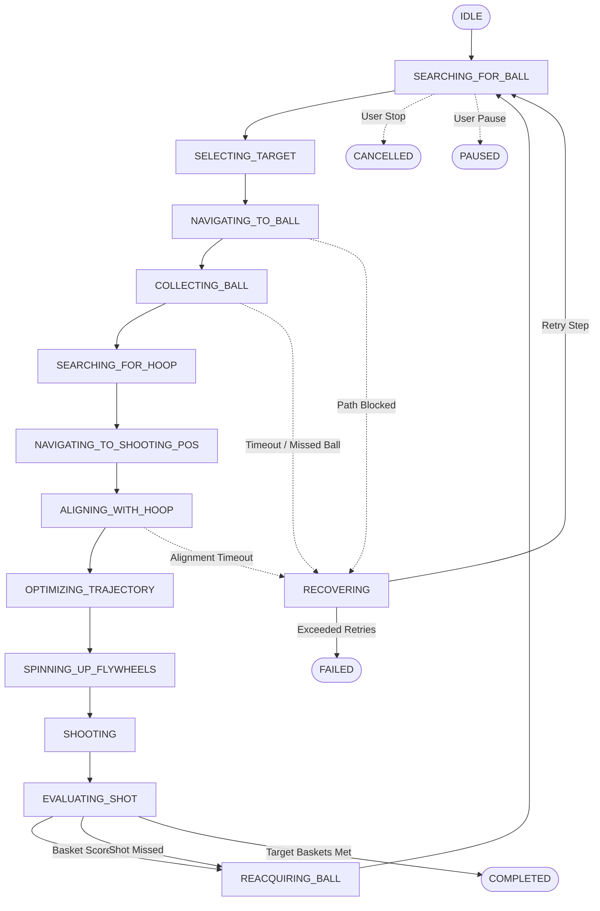

# SMART-BASKETBOT Simulator
### High-Fidelity Autonomous Basketball Robotics Simulation & Performance Analytics Platform

[](https://vitejs.dev/)
[](https://threejs.org/)
[](https://rapier.rs/)
[](https://vitest.dev/)
[](https://github.com/NeilGogy06/smart-basketbot-simulator)
[](https://opensource.org/licenses/MIT)

---

## 1. Project Title & Overview

**SMART-BASKETBOT Simulator** is an engineering-grade, browser-based 3D mobile robotics and physics simulation platform modeling an autonomous basketball-playing robot. Developed across nine progressive engineering milestones, the simulator integrates rigid-body dynamics, differential-drive kinematics, PID closed-loop motion control, grid-based A* path planning with line-of-sight string pulling, simulated robot-mounted pinhole camera perception with occlusion raycasting and temporal tracking, high-velocity dual-flywheel ballistic launch mechanisms with apparent rim aperture entry optimization, an 18-state autonomous decision engine with hierarchical fault recovery, and an event-driven session analytics engine with real-time HUD telemetry and Chart.js performance visualization.

The platform executes entirely client-side inside standard modern web browsers via WebGL and WebAssembly, maintaining 60 FPS physics stepping and visual rendering without requiring backend server processes or remote GPU clusters.

```
       +------------------------------------------------------------------------+
       |                         SMART-BASKETBOT PLATFORM                       |
       +------------------------------------------------------------------------+
                                          |
         +--------------------------------+--------------------------------+
         |                                                                 |
         v                                                                 v
+------------------------+                                      +------------------------+
|   PERCEPTION & WORLD   |                                      |  INTELLIGENCE & ACTION |
|  - Rapier3D (Wasm)     |                                      |  - 18-State Machine    |
|  - Three.js WebGL      |========== Sensor Telemetry =========>|  - Utility Engine      |
|  - Pinhole Camera      |                                      |  - A* Pure Pursuit     |
|  - Alpha-Beta Tracking |<========= Actuator Commands =========|  - Trajectory Solver   |
|  - Optical Cradle Gate |                                      |  - Adaptive Bias Loop  |
+------------------------+                                      +------------------------+
                                          |
                                          v
                         +----------------------------------+
                         |    ANALYTICS & HUD DASHBOARD     |
                         |  - 60Hz Telemetry & 4Hz HUD Dom  |
                         |  - Ballistic Dispersion Geometry |
                         |  - CSV / JSON Dataset Export     |
                         +----------------------------------+
```

---

## 2. System Architecture Summary

The software architecture is decoupled into eight modular subsystems organized under `src/`:

```
src/
├── analytics/         # Session performance monitoring, statistics, metrics, export
├── autonomy/          # High-level decision engine, 18-state finite state machine
├── environment/      # FIBA regulation court, backboard, hoop, rim collider, ball
├── navigation/       # Occupancy grid mapping, 8-connected A*, line-of-sight smoothing
├── robot/            # Kinematics, chassis geometry, dual-flywheel shooter, intake, PID
├── simulation/       # Three.js scene, Rapier3D physics step, fixed-timestep clock
├── ui/               # HUD panels, teleoperation overlays, Chart.js graphs
└── vision/           # Virtual pinhole camera, raycast occlusion, alpha-beta tracker
```

Each subsystem maintains encapsulation through documented public APIs, passing immutable descriptors and numerical telemetry vectors. System integration is arbitrated by `Simulation.js` which manages the 60 Hz fixed-timestep physics update cycle, transform synchronization, camera feed rendering, HUD throttling, and lifecycle teardown.

---

## 3. Mathematical Models & Governing Equations

### 3.1 Differential Drive Kinematics
The robot chassis maneuvers via two independently actuated coaxial drive wheels of radius $r$ separated by track width $L$:
- Forward linear velocity:
  $$v = \frac{v_R + v_L}{2} = \frac{r (\omega_R + \omega_L)}{2}$$
- Angular yaw velocity:
  $$\omega = \frac{v_R - v_L}{L} = \frac{r (\omega_R - \omega_L)}{L}$$
- Inverse kinematics (actuator setpoint mapping):
  $$\omega_L = \frac{v - \frac{\omega L}{2}}{r}, \quad \omega_R = \frac{v + \frac{\omega L}{2}}{r}$$
- Discrete-time pose integration over sampling period $\Delta t$:
  $$\theta_{k+1} = \theta_k + \omega \Delta t$$
  $$x_{k+1} = x_k + v \cos(\theta_{k+1}) \Delta t$$
  $$z_{k+1} = z_k - v \sin(\theta_{k+1}) \Delta t$$

### 3.2 Heading PID Control
Yaw orientation heading error $e_\theta(t) = \text{atan2}(\sin(\theta_{\text{target}} - \theta), \cos(\theta_{\text{target}} - \theta))$ is regulated using a continuous-domain proportional-integral-derivative controller with trapezoidal integration and anti-windup clamping:
$$u(t) = K_p e_\theta(t) + K_i \int_0^t e_\theta(\tau) d\tau + K_d \frac{d e_\theta(t)}{dt}$$
$$\text{Clamping: } \left| \int_0^t e_\theta(\tau) d\tau \right| \le I_{\text{limit}}, \quad |u(t)| \le \omega_{\text{max}}$$

### 3.3 Ballistic Projectile Trajectory & Aerodynamic Drag
The basketball projectile (mass $m = 0.62\text{ kg}$, diameter $D = 0.24\text{ m}$) is governed by Newtonian gravity and quadratic aerodynamic drag:
$$m \frac{d^2 \mathbf{r}}{dt^2} = m \mathbf{g} - \frac{1}{2} \rho C_d A \|\mathbf{v}\| \mathbf{v}$$
Where:
- $\rho = 1.225\text{ kg/m}^3$ (air density at sea level)
- $A = \pi \left(\frac{D}{2}\right)^2 \approx 0.0452\text{ m}^2$ (cross-sectional area)
- $C_d \approx 0.54$ (drag coefficient for leather textured basketball)

For standard closed-form initial velocity approximation between muzzle $(x_0, y_0, z_0)$ and rim $(x_t, y_t, z_t)$ with planar horizontal distance $d = \sqrt{(x_t - x_0)^2 + (z_t - z_0)^2}$ and elevation difference $h = y_t - y_0$:
$$v_0 = \sqrt{ \frac{g d^2}{2 \cos^2(\theta) (d \tan(\theta) - h)} }$$

### 3.4 Apparent Rim Aperture & Entry Angle Kinematics
For a ball descending into a horizontal hoop of regulation diameter $D_{\text{rim}} = 0.45\text{ m}$ at angle $\theta_{\text{entry}}$ relative to horizontal:
- Effective elliptical aperture minor axis:
  $$D_{\text{eff}} = D_{\text{rim}} \sin(\theta_{\text{entry}})$$
- Physical clearance margin:
  $$C_{\text{margin}} = D_{\text{eff}} - D_{\text{ball}} = 0.45 \sin(\theta_{\text{entry}}) - 0.24$$
- Descent condition constraint:
  $$d \tan(\theta) > 2h \implies \theta_{\text{entry}} > 0$$

### 3.5 Pinhole Camera Geometry & Perspective Projection
World coordinate $\mathbf{P}_w = [X_w, Y_w, Z_w, 1]^T$ projects to camera frame $\mathbf{P}_c = \mathbf{T}_{cw} \mathbf{P}_w$, mapped to Normalized Device Coordinates (NDC) via intrinsic projection matrix $\mathbf{K}$:
$$x_{\text{ndc}} = \frac{X_c}{Z_c \tan(\text{FOV}_h / 2)}, \quad y_{\text{ndc}} = \frac{Y_c}{Z_c \tan(\text{FOV}_v / 2)}$$
Screen pixel coordinates $(u, v)$ for image resolution $(W, H)$:
$$u = \left(\frac{x_{\text{ndc}} + 1}{2}\right) W, \quad v = \left(\frac{1 - y_{\text{ndc}}}{2}\right) H$$

---

## 4. Subsystem Breakdown

### 1. Three.js 3D Simulation Environment & Rapier Physics
- **Engine**: Three.js r183 WebGL renderer + Rapier3D 0.21.0 WebAssembly physics engine.
- **Environment**: FIBA standard regulation hardwood court ($28\text{m} \times 15\text{m}$), painted keys, 3-point arcs, center circle, perimeter apron, tempered glass backboards, and steel orange rims.
- **Integrator**: Discrete velocity-Verlet stepping at 60 Hz with continuous collision detection (CCD) on high-speed dynamic bodies.

### 2. Differential-Drive Robot & PID Motion Control
- **Chassis**: Custom aluminum dual-drive mobile base with front caster wheel ($0.76\text{m} \times 0.62\text{m} \times 0.18\text{m}$, mass $38.0\text{kg}$).
- **Actuators**: Coaxial drive wheels ($r = 0.10\text{m}$, track $L = 0.64\text{m}$) commanded via slew-rate limited velocity ramp filters ($a_{\text{max}} = 3.5\text{ m/s}^2$).
- **Safety**: Hard Emergency Stop (E-Stop) interlock that instantly zeroes target commands and halts motor drivers.

### 3. Autonomous Navigation & A* Path Planning
- **Occupancy Grid**: Discretized 2D grid ($0.25\text{m}$ resolution) covering $32\text{m} \times 19\text{m}$ including court aprons.
- **Pathfinder**: 8-connected A* search with Euclidean distance heuristic and corner-cutting prevention.
- **Trajectory Smoothing**: Greedy line-of-sight raycasting string-pulling algorithm reducing waypoints by 60–80%.
- **Guidance**: Lookahead pure pursuit algorithm with dynamic deceleration zones and heading alignment gates.

### 4. Basketball Intake & Optical Possession Detection
- **Mechanism**: Front-mounted dual counter-rotating intake rollers ($w = 0.42\text{m}$) with compliant suction funneling.
- **Sensor**: Simulated photoelectric optical proximity break-beam sensor detecting ball presence in cradle.
- **Interlock**: Automatic sensor physics conversion—switches basketball collider to non-colliding kinematic trigger while captured, restoring full dynamic rigid-body physics and gravity upon launcher firing.

### 5. Flywheel Shooting & Trajectory Optimization
- **Launcher**: Dual high-inertia counter-rotating flywheels with adjustable elevation barrel ($35^\circ$ to $75^\circ$).
- **Optimizer**: Evaluates candidate launch elevation angles ($\theta \in [45^\circ, 65^\circ]$) to maximize apparent rim aperture clearance while adhering to motor RPM limits.
- **Adaptive Closed-Loop**: Exponentially weighted recursive bias corrector adjusting future launch velocity setpoints based on empirical impact miss vectors.

### 6. Simulated Robot Vision & Object Detection
- **Virtual Camera**: Robot-mounted pinhole camera ($320 \times 240$ resolution, $70^\circ$ FOV, 15 Hz capture rate, $-4^\circ$ pitch tilt).
- **Perception Pipeline**: Frustum testing, screen bounding box estimation, line-of-sight raycast occlusion testing, and nearest-neighbor Euclidean object tracking with $\alpha$-$\beta$ position smoothing.
- **Telemetry**: Real-time HUD visual feed overlay with HUD bounding boxes, detection labels, confidence scores, and targeting reticles.

### 7. Autonomous Basketball Intelligence
- **State Machine**: 18-state deterministic finite state machine governing end-to-end autonomous gameplay.
- **Target Selection Engine**: Multi-factor utility function evaluating tracked balls based on proximity, heading alignment, tracking confidence, and boundary validity.
- **Fault Recovery**: Automated recovery branches handling visual loss, intake collection timeouts, navigation obstacles, and shooter rejections.

### 8. Analytics & Performance Monitoring
- **Data Engine**: Event-driven performance monitor recording shot attempts, makes/misses, launch speeds, apex altitudes, flight times, navigation path efficiency, and mode statistics.
- **Visualization**: HUD charts powered by Chart.js (Shooting Accuracy Bar Chart, Launch Velocity Scatter Chart).
- **Export**: One-click session dataset export to standardized JSON and CSV formats.

---

## 5. Control Architecture & Mode Separation

The simulator enforces strict operational mode arbitration:



- **Conflict Prevention**: Switching to `AUTONOMOUS` automatically zeroes all manual keyboard state flags and aborts teleoperation velocity commands. Switching to `MANUAL` cancels active navigation and closed-loop shooting workflows, halting drive motors immediately.
- **Manual Override Preemption**: If an operator presses any manual teleoperation key (`W`, `A`, `S`, `D`) while autonomous gameplay is active, the system automatically yields autonomous control, disengages path pursuit, and returns control to manual teleoperation without thrashing setpoints.

---

## 6. Autonomous Intelligence & State Machine

The autonomous gameplay decision engine executes an 18-state cycle:



### Multi-Factor Target Selection Utility Function
When multiple basketballs are visible in the camera FOV, the target selector computes utility score $U(i)$:
$$U(i) = 0.40 \cdot S_{\text{dist}} + 0.30 \cdot S_{\text{align}} + 0.15 \cdot C_i + 0.15 \cdot S_{\text{fresh}}$$
Where:
- $S_{\text{dist}} = \max\left(0, 1 - \frac{d_i}{18.0}\right)$ (proximity preference)
- $S_{\text{align}} = \max(0, \cos(\Delta \theta_i))$ (collinear heading preference)
- $C_i \in [0, 1]$ (optical tracking confidence)
- $S_{\text{fresh}} = \max(0.2, 1 - \Delta t_{\text{seen}})$ (track freshness)

---

## 7. Navigation & Path Planning

1. **Occupancy Grid Generation**: The court plane is discretized into a $128 \times 76$ grid cell array ($0.25\text{m}$ cell pitch). Static court perimeters, hoop stanchions, and dynamic obstacles are mapped with safety clearance buffers ($r_{\text{robot}} + r_{\text{buffer}} = 0.52\text{m}$).
2. **A\* Shortest Path Search**: Explores the 8-connected grid with diagonal movement costs ($\sqrt{2}$). Employs admissible Euclidean distance heuristics and guarantees shortest obstacle-free paths.
3. **Line-of-Sight String Pulling**: Traverses the raw grid waypoints in reverse, raycasting Bresenham line tests to skip intermediate collinear and unobstructed waypoints. Reduces waypoint count by up to 80% and eliminates zig-zag artifacts.
4. **Pure Pursuit Path Following**: Commands linear velocity $v$ and heading PID angular rate $\omega$ toward a dynamic lookahead point along the smoothed path. Implements cubic polynomial deceleration upon approaching goal waypoints.

---

## 8. Simulated Vision & Perception

- **Mounted Camera Model**: Rigidly transformed relative to the robot base chassis at mount offset $(+0.14\text{m}, +0.35\text{m}, 0.0\text{m})$ with $-4.0^\circ$ downward pitch angle.
- **Frustum Culling**: Evaluates candidate ball and hoop vectors against camera view frustum plane equations.
- **Occlusion Testing**: Casts rays from camera optical origin to target centers through candidate occluders (backboard, stanchions, court obstacles) while ignoring host robot chassis and ground floor meshes.
- **Temporal Association & $\alpha$-$\beta$ Filter**: Associates new detections with existing tracks using Euclidean gating ($\Delta d < 1.0\text{m}$). Smooths 3D position estimates over time:
  $$\hat{\mathbf{x}}_k = \hat{\mathbf{x}}_{k-1} + \alpha (\mathbf{z}_k - \hat{\mathbf{x}}_{k-1}), \quad \alpha = 0.65$$
  Maintains lost tracks for up to $1.5\text{s}$ before pruning to ensure robust tracking through momentary occlusions.

---

## 9. Shooting Mechanism & Closed-Loop Trajectory Optimization

1. **Ballistic Trajectory Sweep**: Sweeps elevation angles from $45^\circ$ to $65^\circ$ in $1^\circ$ increments.
2. **Kinematic Aperture Optimization**: For each valid velocity solution, computes apparent rim ellipse minor axis $D_{\text{eff}} = 0.45 \sin(\theta_{\text{entry}})$ and clearance margin $C = D_{\text{eff}} - 0.24$. Selects the trajectory maximizing steep entry angle and physical clearance margin.
3. **Adaptive Closed-Loop Bias Correction**: On verified missed shots, computes displacement error vector $\mathbf{e} = \mathbf{x}_{\text{impact}} - \mathbf{x}_{\text{rim}}$ and updates velocity and yaw angle correction biases:
  $$\Delta v_{\text{bias}} \leftarrow \Delta v_{\text{bias}} - \gamma_v e_x, \quad \Delta \psi_{\text{bias}} \leftarrow \Delta \psi_{\text{bias}} - \gamma_\psi e_z$$
  Applies biases to subsequent shots from identical court regions, achieving self-tuning accuracy over repeated attempts.

---

## 10. Analytics & Performance Monitoring

- **Event-Driven Collection**: Subscribes directly to `HoopDetector`, `AutonomousStateMachine`, `ShootingMechanism`, and `DifferentialDriveController` events with zero polling overhead.
- **Comprehensive Metrics**: Tracks total attempts, baskets scored, missed shots, shooting accuracy %, average launch speed, average launch angle, average flight time, total distance traveled, path efficiency %, and recovery success rates.
- **Session Telemetry Export**:
  - **JSON**: Full hierarchical export of session metadata, aggregate metrics, and individual shot records with timestamps, speeds, angles, and outcomes.
  - **CSV**: Standardized comma-delimited tabular export ready for ingestion into Python Pandas, Excel, or MATLAB.

---

## 11. Tech Stack & Dependencies

| Component | Library / Framework | Version | Purpose |
|:---|:---|:---|:---|
| **Language** | JavaScript (ESM) | ES2022 | Subsystem logic, state machines, math |
| **Bundler & Dev Server** | Vite | ^8.3.5 | Rapid HMR, asset compilation, production build |
| **3D Rendering** | Three.js | ^0.183.0 | WebGL scene graph, materials, shaders, camera |
| **Physics Simulation** | @dimforge/rapier3d-compat | ^0.21.0 | Fast WebAssembly 3D rigid-body dynamics |
| **Data Visualization** | Chart.js | ^4.4.8 | HUD charts, accuracy bars, launch scatter plots |
| **Unit & Integration Testing** | Vitest | ^5.0.5 | Headless unit, integration, and lifecycle tests |

---

## 12. Project Structure & Directory Layout

```
smart-basketbot-simulator/
├── dist/                               # Production build output
├── docs/                               # Architectural and milestone engineering reports
│   ├── COMPLETE_PROJECT_AUDIT.md       # Full architectural audit report
│   ├── FINAL_SYSTEM_ARCHITECTURE.md   # Subsystem contracts, coordinates, dataflow
│   ├── FINAL_TESTING_GUIDE.md          # Test suite architecture and execution guide
│   ├── KNOWN_LIMITATIONS.md            # Documented simulation vs. reality boundaries
│   ├── MILESTONE_4_IMPLEMENTATION.md   # M4 engineering report
│   ├── MILESTONE_5_IMPLEMENTATION.md   # M5 engineering report
│   ├── MILESTONE_6_IMPLEMENTATION.md   # M6 engineering report
│   ├── MILESTONE_7_IMPLEMENTATION.md   # M7 engineering report
│   ├── MILESTONE_8_IMPLEMENTATION.md   # M8 engineering report
│   └── MILESTONE_9_IMPLEMENTATION.md   # M9 final integration and verification report
├── src/
│   ├── analytics/                      # Milestone 8: Performance monitoring & export
│   │   ├── AnalyticsConfig.js
│   │   ├── AnalyticsManager.js
│   │   ├── AutonomyAnalytics.js
│   │   ├── CollectionAnalytics.js
│   │   ├── MotionAnalytics.js
│   │   ├── NavigationAnalytics.js
│   │   └── ShootingAnalytics.js
│   ├── autonomy/                       # Milestone 7: Autonomous basketball intelligence
│   │   ├── AutonomousConfig.js
│   │   ├── AutonomousDecisionEngine.js
│   │   ├── AutonomousGameplayController.js
│   │   └── AutonomousStateMachine.js
│   ├── environment/                    # Milestone 1: Court, hoops, basketball
│   │   ├── Basketball.js
│   │   ├── BasketballCourt.js
│   │   └── BasketballHoop.js
│   ├── navigation/                     # Milestone 3: A* path planning & navigation
│   │   ├── AStarPlanner.js
│   │   ├── AutonomousNavController.js
│   │   ├── NavigationConfig.js
│   │   ├── OccupancyGrid.js
│   │   └── PathVisualizer.js
│   ├── robot/                          # Milestones 2, 4, 5: Robot chassis & mechanisms
│   │   ├── AdaptiveShotCorrector.js
│   │   ├── ClosedLoopShootingController.js
│   │   ├── DifferentialDriveController.js
│   │   ├── HoopDetector.js
│   │   ├── IntakeMechanism.js
│   │   ├── PIDController.js
│   │   ├── Robot.js
│   │   ├── RobotInputController.js
│   │   ├── RobotKinematics.js
│   │   ├── ShootingMechanism.js
│   │   └── TrajectoryCalculator.js
│   ├── simulation/                     # Milestones 1, 9: Simulation coordinator & physics
│   │   ├── PhysicsWorld.js
│   │   ├── Simulation.js
│   │   └── SimulationConfig.js
│   ├── ui/                             # Milestones 1, 8: HUD dashboard, controls, charts
│   │   └── Dashboard.js
│   ├── vision/                         # Milestone 6: Camera, perception, tracking
│   │   ├── BallDetection.js
│   │   ├── CameraSystem.js
│   │   ├── HoopDetection.js
│   │   ├── ObjectTracker.js
│   │   └── VisionManager.js
│   ├── index.html                      # Primary entry HTML document
│   └── main.js                         # Application bootstrap and initialization
├── tests/                              # Automated test suites (195 tests)
│   ├── analytics.test.js
│   ├── autonomy.test.js
│   ├── differentialDrive.test.js
│   ├── kinematics.test.js
│   ├── navigation.test.js
│   ├── pid.test.js
│   ├── shooting.test.js
│   ├── shootingController.test.js
│   ├── simulation.test.js
│   ├── systemIntegration.test.js       # Milestone 9: End-to-end integration suite
│   └── vision.test.js
├── package.json
└── vite.config.js
```

---

## 13. Installation & Quickstart

### Prerequisites
- [Node.js](https://nodejs.org/) v18.0.0 or higher
- [npm](https://www.npmjs.com/) v9.0.0 or higher

### Installation
```bash
# Clone repository
git clone https://github.com/NeilGogy06/smart-basketbot-simulator.git
cd smart-basketbot-simulator

# Install dependencies
npm install
```

### Launch Development Server
```bash
# Start Vite development server
npm run dev
```
Open your browser to the local URL (typically `http://localhost:5173/`).

### Production Build
```bash
# Compile and bundle minified production assets
npm run build

# Preview production build locally
npm run preview
```

---

## 14. How to Use

### 14.1 Manual Teleoperation
- `W` / `Up Arrow`: Drive forward
- `S` / `Down Arrow`: Drive reverse
- `A` / `Left Arrow`: Turn counter-clockwise (left)
- `D` / `Right Arrow`: Turn clockwise (right)
- `I`: Toggle intake rollers (Intake / Off / Reject)
- `SPACE`: Spin up flywheels and fire basketball at target hoop
- `ESC`: Trigger Emergency Stop (halts all motion instantly)

### 14.2 Autonomous Gameplay Controls
- **Continuous Mode**: Click `Start Continuous` on the HUD Autonomy card. The robot will autonomously search for balls, navigate to approach positions, collect balls, navigate to the key, align with the hoop, optimize elevation, spin up, shoot, evaluate the score, and repeat indefinitely.
- **Fixed Target Mode**: Enter target baskets (e.g. `5`) and click `Start Target Mode`. The robot plays until 5 verified baskets are made, then transitions to `COMPLETED` and halts.
- **Pause / Resume**: Click `Pause` to freeze autonomous execution without resetting timers. Click `Resume` to proceed.
- **Stop**: Click `Stop Autonomy` to cancel the session and immediately return control to manual teleoperation.

### 14.3 Analytics & Data Export
- Click tabs on the HUD (`Overview`, `Shooting`, `Navigation`, `Autonomy`, `Records`) to inspect real-time performance metrics and charts.
- Click `Export JSON` to download the structured session dataset.
- Click `Export CSV` to download tabular shot data for spreadsheet analysis.
- Click `Reset Analytics` to clear active session history.

---

## 15. Verification & Testing Guide

The simulator features a comprehensive Vitest test suite consisting of **195 automated tests** across **11 test suites**:

```bash
# Run entire test suite
npm test

# Run tests in watch mode
npx vitest

# Run specific integration test suite
npx vitest run tests/systemIntegration.test.js
```

### Test Suite Summary
- `tests/kinematics.test.js` (13 tests): Forward/inverse differential drive kinematics and velocity limits.
- `tests/pid.test.js` (14 tests): Proportional, integral, derivative response, and anti-windup clamping.
- `tests/differentialDrive.test.js` (10 tests): Rapier physics world body translation and torque synchronization.
- `tests/navigation.test.js` (16 tests): Occupancy grid mapping, 8-way A*, string pulling, and pure pursuit.
- `tests/shooting.test.js` (32 tests): Ball intake roller physics, optical sensor trigger, and projectile firing.
- `tests/shootingController.test.js` (28 tests): Apparent rim aperture, trajectory optimization, adaptive bias.
- `tests/vision.test.js` (13 tests): Camera coordinate transformations, FOV culling, occlusion, and tracking.
- `tests/autonomy.test.js` (26 tests): 18-state machine transitions, multi-factor utility scoring, recovery paths.
- `tests/analytics.test.js` (26 tests): Event collection, statistics calculation, CSV and JSON serialization.
- `tests/simulation.test.js` (9 tests): Three.js scene graph, Rapier physics step, and transform syncing.
- `tests/systemIntegration.test.js` (8 tests): Cross-subsystem integration, mode switching, interlocks, and lifecycle reset.

---

## 16. Simulation vs. Physical Reality

| Subsystem | Simulation Implementation | Physical Robotics Consideration |
|:---|:---|:---|
| **Chassis Motion** | Velocity setpoint integration in Rapier3D with linear damping | Wheel slippage, tire scrub, floor dust, battery voltage sag, gearbox backlash |
| **Perception** | Virtual pinhole camera with geometric raycasting | Sensor noise, lighting variations, motion blur, lens distortion, camera calibration |
| **Intake** | Proximity check + physical kinematic containment trigger | Roller surface wear, ball squish elasticity, variable leather inflation pressure |
| **Shooting** | Instantaneous ballistic velocity impulse injection into rigid body | Wheel speed recovery droop, wheel groove slip, ball seam orientation aerodynamics |
| **Navigation** | 2D occupancy grid with perfect odometry | Wheel odometry drift, encoder discretization, IMU gyro bias drift, dynamic obstacles |

---

## 17. Performance & Optimization

- **Throttled HUD Updates**: Heavy DOM table re-renders and Chart.js updates are throttled to 4 Hz (every $250\text{ms}$), eliminating 60 Hz DOM layout thrashing and freeing CPU cycles for physics.
- **Offscreen Camera Throttling**: The robot-mounted camera feed renders to an offscreen `WebGLRenderTarget` at a controlled 15 Hz rate rather than full 60 Hz.
- **Bounded Telemetry Buffers**: Real-time history arrays (e.g. shot records, state transitions, motion trajectories) use bounded ring buffers capped at 50–100 elements to guarantee constant $O(1)$ memory consumption.
- **Resource Cleanup & Disposal**: Reset and destroy routines systematically dispose of Three.js geometries, materials, and textures, detach event listeners, and destroy Rapier colliders to prevent memory leaks during long-running sessions.

---

## 18. Known Issues & Limitations

1. **Rapier3D Fast-Bounce Penetration**: At launch speeds exceeding $14\text{ m/s}$, basketball rim collisions can rarely tunnel through thin colliders if browser frame rates drop below 30 FPS. Continuous Collision Detection (CCD) is enabled on the basketball body to mitigate this.
2. **Headless Canvas Mocking**: In headless Node.js test environments, HTML Canvas rendering (`createCourtTexture`) and WebGL offscreen buffers are safely bypassed with null guards. Full visual camera feed rendering requires a browser WebGL context.
3. **Flat Floor Assumption**: The court surface is modeled as a perfectly flat plane without court slope or dead spots.
4. **Magnus Effect Approximation**: Basketball trajectory calculations currently model linear and quadratic air drag; lateral Magnus deflection from heavy backspin is simplified to vertical backspin velocity scaling.

---

## 19. Roadmap & Future Improvements

- [ ] **Sim-to-Real ROS2 Bridge**: Implement a WebSocket/WebRTC ROS2 bridge publishing `/cmd_vel`, `/odom`, and `/camera/image_raw` topics.
- [ ] **Multi-Robot Arena**: Support multiple cooperative or opposing basketball bots with decentralized collision avoidance.
- [ ] **Full Magnus Effect Aerodynamics**: Incorporate real-time cross-product Magnus lift and lateral drift forces $\mathbf{F}_M = S (\boldsymbol{\omega} \times \mathbf{v})$.
- [ ] **Deep Reinforcement Learning**: Train shooter elevation and drive positioning policies directly in the browser via WebAssembly-accelerated PPO.

---

## 20. License & Credits

### License
This project is licensed under the **MIT License** — see the [LICENSE](LICENSE) file for details.

### Engineering & Development
- **Lead Architect & Developer**: Neil Gogy ([@NeilGogy06](https://github.com/NeilGogy06))
- **Milestones**: M1 (Environment) $\to$ M2 (Motion) $\to$ M3 (Navigation) $\to$ M4 (Intake & Shooting) $\to$ M5 (Closed-Loop Trajectory) $\to$ M6 (Simulated Vision) $\to$ M7 (Autonomy) $\to$ M8 (Analytics) $\to$ M9 (System Integration & Final Documentation).

*Built with Three.js, Rapier Physics, Vite, and Vitest.*
