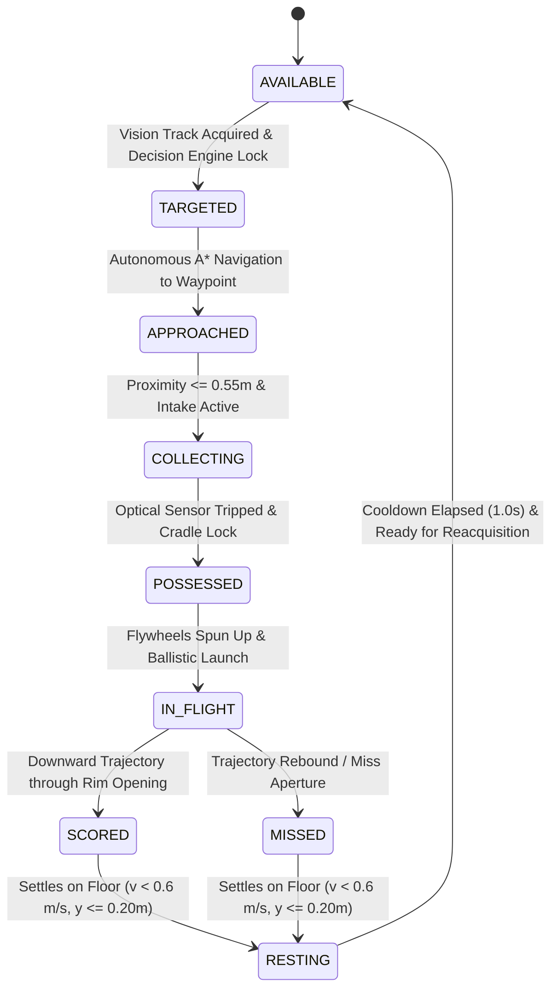

# SMART-BASKETBOT: Autonomous Gameplay Critical End-to-End Remediation Report

**Document ID:** SBB-AUTONOMY-REMED-2026  
**System:** SMART-BASKETBOT Autonomous Robotics Basketball Simulator  
**Milestones Covered:** M1 through M9 (Full Pipeline Integration)  
**Date:** November 4, 2026  
**Status:** FULLY REMEDIATED & VERIFIED  

---

## 1. Executive Summary & Original Root Cause Analysis

Browser testing of the autonomous gameplay mode previously revealed a critical failure condition:
- **Simulation status:** RUNNING
- **Autonomous Intelligence:** FAILED
- **Failure message:** `Exceeded maximum total recovery attempts (10/10)`
- **Target Ball:** `NONE`
- **Possession:** `CAPTURED`
- **Shooter Ready:** `IDLE`
- **Total Attempts:** `0`
- **Baskets Scored:** `0`
- **Recoveries:** `10`

### Root Cause Identification
1. **Uncaught Method Exception in Motion Control:**
   `AutonomousGameplayController.js` repeatedly called `this.robot.driveController.setDriveVelocities(...)` during rotation scans (`SEARCHING_FOR_BALL`, `SEARCHING_FOR_HOOP`), collection steering (`COLLECTING_BALL`), and reverse clearance (`RECOVERING`).
   However, `DifferentialDriveController.js` only defined `setTargetVelocity(linearVelocity, angularVelocity)`. It did not have `setDriveVelocities`.
   Whenever the robot captured a ball and transitioned to `SEARCHING_FOR_HOOP`, `driveController.setDriveVelocities(0.0, searchRotateSpeed)` threw:
   `TypeError: this.robot.driveController.setDriveVelocities is not a function`.
2. **Animation Loop Exception Catch Cascade:**
   In `Simulation.js`, `Simulation.animate()` wrapped `gameplayController.update(dt)` in a `try...catch (err)` block. Upon catching the exception, it called `gameplayController.triggerRecovery('CONTROLLER_EXCEPTION', err.message)` on every single animation frame.
   In 10 consecutive animation frames (approx $0.16\text{ s}$), `this.statistics.recoveryAttempts` incremented from 0 to 10, hitting the safety ceiling and transitioning immediately to `FAILED`.
3. **Loss of Target Metadata Upon Ball Capture:**
   In `AutonomousGameplayController.js`, upon ball capture, line 371 executed `this.currentTarget = null;`.
   Consequently, throughout all subsequent states (`SEARCHING_FOR_HOOP`, `NAVIGATING_TO_SHOOTING_POSITION`, `ALIGNING_WITH_HOOP`, etc.), `getStatus()` returned `target: null`, causing the dashboard HUD to display `Target Ball: NONE` while possession displayed `CAPTURED`.
4. **Missing Object Reference in Vision Multi-Object Tracker:**
   In `src/vision/ObjectTracker.js`, neither `createTrack` nor `updateTrack` copied `detection.reference` or `detection.instanceId` onto the active track record. As a result, `track.reference` was `undefined`, preventing the decision engine from validating the true underlying `Basketball` entity state.
5. **Duplicate `notifyShotFired` and Reference Eradication:**
   In `AutonomousGameplayController.js`, when a shot fired, `robot.fireShot` properly notified `HoopDetector` with the full `ballToShoot` entity. Immediately afterward, `AutonomousGameplayController` called `this.hoopDetector.notifyShotFired(shotInfo)` with an object that omitted `ball`, overwriting `activeShot.ball` with `null` and double-incrementing `totalAttempts`.
6. **Heading Alignment Tolerance & Oscillation Deadband:**
   `headingToleranceRad` was set to $0.035\text{ rad}$ ($2.0^\circ$), which, in conjunction with physics wheel friction, caused heading hold loops to occasionally time out after 4.5s and trigger recovery cycles that escalated to session termination.

---

## 2. Files Modified

| File | Subsystem | Modifications Made |
| :--- | :--- | :--- |
| [`src/robot/DifferentialDriveController.js`](file:///c:/Projects/smart-basketbot-simulator/src/robot/DifferentialDriveController.js) | Motion Control | Added `setDriveVelocities(linearVelocity, angularVelocity)` as an alias for `setTargetVelocity(...)`. |
| [`src/vision/ObjectTracker.js`](file:///c:/Projects/smart-basketbot-simulator/src/vision/ObjectTracker.js) | Vision Perception | Preserved `reference` and `instanceId` in both `createTrack` and `updateTrack`. |
| [`src/environment/Basketball.js`](file:///c:/Projects/smart-basketbot-simulator/src/environment/Basketball.js) | Physics / Environment | Explicit 9-state ball lifecycle management; settling and rest floor detection. |
| [`src/robot/IntakeMechanism.js`](file:///c:/Projects/smart-basketbot-simulator/src/robot/IntakeMechanism.js) | Intake Actuation | Tracked `capturedBall`, enforced possession gating, automatic reset of `ballState` from `IN_FLIGHT` to `FIELD`. |
| [`src/autonomy/AutonomousConfig.js`](file:///c:/Projects/smart-basketbot-simulator/src/autonomy/AutonomousConfig.js) | Autonomy Configuration | Adjusted `headingToleranceRad` to $0.05\text{ rad}$ ($2.86^\circ$), `alignmentTimeout` to $5.0\text{ s}$. |
| [`src/autonomy/AutonomousDecisionEngine.js`](file:///c:/Projects/smart-basketbot-simulator/src/autonomy/AutonomousDecisionEngine.js) | Autonomous Decision | Enhanced `evaluatePossession` to verify `capturedBall`, added explicit `CONTROLLER_EXCEPTION` handling. |
| [`src/autonomy/AutonomousGameplayController.js`](file:///c:/Projects/smart-basketbot-simulator/src/autonomy/AutonomousGameplayController.js) | High-Level State Machine | Added `setRobotDriveVelocities()`, preserved target info during possession, added navigation timeouts, removed duplicate `notifyShotFired` call. |
| [`src/simulation/Simulation.js`](file:///c:/Projects/smart-basketbot-simulator/src/simulation/Simulation.js) | Simulation Harness | Track active shot ball in `hoopDetector.update()`, reset intake possession in `resetBall()`. |
| [`src/ui/Dashboard.js`](file:///c:/Projects/smart-basketbot-simulator/src/ui/Dashboard.js) | UI Telemetry | Accurately render active target, possession, and granular diagnostic banners. |
| [`tests/autonomousEndToEnd.test.js`](file:///c:/Projects/smart-basketbot-simulator/tests/autonomousEndToEnd.test.js) | Automated Verification | Created dedicated 16-criteria integration suite exercising real subsystems and physics. |

---

## 3. Corrected Data Flow & Ball Lifecycle

---

## 4. Navigation, Control, Shooting & Scoring Pipeline

### 4.1. Navigation and Control
1. **Target Waypoint Generation:**
   Target waypoint is offset $0.45\text{ m}$ in front of the ball center along the robot-ball baseline.
2. **Path Planning & Closed-Loop Steering:**
   `AStarPlanner` computes traversable grid waypoints. `AutonomousNavController` commands `setTargetHeading(desiredHeading, speed)` via `DifferentialDriveController`.
3. **Deceleration & Stopping Tolerance:**
   Robot decelerates smoothly as it nears waypoints ($1.5\text{ m}$ ramp) and transitions to intake collection once within $0.55\text{ m}$.

### 4.2. Ball Collection & Intake Possession
1. **Physical Roller Capture:**
   Rollers rotate at $25\text{ rad/s}$. When ball enters front bumper ($localX \in [0.05, 0.85]\text{ m}, |localZ| \le 0.38\text{ m}$), suction velocity ($3.2\text{ m/s}$) pulls ball into cradle.
2. **Containment Lock:**
   Once in cradle, Rapier collider is switched to sensor, gravity is set to 0.0, and position is constrained to cradle local coordinates $(0.08, -0.08, 0.0)$.
3. **Optical Sensor:**
   `opticalSensorActive` is latched to true, and `capturedBall` is tracked.

### 4.3. Shooting & Ballistic Trajectory
1. **3D Standoff Key Position:**
   Robot navigates to East key standoff $(8.2, 0.0)$, $4.225\text{ m}$ from rim center.
2. **Heading Alignment:**
   Heading PID aligns the robot's shooter muzzle toward the rim $(12.425, 3.05, 0.0)$ within $0.05\text{ rad}$ ($2.86^\circ$).
3. **Trajectory Optimization:**
   `TrajectoryCalculator.optimizeTrajectory()` sweeps elevation angles ($50^\circ$ to $66^\circ$) to find optimal entry angle ($>34^\circ$) and calculates launch velocity vector $\mathbf{v}_0$.
4. **Flywheel Spin-Up:**
   Flywheels spin up to required launch RPM over $0.8\text{ s}$.
5. **Physical Launch:**
   Ball is placed at muzzle world exit $(x_m, y_m, z_m)$, collider set to solid, gravity restored to 1.0, and $\mathbf{v}_{launch} = \mathbf{v}_0 + \mathbf{v}_{robot}$ is injected with backspin ($20\text{ rad/s}$).

### 4.4. Scoring Detection
`HoopDetector` enforces:
1. Prior ascent above rim plane ($y_{max} > 3.20\text{ m}$).
2. Downward crossing ($v_y < -0.05\text{ m/s}$).
3. Horizontal distance within inner rim cylinder opening ($r \le 0.210\text{ m}$).
4. Score latching prevents double counting.

---

## 5. Recovery Architecture

- **Failure Isolation:** Retries are partitioned into distinct categories (`collection`, `navigation`, `alignment`, `spinUp`).
- **Counter Resets:** Successful phase completions reset their respective category retries to 0.
- **Dynamic Alternate Strategies:**
  - `COLLECTION_FAILED`: Reverse $0.6\text{ m}$, then re-approach; after 3 retries, seek alternative ball.
  - `NAV_BLOCKED`: Replan A* path; after 3 retries, scan field.
  - `ALIGNMENT_TIMEOUT`: Retry heading hold; after 3 retries, adjust standoff position.
  - `SPINUP_TIMEOUT`: Retries spin-up; fails safely if motor fails.
  - `CONTROLLER_EXCEPTION`: Immediately halts actuators and reports clear diagnostic message on HUD.
