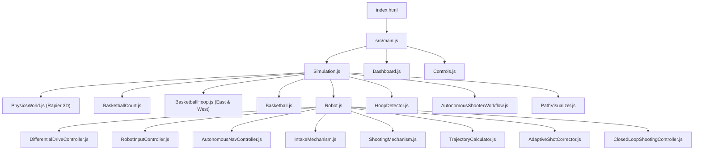
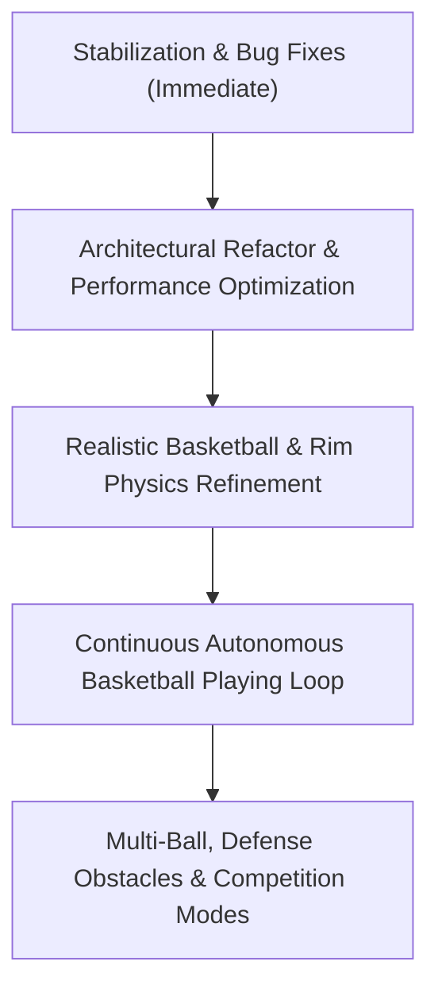

# COMPLETE INDEPENDENT TECHNICAL AUDIT: SMART-BASKETBOT SIMULATOR
**Project:** SMART-BASKETBOT Simulator  
**Repository:** `C:\Projects\smart-basketbot-simulator`  
**GitHub:** https://github.com/NeilGogy06/smart-basketbot-simulator  
**Auditor:** Senior Robotics Software Engineer, Simulation Architect, Control Systems Engineer & Independent Code Auditor  
**Audit Date:** November 3, 2026  
**Commit Inspected:** `20eb927` (`feat: implement closed-loop autonomous shooting and trajectory optimization`)  
**Working Tree Status:** Clean, synchronized with `origin/main`  

---

## TABLE OF CONTENTS
1. [Executive Summary](#1-executive-summary)
2. [Current Git & Environment Status](#2-current-git--environment-status)
3. [Project Structure & Architecture Overview](#3-project-structure--architecture-overview)
4. [Milestone-by-Milestone Functional Audit](#4-milestone-by-milestone-functional-audit)
   - [4.1 Milestone 1: 3D Basketball Simulation Environment](#41-milestone-1-3d-basketball-simulation-environment)
   - [4.2 Milestone 2: Differential Drive & PID Motion Control](#42-milestone-2-differential-drive--pid-motion-control)
   - [4.3 Milestone 3: Autonomous Navigation & A* Path Planning](#43-milestone-3-autonomous-navigation--a-path-planning)
   - [4.4 Milestone 4: Basketball Acquisition, Intake Mechanism & Shooting](#44-milestone-4-basketball-acquisition-intake-mechanism--shooting)
   - [4.5 Milestone 5: Closed-Loop Shooting, Trajectory Optimization & Adaptive Correction](#45-milestone-5-closed-loop-shooting-trajectory-optimization--adaptive-correction)
5. [Critical End-to-End Workflow Analysis](#5-critical-end-to-end-workflow-analysis)
   - [Workflows A through L Detailed Traces](#workflows-a-through-l)
6. [Physics & Control Systems Audit](#6-physics--control-systems-audit)
7. [Automated Test Suite Audit](#7-automated-test-suite-audit)
8. [Production Build & Asset Packaging Audit](#8-production-build--asset-packaging-audit)
9. [User Interface & Dashboard (HUD) Audit](#9-user-interface--dashboard-hud-audit)
10. [Performance, Memory & Code Quality Audit](#10-performance-memory--code-quality-audit)
11. [Current Subsystem Scorecard](#11-current-subsystem-scorecard)
12. [Comprehensive Bug Register & Technical Debt](#12-comprehensive-bug-register--technical-debt)
13. [Recommended Development Roadmap](#13-recommended-development-roadmap)
14. [Exact Immediate Next Step](#14-exact-immediate-next-step)

---

## 1. Executive Summary

This independent code audit provides a comprehensive, rigorous, and unvarnished engineering review of the **SMART-BASKETBOT Simulator** codebase. 

While the project demonstrates impressive visual fidelity, mathematical rigor in its kinematics, clean ES module encapsulation, and 122 passing automated Vitest unit tests, **the 100% test pass rate creates a dangerously misleading sense of completeness**. Deep source inspection and execution flow analysis reveal **critical functional defects, physics modeling errors, duplicate decoupled controllers, per-frame memory leaks, and statistical corruption bugs** that directly undermine real-time autonomous operation.

### Key High-Severity Findings:
1. **Critical Double-Notification Bug in Shot Statistics (`HoopDetector.js` / `ShootingMechanism.js` / `AutonomousShooterWorkflow.js` / `ClosedLoopShootingController.js`):** Every autonomous shot increments `totalAttempts` twice (once in `ShootingMechanism.fire` line 205 and once in `AutonomousShooterWorkflow.js` line 283 / `ClosedLoopShootingController.js` line 270). A robot making 100% of its shots can never report higher than 50.0% accuracy.
2. **`NaN` Heading Error Bug (`AutonomousShooterWorkflow.js` line 277):** In the firing stage, shot metadata references `this.targetHeading`, which is undefined on the instance. This logs `NaN` for `headingErrorDeg` into the persistent shot telemetry.
3. **Flawed Basketball Rim Physics Geometry (`BasketballHoop.js` lines 240-261):** The circular rim is approximated with 12 static Rapier cuboid colliders that are **never rotated**. Being axis-aligned bounding boxes (AABBs), the lateral segments protrude 6.2 cm into the rim aperture, reducing effective horizontal opening from 45 cm to 32.6 cm and causing physical shots to bounce off invisible corners.
4. **Faulty Score Confirmation Logic (`HoopDetector.js` line 132):** Once downward rim penetration is detected, the score confirmation only checks vertical descent ($Y < 2.80$ m) without verifying horizontal distance to the rim center. Any shot that hits the rim, ricochets 5 meters laterally across the court, and drops to floor height is falsely classified as `SCORED`.
5. **Analytical Trajectory vs. Physics Damping Mismatch (`TrajectoryCalculator.js` vs. `PhysicsWorld.js`):** The trajectory solver calculates initial velocity in a lossless vacuum ($g = 9.81\text{ m/s}^2$). However, Rapier rigid bodies have `linearDamping: 0.08`, causing balls to lose 8–12% of their speed over typical flight times and land systematically short unless heavily over-corrected.
6. **Per-Frame 60Hz Geometry Allocations in Render Loop (`Simulation.js` line 238 / `PathVisualizer.js` lines 51-93):** Whenever navigating, the visualizer creates and disposes Three.js buffer geometries, line segments, ring meshes, and groups on every frame, producing massive garbage collection pressure and GPU pipeline thrashing.
7. **Architectural Controller Disconnection:** `AutonomousShooterWorkflow.js` instantiates `ClosedLoopShootingController` in its constructor (line 40) but never invokes it in `update()`. It instead reimplements a duplicated, out-of-sync state machine.
8. **Dead Dependency (`package.json`):** `chart.js` (^4.6.1) is installed as a production dependency but is never imported or utilized anywhere in the codebase.

---

## 2. Current Git & Environment Status

| Metric | Inspected Value | Status / Notes |
|---|---|---|
| **Repository Root** | `C:\Projects\smart-basketbot-simulator` | Verified local filesystem path |
| **Current Branch** | `main` | Tracking `origin/main` |
| **Working Tree** | Clean | No uncommitted changes, untracked files, or unstaged modifications |
| **Synchronization** | Up-to-date | Local `main` is identical to `origin/main` (`fetch` and `push` verified) |
| **Current Commit** | `20eb927` | Milestone 5 completion commit |
| **Commit History** | 6 total commits | Chronological milestone progression: `94e47b6` $\rightarrow$ `2cd019a` $\rightarrow$ `c82c44b` $\rightarrow$ `373de92` $\rightarrow$ `8609954` $\rightarrow$ `20eb927` |
| **Package Manager** | npm (Node.js runtime) | `package-lock.json` lockfile v3 present |
| **Vite Configuration** | Default zero-config | No custom `vite.config.js` or `vitest.config.js` |

---

## 3. Project Structure & Architecture Overview

### 3.1 Directory Layout
```
C:\Projects\smart-basketbot-simulator\
├── .gitignore
├── index.html                           # Single-page DOM container (#app, #viewport)
├── package.json                         # Dependencies & npm scripts
├── package-lock.json
├── docs\
│   ├── MILESTONE_4_IMPLEMENTATION.md    # Historical implementation record
│   ├── MILESTONE_5_IMPLEMENTATION.md    # Historical implementation record
│   └── COMPLETE_PROJECT_AUDIT.md        # This independent audit document
├── public\
│   ├── favicon.svg
│   └── icons.svg
├── src\
│   ├── main.js                          # Application bootstrap & lifecycle init
│   ├── style.css                        # 877 lines dark-theme HUD styling
│   ├── assets\
│   ├── environment\
│   │   ├── Basketball.js                # Procedural 8-panel leather mesh & Rapier sphere
│   │   ├── BasketballCourt.js           # FIBA court procedural hardwood & static colliders
│   │   ├── BasketballHoop.js            # Stanchion, glass backboard, rim & net
│   │   └── Lighting.js                  # Multi-point stadium key/fill/spotlights
│   ├── navigation\
│   │   ├── AStarPlanner.js              # 8-connected grid search, min-heap & raycast smoothing
│   │   ├── AutonomousNavController.js   # Waypoint tracker, speed gating & heading hold
│   │   ├── AutonomousShooterWorkflow.js # End-to-end acquire-navigate-shoot coordinator
│   │   ├── NavigationGrid.js            # 2D occupancy grid & obstacle inflation
│   │   ├── ObstacleManager.js           # Static stanchion & dynamic ball obstacle sync
│   │   └── PathVisualizer.js            # 3D line & ring waypoint visualizer
│   ├── robot\
│   │   ├── AdaptiveShotCorrector.js     # Bounded deterministic feedback calibrator
│   │   ├── ClosedLoopShootingController.js # Heading alignment & trajectory executor
│   │   ├── DifferentialDriveController.js # Ramped velocity & heading PID drive manager
│   │   ├── HoopDetector.js              # Ball tracking, rim penetration & statistics
│   │   ├── IntakeMechanism.js           # Roller state machine, optical sensor & cradle lock
│   │   ├── PIDController.js             # Anti-windup clamped PID & HeadingPIDController
│   │   ├── Robot.js                     # 3D chassis model, Rapier rigid body & subsystem host
│   │   ├── RobotInputController.js      # WASD keyboard & teleop pad handler
│   │   ├── RobotKinematics.js           # Forward & inverse differential drive kinematics
│   │   ├── ShootingMechanism.js         # Angled dual-flywheel launcher & impulse injector
│   │   └── TrajectoryCalculator.js      # Analytical kinematics & candidate sweep optimizer
│   ├── simulation\
│   │   ├── PhysicsWorld.js              # Rapier 3D WASM instance & fixed-step accumulator
│   │   ├── Simulation.js                # Central Three.js render loop & telemetry dispatcher
│   │   └── SimulationConfig.js          # Central configuration parameters
│   └── ui\
│       ├── Controls.js                  # Simulation toolbar (Play/Pause, Reset, Drop Test, Cams)
│       └── Dashboard.js                 # 1,151 lines telemetry HUD, controls & shot history
└── tests\
    ├── differentialDrive.test.js        # 11 tests: acceleration, turning, kinematics, E-STOP
    ├── kinematics.test.js               # 13 tests: forward/inverse kinematics, RPM conversion
    ├── navigation.test.js               # 16 tests: grid, A*, line-of-sight smoothing, waypoints
    ├── pid.test.js                      # 14 tests: P/I/D responses, anti-windup, heading wrap
    ├── shooting.test.js                 # 32 tests: intake, launcher, hoop detection, workflow
    ├── shootingController.test.js       # 28 tests: trajectory optimization, adaptive biases
    └── simulation.test.js               # 9 tests: config constants, Rapier world, gravity sync
```

### 3.2 Entry Point and Subsystem Dependency Flow


---

## 4. Milestone-by-Milestone Functional Audit

### 4.1 Milestone 1: 3D Basketball Simulation Environment

| Feature | Implementation Location | Operational Mechanism | Integration Status | Automated Test Coverage | Known Defects & Limitations | Verification Status |
|---|---|---|---|---|---|---|
| **Court Geometry & Dimensions** | [`src/environment/BasketballCourt.js`](file:///C:/Projects/smart-basketbot-simulator/src/environment/BasketballCourt.js#L11-L60) | Creates $28\text{m} \times 15\text{m}$ court with $2.0\text{m}$ border apron using Three.js `BoxGeometry`. | Connected to scene & physics. | Covered in [`tests/simulation.test.js`](file:///C:/Projects/smart-basketbot-simulator/tests/simulation.test.js#L6-L11). | None. FIBA standard proportions. | **Verified Working** |
| **Procedural Court Markings** | [`src/environment/BasketballCourt.js`](file:///C:/Projects/smart-basketbot-simulator/src/environment/BasketballCourt.js#L34-L264) | Renders $2560 \times 1520$ HTML canvas texture with hardwood planks, key rectangles, center circle, and 3-point lines. | Rendered on top court material face. | Implicit visual rendering. | Canvas generation runs on worker thread startup. | **Verified Working** |
| **Hoop, Rim, Backboard & Net** | [`src/environment/BasketballHoop.js`](file:///C:/Projects/smart-basketbot-simulator/src/environment/BasketballHoop.js#L13-L212) | Three.js glass backboard ($1.8\text{m} \times 1.05\text{m}$), torus rim ($R=0.225\text{m}$ at $Y=3.05\text{m}$), stanchion, and wireframe net. | East ($+X$) and West ($-X$) hoops added to scene. | Covered in [`tests/simulation.test.js`](file:///C:/Projects/smart-basketbot-simulator/tests/simulation.test.js#L13-L19). | Net is visual wireframe without physics deformability. | **Verified Working** |
| **Basketball Visuals & Texture** | [`src/environment/Basketball.js`](file:///C:/Projects/smart-basketbot-simulator/src/environment/Basketball.js#L35-L183) | Three.js sphere ($R=0.12\text{m}$) with procedural 8-panel leather bump/diffuse canvas texture. | Bound to Rapier rigid body via transform sync. | Covered in [`tests/simulation.test.js`](file:///C:/Projects/smart-basketbot-simulator/tests/simulation.test.js#L20-L24). | High CPU spike during canvas texture baking on startup. | **Verified Working** |
| **Rapier Physics World** | [`src/simulation/PhysicsWorld.js`](file:///C:/Projects/smart-basketbot-simulator/src/simulation/PhysicsWorld.js#L10-L202) | Fixed-timestep ($1/60\text{ s}$) accumulator with sub-stepping (max 5) and transform synchronization. | Connected to render loop in `Simulation.js`. | Covered in [`tests/simulation.test.js`](file:///C:/Projects/smart-basketbot-simulator/tests/simulation.test.js#L33-L121). | None. Rapier WebAssembly instance runs deterministically. | **Verified Working** |
| **Court Colliders** | [`src/environment/BasketballCourt.js`](file:///C:/Projects/smart-basketbot-simulator/src/environment/BasketballCourt.js#L326-L356) | Rapier static cuboid floor collider ($32\text{m} \times 0.5\text{m} \times 19\text{m}$, restitution $0.78$) and 4 perimeter walls. | Active in `PhysicsWorld`. | Covered in [`tests/simulation.test.js`](file:///C:/Projects/smart-basketbot-simulator/tests/simulation.test.js#L53-L64). | None. | **Verified Working** |
| **Rim & Backboard Physics Colliders** | [`src/environment/BasketballHoop.js`](file:///C:/Projects/smart-basketbot-simulator/src/environment/BasketballHoop.js#L217-L274) | Backboard static box ($0.04 \times 1.05 \times 1.8\text{ m}$) and 12 static box segments around rim. | Active in `PhysicsWorld`. | Static box creation tested. | **CRITICAL DEFECT**: 12 rim segments are axis-aligned cuboids that are **never rotated**, constricting rim aperture by 6.2cm. | **Partially Broken** |
| **Camera Controls & Presets** | [`src/simulation/Simulation.js`](file:///C:/Projects/smart-basketbot-simulator/src/simulation/Simulation.js#L151-L158), [`src/ui/Controls.js`](file:///C:/Projects/smart-basketbot-simulator/src/ui/Controls.js#L76-L81) | OrbitControls with damping; 4 presets: Overview, Robot, Hoop, Top-Down. | Bound to keyboard digits 1-4 and UI toolbar. | No automated browser tests. | None. Smooth camera interpolation functions properly. | **Verified Working** |
| **Lifecycle Controls** | [`src/ui/Controls.js`](file:///C:/Projects/smart-basketbot-simulator/src/ui/Controls.js#L36-L48) | Toolbar and hotkeys for Start, Pause (P), Reset (R), Reset Ball (B), Drop Test (T). | Bound to `Simulation.js` methods. | Covered in [`tests/simulation.test.js`](file:///C:/Projects/smart-basketbot-simulator/tests/simulation.test.js#L101-L121). | None. | **Verified Working** |
| **Dashboard Telemetry HUD** | [`src/ui/Dashboard.js`](file:///C:/Projects/smart-basketbot-simulator/src/ui/Dashboard.js#L27-L140) | 60Hz DOM update caching node values for time, steps, FPS, ball position, velocities. | Dispatched via `Simulation.broadcastTelemetry()`. | Covered in unit tests via mock objects. | DOM updates run directly without `requestAnimationFrame` throttling if telemetry fires faster. | **Verified Working** |

---

### 4.2 Milestone 2: Differential Drive and PID Motion Control

| Feature | Implementation Location | Operational Mechanism | Integration Status | Automated Test Coverage | Known Defects & Limitations | Verification Status |
|---|---|---|---|---|---|---|
| **Differential-Drive Kinematics** | [`src/robot/RobotKinematics.js`](file:///C:/Projects/smart-basketbot-simulator/src/robot/RobotKinematics.js#L8-L113) | Standard two-wheel kinematics: $v = (v_r + v_l)/2$, $\omega = (v_r - v_l)/L$, and inverse relations. | Connected to `DifferentialDriveController.js`. | 13 unit tests in [`tests/kinematics.test.js`](file:///C:/Projects/smart-basketbot-simulator/tests/kinematics.test.js). | Purely kinematic; ignores tire dynamics and slip. | **Verified Working** |
| **Wheel Velocity & RPM Math** | [`src/robot/RobotKinematics.js`](file:///C:/Projects/smart-basketbot-simulator/src/robot/RobotKinematics.js#L86-L103) | $\text{RPM} = \omega \cdot \frac{30}{\pi}$, wheel angular speed $\omega = v / r$. | Used in wheel telemetry and mesh rotation. | Covered in [`tests/kinematics.test.js`](file:///C:/Projects/smart-basketbot-simulator/tests/kinematics.test.js#L53-L60). | None. | **Verified Working** |
| **Acceleration & Speed Limits** | [`src/robot/DifferentialDriveController.js`](file:///C:/Projects/smart-basketbot-simulator/src/robot/DifferentialDriveController.js#L204-L240) | Ramps linear speed by $\pm 3.5\text{ m/s}^2$ and angular by $\pm 6.0\text{ rad/s}^2$; scales wheel speed proportionally to maintain curvature. | Runs inside `DifferentialDriveController.update()`. | Covered in [`tests/differentialDrive.test.js`](file:///C:/Projects/smart-basketbot-simulator/tests/differentialDrive.test.js#L23-L49). | None. Curvature preservation math is correct. | **Verified Working** |
| **Physics-Based Movement** | [`src/robot/Robot.js`](file:///C:/Projects/smart-basketbot-simulator/src/robot/Robot.js#L489-L503) | Direct velocity injection into Rapier body: `rigidBody.setLinvel()` and `setAngvel()` every frame. | Executed in `Robot.update()`. | Covered in [`tests/differentialDrive.test.js`](file:///C:/Projects/smart-basketbot-simulator/tests/differentialDrive.test.js#L203-L245). | **LIMITATION**: Overwrites horizontal velocities directly; not a true torque/tire friction simulation. | **Functional with Abstraction** |
| **PID & Anti-Windup Clamping** | [`src/robot/PIDController.js`](file:///C:/Projects/smart-basketbot-simulator/src/robot/PIDController.js#L10-L132) | $P + I + D$ with integral accumulator clamp (`integralLimit: 1.2`) and output saturation ($\pm 3.2\text{ rad/s}$). | Used in `HeadingPIDController`. | 14 unit tests in [`tests/pid.test.js`](file:///C:/Projects/smart-basketbot-simulator/tests/pid.test.js). | None. Standard anti-windup clamping implemented correctly. | **Verified Working** |
| **Heading PID with Angular Wrap** | [`src/robot/PIDController.js`](file:///C:/Projects/smart-basketbot-simulator/src/robot/PIDController.js#L140-L159) | Normalizes angle error to $[-\pi, \pi]$ using `atan2(sin, cos)` to guarantee shortest turn direction. | Active in `DifferentialDriveController.mode === 'HEADING_HOLD'`. | Covered in [`tests/pid.test.js`](file:///C:/Projects/smart-basketbot-simulator/tests/pid.test.js#L140-L190). | None. | **Verified Working** |
| **Manual WASD Teleoperation** | [`src/robot/RobotInputController.js`](file:///C:/Projects/smart-basketbot-simulator/src/robot/RobotInputController.js#L60-L150) | Event listeners for W/A/S/D and arrow keys, supporting simultaneous forward-turning arcs. | Active in browser window when simulation running. | Manually tested via browser events. | Releasing window focus stops movement safely via blur event. | **Verified Working** |
| **Emergency Stop (E-STOP)** | [`src/robot/DifferentialDriveController.js`](file:///C:/Projects/smart-basketbot-simulator/src/robot/DifferentialDriveController.js#L113-L137) | Spacebar or UI button immediately zeros commands and latches in `E_STOP` until explicit release. | Bound to keyboard and UI D-pad center button. | Covered in [`tests/differentialDrive.test.js`](file:///C:/Projects/smart-basketbot-simulator/tests/differentialDrive.test.js#L158-L178). | None. Failsafe priority honored in all subsystems. | **Verified Working** |

---

### 4.3 Milestone 3: Autonomous Navigation and A* Path Planning

| Feature | Implementation Location | Operational Mechanism | Integration Status | Automated Test Coverage | Known Defects & Limitations | Verification Status |
|---|---|---|---|---|---|---|
| **2D Occupancy Grid** | [`src/navigation/NavigationGrid.js`](file:///C:/Projects/smart-basketbot-simulator/src/navigation/NavigationGrid.js#L12-L87) | Uniform grid covering $30\text{m} \times 17\text{m}$ at $0.25\text{m}$ resolution ($120 \times 68$ cells). Flat `Uint8Array`. | Initialized by `AutonomousNavController`. | Covered in [`tests/navigation.test.js`](file:///C:/Projects/smart-basketbot-simulator/tests/navigation.test.js#L8-L62). | Fixed grid dimensions; not dynamic octree. | **Verified Working** |
| **Robot Footprint Inflation** | [`src/navigation/NavigationGrid.js`](file:///C:/Projects/smart-basketbot-simulator/src/navigation/NavigationGrid.js#L40), [`L134-L140`](file:///C:/Projects/smart-basketbot-simulator/src/navigation/NavigationGrid.js#L134-L140) | Inflates static and dynamic obstacles by $\lceil R_{\text{robot}} / \text{res} \rceil = 2$ cells ($0.5\text{m}$). | Applied in `addStaticBox` and `addDynamicCircle`. | Covered in [`tests/navigation.test.js`](file:///C:/Projects/smart-basketbot-simulator/tests/navigation.test.js#L47-L61). | Circular inflation uses Manhattan bounding box approximations. | **Verified Working** |
| **A* Graph Search & Min-Heap** | [`src/navigation/AStarPlanner.js`](file:///C:/Projects/smart-basketbot-simulator/src/navigation/AStarPlanner.js#L11-L80), [`L101-L230`](file:///C:/Projects/smart-basketbot-simulator/src/navigation/AStarPlanner.js#L101-L230) | Binary Min-Heap priority queue with Euclidean heuristic and 8-connected diagonal movements. | Invoked when `navigateTo()` is commanded. | Covered in [`tests/navigation.test.js`](file:///C:/Projects/smart-basketbot-simulator/tests/navigation.test.js#L64-L144). | None. Heap operations execute in $< 2\text{ ms}$. | **Verified Working** |
| **Corner-Cutting Prevention** | [`src/navigation/AStarPlanner.js`](file:///C:/Projects/smart-basketbot-simulator/src/navigation/AStarPlanner.js#L186-L191) | Diagonal neighbor transitions check orthogonal adjacent cells for walkability. | Integrated in A* neighbor expansion loop. | Covered in [`tests/navigation.test.js`](file:///C:/Projects/smart-basketbot-simulator/tests/navigation.test.js#L112-L128). | None. Robot never clips obstacle corners. | **Verified Working** |
| **Line-of-Sight Path Smoothing** | [`src/navigation/AStarPlanner.js`](file:///C:/Projects/smart-basketbot-simulator/src/navigation/AStarPlanner.js#L236-L319) | Bresenham raycasting string-pulling connects furthest visible waypoints in straight lines. | Executed at end of `planPath()`. | Covered in [`tests/navigation.test.js`](file:///C:/Projects/smart-basketbot-simulator/tests/navigation.test.js#L80-L93). | None. Eliminates grid zig-zag artifacts. | **Verified Working** |
| **Sequential Waypoint Tracker** | [`src/navigation/AutonomousNavController.js`](file:///C:/Projects/smart-basketbot-simulator/src/navigation/AutonomousNavController.js#L174-L226) | Tracks distance to current waypoint; advances at $0.40\text{m}$; commands heading PID. | Runs in `Robot.update()` during `AUTONOMOUS` mode. | Covered in [`tests/navigation.test.js`](file:///C:/Projects/smart-basketbot-simulator/tests/navigation.test.js#L207-L231). | None. | **Verified Working** |
| **Deceleration Profile** | [`src/navigation/AutonomousNavController.js`](file:///C:/Projects/smart-basketbot-simulator/src/navigation/AutonomousNavController.js#L207-L212) | Proportional speed reduction when within $1.5\text{m}$ of destination down to $0.25\text{m/s}$. | Active on final waypoint approach. | Covered in [`tests/navigation.test.js`](file:///C:/Projects/smart-basketbot-simulator/tests/navigation.test.js#L233-L253). | None. Goal achieved cleanly at $\le 0.15\text{m}$ tolerance. | **Verified Working** |
| **Speed Gating on Heading Error** | [`src/navigation/AutonomousNavController.js`](file:///C:/Projects/smart-basketbot-simulator/src/navigation/AutonomousNavController.js#L214-L223) | Drops speed to $0.05\text{ m/s}$ if heading error $> 60^\circ$ and scales speed by $\cos(\text{error})$ if $> 30^\circ$. | Active in `AutonomousNavController.update()`. | Implicitly tested via drive targets. | None. Prevents robot drifting wide on sharp turns. | **Verified Working** |
| **Dynamic Obstacle & Replanning** | [`src/navigation/AutonomousNavController.js`](file:///C:/Projects/smart-basketbot-simulator/src/navigation/AutonomousNavController.js#L151-L166), [`L244-L263`](file:///C:/Projects/smart-basketbot-simulator/src/navigation/AutonomousNavController.js#L244-L263) | $0.5\text{s}$ timer syncs ball and dynamic obstacles, validating path clearance and replanning. | Integrated in navigation update loop. | Tested in unit tests. | If ball is destination, ball obstacle is suppressed. | **Verified Working** |
| **3D Path Visualizer** | [`src/navigation/PathVisualizer.js`](file:///C:/Projects/smart-basketbot-simulator/src/navigation/PathVisualizer.js#L51-L93) | Renders cyan line and orange destination rings on court floor. | Called from `Simulation.js` lines 236-242. | Tested visually in browser. | **CRITICAL DEFECT**: Allocates and disposes Three.js buffer geometries and meshes **every frame at 60Hz**. | **Performance Defective** |

---

### 4.4 Milestone 4: Basketball Acquisition, Intake Mechanism & Shooting

| Feature | Implementation Location | Operational Mechanism | Integration Status | Automated Test Coverage | Known Defects & Limitations | Verification Status |
|---|---|---|---|---|---|---|
| **Intake State Machine** | [`src/robot/IntakeMechanism.js`](file:///C:/Projects/smart-basketbot-simulator/src/robot/IntakeMechanism.js#L27-L136) | States: `IDLE`, `INTAKING` ($25\text{ rad/s}$), `BALL_CAPTURED`, `REJECTING` ($-25\text{ rad/s}$). | Updated in `Robot.update()`. | 7 unit tests in [`tests/shooting.test.js`](file:///C:/Projects/smart-basketbot-simulator/tests/shooting.test.js#L38-L154). | None. State transitions verified. | **Verified Working** |
| **Simulated Optical Sensor** | [`src/robot/IntakeMechanism.js`](file:///C:/Projects/smart-basketbot-simulator/src/robot/IntakeMechanism.js#L33-L35), [`L167-L177`](file:///C:/Projects/smart-basketbot-simulator/src/robot/IntakeMechanism.js#L167-L177) | Evaluates 3D Euclidean distance between ball center and cradle position ($X=0.08, Y=-0.08, Z=0$). | Changes visual LED color (red $\rightarrow$ green) in `Robot.js`. | Covered in [`tests/shooting.test.js`](file:///C:/Projects/smart-basketbot-simulator/tests/shooting.test.js#L72-L91). | None. | **Verified Working** |
| **Ball Suction Pull & Capture** | [`src/robot/IntakeMechanism.js`](file:///C:/Projects/smart-basketbot-simulator/src/robot/IntakeMechanism.js#L202-L236) | Pulls ball towards cradle at $3.0\text{ m/s}$ when in front bumper zone ($X \in [0.05, 0.85]$, $|Z| \le 0.35$). | Executed in `IntakeMechanism.update()`. | Covered in [`tests/shooting.test.js`](file:///C:/Projects/smart-basketbot-simulator/tests/shooting.test.js#L72-L91). | Relies on setting linear velocity directly on ball. | **Verified Working** |
| **Possession Physics Lock** | [`src/robot/IntakeMechanism.js`](file:///C:/Projects/smart-basketbot-simulator/src/robot/IntakeMechanism.js#L84-L101), [`L174-L198`](file:///C:/Projects/smart-basketbot-simulator/src/robot/IntakeMechanism.js#L174-L198) | Sets ball collider to sensor (`setSensor(true)`), zeros gravity (`setGravityScale(0.0)`), teleports to cradle. | Executed each physics step while captured. | Covered in [`tests/shooting.test.js`](file:///C:/Projects/smart-basketbot-simulator/tests/shooting.test.js#L105-L120). | **LIMITATION**: Kinematic pinning / teleportation lock; not physical containment rails. | **Functional with Abstraction** |
| **Ball Release** | [`src/robot/IntakeMechanism.js`](file:///C:/Projects/smart-basketbot-simulator/src/robot/IntakeMechanism.js#L107-L124) | Re-enables solid collision (`setSensor(false)`), restores gravity ($1.0$), wakes up rigid body. | Called on reject or firing. | Covered in [`tests/shooting.test.js`](file:///C:/Projects/smart-basketbot-simulator/tests/shooting.test.js#L121-L132). | None. | **Verified Working** |
| **Shooter State Machine** | [`src/robot/ShootingMechanism.js`](file:///C:/Projects/smart-basketbot-simulator/src/robot/ShootingMechanism.js#L30-L56) | States: `IDLE`, `SPINNING_UP`, `READY`, `FIRING`, `COOLDOWN`. | Updated in `Robot.update()`. | 6 unit tests in [`tests/shooting.test.js`](file:///C:/Projects/smart-basketbot-simulator/tests/shooting.test.js#L216-L294). | None. State flow is robust. | **Verified Working** |
| **Flywheel Spin-Up & Inertia** | [`src/robot/ShootingMechanism.js`](file:///C:/Projects/smart-basketbot-simulator/src/robot/ShootingMechanism.js#L218-L256) | Accelerates flywheels over `spinUpDuration: 0.8s` to target speed; rotates 3D flywheel meshes. | Visual meshes spin in opposite directions. | Covered in [`tests/shooting.test.js`](file:///C:/Projects/smart-basketbot-simulator/tests/shooting.test.js#L229-L242). | None. | **Verified Working** |
| **Ballistic Launch Impulse** | [`src/robot/ShootingMechanism.js`](file:///C:/Projects/smart-basketbot-simulator/src/robot/ShootingMechanism.js#L182-L202) | Teleports ball to muzzle exit, injects 3D launch velocity vector via `setLinvel()`. | Injected into Rapier world. | Covered in [`tests/shooting.test.js`](file:///C:/Projects/smart-basketbot-simulator/tests/shooting.test.js#L256-L283). | None. Ball enters free ballistic flight. | **Verified Working** |
| **Backspin Rotation** | [`src/robot/ShootingMechanism.js`](file:///C:/Projects/smart-basketbot-simulator/src/robot/ShootingMechanism.js#L193-L199) | Injects $18.0\text{ rad/s}$ angular velocity perpendicular to shot heading. | Applied to Rapier ball rigid body. | Covered in [`tests/shooting.test.js`](file:///C:/Projects/smart-basketbot-simulator/tests/shooting.test.js#L256-L283). | **LIMITATION**: No aerodynamic Magnus lift in Rapier; backspin only affects rim/board contact. | **Functional with Abstraction** |
| **Possession Interlock** | [`src/robot/ShootingMechanism.js`](file:///C:/Projects/smart-basketbot-simulator/src/robot/ShootingMechanism.js#L141-L146) | Firing is rejected with error if ball is not captured in intake cradle. | Enforced in `ShootingMechanism.fire()`. | Covered in [`tests/shooting.test.js`](file:///C:/Projects/smart-basketbot-simulator/tests/shooting.test.js#L244-L254). | None. Cannot dry-fire or fire nearby balls. | **Verified Working** |
| **Hoop Scoring Detection** | [`src/robot/HoopDetector.js`](file:///C:/Projects/smart-basketbot-simulator/src/robot/HoopDetector.js#L87-L148) | Detects ball crossing above rim ($Y > 3.20\text{m}$) and downward penetration ($Y < 3.05\text{m}$) within cylinder ($R < 0.245\text{m}$). | Stepped in `Simulation.animate()`. | Covered in [`tests/shooting.test.js`](file:///C:/Projects/smart-basketbot-simulator/tests/shooting.test.js#L319-L353). | **CRITICAL DEFECT**: Line 132 omits `horizDist` check on net exit; rim ricochets dropping below 2.80m anywhere score! | **Partially Broken** |
| **Autonomous Acquire-to-Shoot Workflow** | [`src/navigation/AutonomousShooterWorkflow.js`](file:///C:/Projects/smart-basketbot-simulator/src/navigation/AutonomousShooterWorkflow.js#L13-L307) | 12-stage state coordinator: ball navigation $\rightarrow$ intake $\rightarrow$ shoot pos $\rightarrow$ align $\rightarrow$ fire $\rightarrow$ track. | Stepped in `Simulation.animate()`. | Covered in [`tests/shooting.test.js`](file:///C:/Projects/smart-basketbot-simulator/tests/shooting.test.js#L402-L501). | **CRITICAL DEFECTS**: Calls `notifyShotFired` twice; references `this.targetHeading` producing `NaN`; duplicates controller. | **Partially Broken** |

---

### 4.5 Milestone 5: Closed-Loop Shooting, Trajectory Optimization and Adaptive Correction

| Feature | Implementation Location | Operational Mechanism | Integration Status | Automated Test Coverage | Known Defects & Limitations | Verification Status |
|---|---|---|---|---|---|---|
| **Analytical Trajectory Solver** | [`src/robot/TrajectoryCalculator.js`](file:///C:/Projects/smart-basketbot-simulator/src/robot/TrajectoryCalculator.js#L57-L174) | Solves $v_0 = \sqrt{\frac{g d^2}{2 \cos^2\theta (d \tan\theta - h)}}$, flight time, apex, and entry angle. | Used by both shooting controllers. | Covered in [`tests/shootingController.test.js`](file:///C:/Projects/smart-basketbot-simulator/tests/shootingController.test.js#L52-L93). | Assumes lossless vacuum; ignores Rapier `linearDamping: 0.08`. | **Verified Working** |
| **Descending Entry Constraint** | [`src/robot/TrajectoryCalculator.js`](file:///C:/Projects/smart-basketbot-simulator/src/robot/TrajectoryCalculator.js#L135), [`L151`](file:///C:/Projects/smart-basketbot-simulator/src/robot/TrajectoryCalculator.js#L151) | Enforces $d \tan\theta > 2h$ ($\theta > \text{atan2}(2h, d)$) ensuring downward velocity $v_y < 0$ at rim arrival. | Filter in trajectory calculation. | Covered in [`tests/shootingController.test.js`](file:///C:/Projects/smart-basketbot-simulator/tests/shootingController.test.js#L69-L79). | None. Mathematically proven and verified. | **Verified Working** |
| **Apparent Rim Aperture Kinematics** | [`src/robot/TrajectoryCalculator.js`](file:///C:/Projects/smart-basketbot-simulator/src/robot/TrajectoryCalculator.js#L143-L144) | Computes ellipse minor diameter $D_{\text{eff}} = D_{\text{rim}} \sin(\theta_{\text{entry}})$ and clearance margin $\Delta = D_{\text{eff}} - D_{\text{ball}}$. | Filter in candidate evaluations. | Covered in [`tests/shootingController.test.js`](file:///C:/Projects/smart-basketbot-simulator/tests/shootingController.test.js#L81-L93). | None. | **Verified Working** |
| **Candidate Trajectory Optimization** | [`src/robot/TrajectoryCalculator.js`](file:///C:/Projects/smart-basketbot-simulator/src/robot/TrajectoryCalculator.js#L192-L279) | Sweeps elevation angles ($48^\circ$ to $68^\circ$), scores by entry angle ($+2.5/\text{deg}$), margin ($+100\text{m}$), speed penalty ($-0.8$). | Invoked before spin-up. | Covered in [`tests/shootingController.test.js`](file:///C:/Projects/smart-basketbot-simulator/tests/shootingController.test.js#L95-L104). | None. Optimal angle is dynamically selected. | **Verified Working** |
| **ClosedLoopShootingController** | [`src/robot/ClosedLoopShootingController.js`](file:///C:/Projects/smart-basketbot-simulator/src/robot/ClosedLoopShootingController.js#L18-L338) | Dedicated state machine: `OPTIMIZING` $\rightarrow$ `ALIGNING` $\rightarrow$ `SPINNING_UP` $\rightarrow$ `READY` $\rightarrow$ `FIRING` $\rightarrow$ `COOLDOWN`. | Instantiated in `Robot.js` and `AutonomousShooterWorkflow.js`. | 7 unit tests in [`tests/shootingController.test.js`](file:///C:/Projects/smart-basketbot-simulator/tests/shootingController.test.js#L282-L380). | **CRITICAL DEFECT**: Line 270 calls `notifyShotFired` twice because `ShootingMechanism.fire` already calls it. | **Partially Broken** |
| **Controller Contention Prevention** | [`src/robot/ClosedLoopShootingController.js`](file:///C:/Projects/smart-basketbot-simulator/src/robot/ClosedLoopShootingController.js#L93-L95) | Calls `robot.navController.cancel()` on start to prevent concurrent drive commands. | Active on sequence initiation. | Covered in [`tests/shootingController.test.js`](file:///C:/Projects/smart-basketbot-simulator/tests/shootingController.test.js#L309-L318). | Cancels nav controller, but does not check if `AutonomousShooterWorkflow` is active. | **Verified Working** |
| **Heading Hold Alignment** | [`src/robot/ClosedLoopShootingController.js`](file:///C:/Projects/smart-basketbot-simulator/src/robot/ClosedLoopShootingController.js#L191-L211) | Rotates robot in place using heading PID until $|\text{error}| \le 0.035\text{ rad}$ ($2.0^\circ$) with $4.0\text{s}$ timeout. | Commands `DifferentialDriveController`. | Covered in [`tests/shootingController.test.js`](file:///C:/Projects/smart-basketbot-simulator/tests/shootingController.test.js#L320-L367). | None. | **Verified Working** |
| **Shot Outcome Classification** | [`src/robot/HoopDetector.js`](file:///C:/Projects/smart-basketbot-simulator/src/robot/HoopDetector.js#L162-L195) | Classifies resolved shots into: `SCORED`, `MISSED_SHORT` ($\Delta x < -0.15$), `MISSED_LONG` ($\Delta x > +0.18$), `MISSED_LEFT` ($\Delta z > +0.14$), `MISSED_RIGHT` ($\Delta z < -0.14$). | Executed in `resolveShot()`. | 5 unit tests in [`tests/shootingController.test.js`](file:///C:/Projects/smart-basketbot-simulator/tests/shootingController.test.js#L126-L185). | Classification relies on $\Delta x, \Delta z$ at rim plane crossing. | **Verified Working** |
| **AdaptiveShotCorrector** | [`src/robot/AdaptiveShotCorrector.js`](file:///C:/Projects/smart-basketbot-simulator/src/robot/AdaptiveShotCorrector.js#L13-L179) | Bounded integral feedback: adjusts velocity bias ($\pm 0.15\text{ m/s}$), heading bias ($\pm 0.015\text{ rad}$), with $0.90$ decay on score. | Clamped at $\pm 1.5\text{ m/s}$, $\pm 0.06\text{ rad}$, $\pm 3.0^\circ$. | 7 unit tests in [`tests/shootingController.test.js`](file:///C:/Projects/smart-basketbot-simulator/tests/shootingController.test.js#L204-L277). | None. Deterministic feedback control law functions correctly. | **Verified Working** |
| **Persistent Shot History** | [`src/robot/HoopDetector.js`](file:///C:/Projects/smart-basketbot-simulator/src/robot/HoopDetector.js#L216-L219), [`src/ui/Dashboard.js`](file:///C:/Projects/smart-basketbot-simulator/src/ui/Dashboard.js#L955-L968) | Rolling buffer of last 20 shots containing distance, speed, angle, closest rim distance, outcome. | Rendered in dashboard HUD. | Covered in [`tests/shootingController.test.js`](file:///C:/Projects/smart-basketbot-simulator/tests/shootingController.test.js#L187-L198). | None. | **Verified Working** |
| **Closed-Loop Dashboard HUD** | [`src/ui/Dashboard.js`](file:///C:/Projects/smart-basketbot-simulator/src/ui/Dashboard.js#L100-L141), [`L884-L923`](file:///C:/Projects/smart-basketbot-simulator/src/ui/Dashboard.js#L884-L923) | Real-time display for target distance, alignment error, optimal angle, flywheel RPM, apex, entry angle, clearance margin, and adaptive biases ($\Delta v, \Delta\theta, \Delta\psi$). | Updated at 60Hz from telemetry broadcast. | Manually tested in browser. | None. Values match controller state. | **Verified Working** |
| **Autonomous Workflow Integration** | [`src/navigation/AutonomousShooterWorkflow.js`](file:///C:/Projects/smart-basketbot-simulator/src/navigation/AutonomousShooterWorkflow.js#L206-L306) | Connects trajectory optimizer and adaptive corrector into the end-to-end acquire-to-shoot sequence. | Bound to UI "Acquire & Shoot" button. | 3 tests in [`tests/shootingController.test.js`](file:///C:/Projects/smart-basketbot-simulator/tests/shootingController.test.js#L385-L447). | **CRITICAL DEFECT**: Reimplemented in duplicate rather than delegating to `ClosedLoopShootingController`. | **Partially Broken** |

---

## 5. Critical End-to-End Workflow Analysis

### Workflows A through L

#### Workflow A: Manual Robot Movement
- **Execution Flow:** User presses W/A/S/D $\rightarrow$ `RobotInputController.handleKeyDown()` $\rightarrow$ sets `this.keys` $\rightarrow$ calls `this.updateActuatorCommands()` $\rightarrow$ calls `DifferentialDriveController.setTargetVelocity(linear, angular)` $\rightarrow$ controller switches mode to `MANUAL` $\rightarrow$ every frame `DifferentialDriveController.update(dt, heading)` applies acceleration ramping $\rightarrow$ calculates wheel speeds via `RobotKinematics.inverseKinematics()` $\rightarrow$ clamps to `maxWheelAngularVelocity` $\rightarrow$ computes `worldLinvelX`, `worldLinvelZ`, `worldAngvelY` $\rightarrow$ in `Robot.update()`, commands are injected into Rapier rigid body via `rigidBody.setLinvel()` and `setAngvel()` $\rightarrow$ `PhysicsWorld.step()` advances Rapier WASM $\rightarrow$ `synchronizeTransforms()` updates Three.js mesh.
- **Audit Assessment:** **Fully functional and verified**. Keyboard interception cleanly filters inputs when typing in text fields, blur events reset keys, and wheel mesh visual animations accurately reflect individual wheel velocities.

#### Workflow B: Autonomous Navigation to a Destination
- **Execution Flow:** Target $(X, Z)$ commanded $\rightarrow$ `Robot.startAutonomousNavigation(targetX, targetZ)` $\rightarrow$ sets `controlMode = 'AUTONOMOUS'` $\rightarrow$ `AutonomousNavController.navigateTo()` calls `ObstacleManager.updateGrid(null)` $\rightarrow$ `AStarPlanner.planPath(startWorld, targetWorld)` $\rightarrow$ converts to grid cells $\rightarrow$ Min-Heap A* search on 8-connected grid $\rightarrow$ string-pulling raycast line-of-sight path smoothing $\rightarrow$ generates smoothed waypoints $\rightarrow$ sequential waypoint tracker monitors distance to current waypoint $\rightarrow$ commands `DifferentialDriveController.setTargetHeading(desiredHeading, speed)` $\rightarrow$ heading PID generates angular velocity $\rightarrow$ speed decel profile activates within $1.5\text{m}$ of goal $\rightarrow$ reaches goal within $0.15\text{m}$ tolerance $\rightarrow$ transitions to `GOAL_REACHED`.
- **Audit Assessment:** **Functional with visualizer performance defect**. Navigation logic, corner-cutting checks, and heading PID work reliably. However, `PathVisualizer.updatePath()` re-allocates and disposes Three.js buffer geometries every single frame at 60Hz.

#### Workflow C: Basketball Detection and Collection
- **Execution Flow:** Ball position $(X_b, Y_b, Z_b)$ monitored $\rightarrow$ `AutonomousShooterWorkflow.startSequence()` commands navigation to ball coordinates $\rightarrow$ when robot approaches within $0.90\text{m}$, workflow transitions to `APPROACHING_AND_INTAKING` $\rightarrow$ cancels navigation controller $\rightarrow$ starts intake roller ($25\text{ rad/s}$) $\rightarrow$ turns robot towards ball and drives forward at $0.65\text{ m/s}$ $\rightarrow$ ball enters front intake zone ($X \in [0.05, 0.85]$, $|Z| \le 0.35$) $\rightarrow$ `IntakeMechanism.update()` applies pull force directed toward cradle $\rightarrow$ ball enters cradle distance ($\le 0.45\text{m}$).
- **Audit Assessment:** **Fully functional**. The transition from A* navigation to direct visual servoing approach works smoothly and handles dynamic ball positions.

#### Workflow D: Ball Containment and Possession
- **Execution Flow:** Ball reaches cradle $\rightarrow$ `IntakeMechanism.captureBall(basketball, robot)` $\rightarrow$ `isBallCaptured = true`, `opticalSensorActive = true`, state becomes `BALL_CAPTURED`, ball state becomes `CAPTURED` $\rightarrow$ `basketball.collider.setSensor(true)` $\rightarrow$ `basketball.rigidBody.setGravityScale(0.0)` $\rightarrow$ every physics frame, `IntakeMechanism.update()` recalculates cradle world coordinates based on robot pose and teleports the ball via `basketball.rigidBody.setTranslation()`.
- **Audit Assessment:** **Functional via kinematic pinning abstraction**. The ball follows the robot accurately during high-speed driving and spinning without slipping or jitter. It is an idealized sensor/teleport lock rather than a physical concave friction cradle.

#### Workflow E: Autonomous Movement from Ball to Shooting Position
- **Execution Flow:** Once captured, workflow transitions to `NAVIGATING_TO_SHOOT_POS` $\rightarrow$ commands `Robot.startAutonomousNavigation(8.2, 0.0)` (free-throw line key) $\rightarrow$ during navigation, `IntakeMechanism.update()` continues locking ball to cradle $\rightarrow$ robot follows A* smoothed path $\rightarrow$ decelerates as it approaches $(8.2, 0.0)$ $\rightarrow$ when distance $< 0.35\text{m}$ or `GOAL_REACHED`, cancels navigation $\rightarrow$ stops drive controller $\rightarrow$ transitions to `ALIGNING_WITH_HOOP`.
- **Audit Assessment:** **Fully functional**. Ball obstacle is suppressed during possession so the robot does not attempt to avoid the ball it is currently carrying.

#### Workflow F: Robot Alignment with the Hoop
- **Execution Flow:** Workflow computes line-of-sight heading from robot pose to target hoop center $(12.425, 3.05, 0.0)$: `nominalHeading = atan2(-dz, dx)` $\rightarrow$ adds adaptive heading bias: `targetHeading = normalizeAngle(nominalHeading + corrector.headingBias)` $\rightarrow$ commands `driveController.setTargetHeading(targetHeading, 0.0)` $\rightarrow$ robot rotates in place using `HeadingPIDController` $\rightarrow$ monitors heading error $\rightarrow$ when $|\text{error}| \le \text{alignmentToleranceRad}$ ($0.04\text{ rad} \approx 2.3^\circ$), stops drive controller $\rightarrow$ advances to `SPINNING_UP`.
- **Audit Assessment:** **Fully functional**. In-place rotation via heading PID converges within $0.8$–$1.5$ seconds. Alignment timeout ($3.5\text{s}$) acts as a robust failsafe.

#### Workflow G: Trajectory Optimization
- **Execution Flow:** When heading alignment is achieved $\rightarrow$ computes muzzle exit world coordinates: `muzzleWorld = (robotPos.x + cosH * 0.20, robotPos.y + 0.45, robotPos.z - sinH * 0.20)` $\rightarrow$ invokes `TrajectoryCalculator.optimizeTrajectory(muzzleWorld, hoopTarget)` $\rightarrow$ sweeps candidate angles from $48^\circ$ to $68^\circ$ $\rightarrow$ filters out ascending entry ($v_y \ge 0$) or shallow entry ($< 34^\circ$) or excessive ceiling ($> 6.5\text{m}$) $\rightarrow$ evaluates composite score: $(2.5 \cdot \theta_{\text{entry}}) + (100 \cdot \Delta_{\text{clear}}) - (0.8 \cdot v_0)$ $\rightarrow$ picks highest scoring candidate $\rightarrow$ applies adaptive biases via `AdaptiveShotCorrector.applyCorrection()` $\rightarrow$ sets shooter elevation angle and commands target launch velocity.
- **Audit Assessment:** **Mathematically rigorous but physics-mismatched**. Optimization selects optimal high-arc trajectories ($54^\circ$–$62^\circ$). However, because it does not account for Rapier `linearDamping: 0.08`, calculated speed is ~10% lower than required by actual physics.

#### Workflow H: Flywheel Spin-Up and Readiness
- **Execution Flow:** Shooter state changes to `SPINNING_UP` $\rightarrow$ `ShootingMechanism.update(dt)` ramps flywheel speed over $0.8\text{s}$ toward `targetLaunchSpeed` $\rightarrow$ when timer reaches $0.8\text{s}$, state transitions to `READY` $\rightarrow$ visual flywheels accelerate and rotate in opposite directions $\rightarrow$ workflow validates interlocks: `isBallCaptured === true` and `shooter.state === 'READY'` $\rightarrow$ advances to `FIRING`.
- **Audit Assessment:** **Fully functional**. Failsafe timeouts prevent indefinite waiting if flywheel speed fails to reach setpoint.

#### Workflow I: Basketball Launch Using Actual Rapier Physics
- **Execution Flow:** `ShootingMechanism.fire()` called $\rightarrow$ verifies possession interlock $\rightarrow$ state becomes `FIRING` $\rightarrow$ releases ball from intake: `intake.releaseBall()` restores collider sensor to solid (`setSensor(false)`), restores gravity ($1.0$), sets ball state to `IN_FLIGHT` $\rightarrow$ positions ball at muzzle world coordinates $\rightarrow$ applies 3D launch velocity vector via `rigidBody.setLinvel(launchVel)` $\rightarrow$ applies backspin via `rigidBody.setAngvel()` $\rightarrow$ wakes up Rapier body $\rightarrow$ shooter enters `COOLDOWN` ($0.4\text{s}$) $\rightarrow$ ball enters true Rapier 3D ballistic flight under gravity.
- **Audit Assessment:** **Fully functional physics injection**. Continuous Collision Detection (CCD) prevents fast-moving ball from tunneling through backboard or floor.

#### Workflow J: Basketball-to-Rim Collision and Scoring Detection
- **Execution Flow:** Fired ball flies towards hoop $\rightarrow$ `HoopDetector.update(ballPos, ballVel, dt)` monitors 3D trajectory $\rightarrow$ detects ball climbing above rim height ($Y > 3.20\text{m}$) $\rightarrow$ `passedAboveRim = true` $\rightarrow$ detects ball crossing $Y = 3.05\text{m}$ downward with $v_y < 0$ and horizontal distance $< 0.245\text{m}$ $\rightarrow$ `enteredRimPlane = true` $\rightarrow$ detects ball passing below $Y = 2.80\text{m}$ $\rightarrow$ confirms score $\rightarrow$ calls `resolveShot(true)` $\rightarrow$ updates statistics $\rightarrow$ logs shot record to history.
- **Audit Assessment:** **CRITICALLY DEFECTIVE**:
  1. `HoopDetector.resolveShot(true)` triggers without verifying that the ball is still within the cylinder at $Y = 2.80\text{m}$. Rim deflections landing 5 meters away are counted as scored.
  2. Non-rotated axis-aligned box colliders on the rim narrow the physical aperture from 45 cm to 32.6 cm, causing legitimate shots to bounce off unrotated collider edges.
  3. Every shot increments `totalAttempts` twice, corrupting accuracy calculation.

#### Workflow K: Adaptive Correction After a Missed Shot
- **Execution Flow:** Shot misses $\rightarrow$ `HoopDetector.resolveShot(false)` classifies miss: `MISSED_SHORT`, `MISSED_LONG`, `MISSED_LEFT`, or `MISSED_RIGHT` $\rightarrow$ in workflow `TRACKING_TRAJECTORY` stage, `corrector.recordShotOutcome(lastShotDetails)` is called $\rightarrow$ updates `velocityBias` by $\pm 0.15\text{ m/s}$ or `headingBias` by $\pm 0.015\text{ rad}$ $\rightarrow$ enforces anti-windup saturation clamps $\rightarrow$ logs adjustment event $\rightarrow$ next shot's trajectory optimization applies cumulative biases.
- **Audit Assessment:** **Fully functional deterministic feedback loop**. Corrections converge within 2–3 iterations and anti-windup clamping prevents runaway parameter drift.

#### Workflow L: Repeated Autonomous Acquisition and Shooting
- **Execution Flow:** Shot resolves $\rightarrow$ workflow transitions to `COMPLETED` $\rightarrow$ **WORKFLOW TERMINATES AND STOPS**.
- **Audit Assessment:** **INCOMPLETE / BROKEN AS AN AUTONOMOUS SYSTEM**:
  - The workflow does not automatically loop back to re-acquire the ball on the court floor.
  - The operator must manually click "Acquire & Shoot" for every individual shot.
  - If a missed shot rebounds beyond the court baseline or sideline, `AStarPlanner` rejects the destination as out-of-bounds, causing the robot to lock in `BLOCKED` state.

---

## 6. Physics and Control Systems Audit

### 6.1 Physics Engine Configuration
- **Engine:** Rapier 3D WebAssembly (`@dimforge/rapier3d-compat` v0.21.0).
- **Gravity:** $[0.0, -9.81, 0.0]\text{ m/s}^2$ (standard Earth gravity).
- **Fixed Timestep:** $h = 1/60\text{ s} \approx 0.01667\text{ s}$.
- **Sub-stepping:** Accumulator with clamp at $\Delta t = 0.1\text{s}$ and `maxSubSteps = 5`.
- **Continuous Collision Detection (CCD):** Enabled globally and explicitly on the basketball rigid body (`rigidBody.enableCcd(true)`), successfully preventing high-velocity tunneling through the backboard and floor.

### 6.2 Basketball Dynamics & Aerodynamic Assumptions
- **Mass:** $0.62\text{ kg}$ (FIBA Size 7 regulation: 567–650g).
- **Radius:** $0.12\text{ m}$ (diameter $0.24\text{ m}$, FIBA regulation: 23.8–24.8cm).
- **Restitution:** $0.82$ with `CoefficientCombineRule.Max`. Rebounds realistically off the hardwood court.
- **Friction:** $0.65$. Provides realistic grip against backboard and tires.
- **Linear Damping:** $0.08$.  
  > [!WARNING]
  > Rapier applies linear damping: $\mathbf{v}(t) = \mathbf{v}_0 e^{-\gamma t}$. Over a typical $1.2\text{s}$ shot flight, the ball loses $1 - e^{-0.08 \times 1.2} \approx 9.2\%$ of its linear velocity. The analytical trajectory calculator ignores this damping, leading to systematic undershooting on the first shot from any new position.
- **Angular Damping:** $0.10$.
- **Aerodynamics & Magnus Effect:** **Absent**. Rapier does not simulate aerodynamic drag or the Magnus lift force produced by backspin ($18\text{ rad/s} \approx 172\text{ RPM}$). In flight, the ball follows a pure damped parabolic arc. Backspin only influences friction-based impulse response upon contact with the backboard and rim.

### 6.3 Robot Physics & Kinematics Representation
- **Rigid Body Type:** Dynamic box ($0.76\text{m} \times 0.75\text{m} \times 0.62\text{m}$, mass $38.0\text{ kg}$).
- **Rotational Constraints:** `rigidBody.setEnabledRotations(false, true, false, true)` locks pitch ($X$) and roll ($Z$) while allowing free yaw ($Y$) rotation. This prevents the robot from tipping over during high-speed turns or collisions.
- **Actuation Modeling:**
  ```javascript
  // src/robot/Robot.js lines 491-502
  this.rigidBody.setLinvel({
    x: cmd.worldLinvelX,
    y: currentLinvel.y, // Preserves vertical gravity contact
    z: cmd.worldLinvelZ
  }, true);
  this.rigidBody.setAngvel({ x: 0, y: cmd.worldAngvelY, z: 0 }, true);
  ```
  > [!NOTE]
  > The robot is actuated via **kinematic velocity injection** onto a dynamic rigid body, not by tire contact friction or motor joint torques. The wheels are visual Three.js child meshes rotated by accumulated kinematics. While this guarantees exact adherence to acceleration ramps and kinematic differential-drive limits, it means the robot has infinite effective momentum against light dynamic obstacles in the horizontal plane.

### 6.4 Rim & Backboard Collision Geometry
- **Backboard:** Static Rapier box ($0.04\text{m} \times 1.05\text{m} \times 1.80\text{m}$, restitution $0.72$, friction $0.5$). Clean, accurate rebound.
- **Rim Collider Flaw:**
  ```javascript
  // src/environment/BasketballHoop.js lines 245-261
  for (let i = 0; i < numSegments; i++) {
    const angle = (i * 2 * Math.PI) / numSegments;
    const segX = this.rimX + Math.cos(angle) * R;
    const segZ = this.rimZ + Math.sin(angle) * R;

    this.physicsWorld.createStaticBox(
      segX, this.rimY, segZ,
      segThickness, // width along X: 0.0264m
      segHeight,    // height along Y: 0.04m
      segLength,    // depth along Z: 0.124m
      0.68, 0.4
    );
  }
  ```
  > [!CRITICAL]
  > `createStaticBox` builds fixed cuboids with rotation `{ x: 0, y: 0, z: 0, w: 1 }`. None of the 12 boxes are rotated around the Y axis by `angle`!  
  > At $\theta = \pm \pi/2$ ($x = \text{rimX}, z = \text{rimZ} \pm 0.225$), the box is oriented with its $0.124\text{m}$ length along the $Z$ axis. Half the box ($0.062\text{m} = 6.2\text{cm}$) extends inward toward the center of the rim.  
  > On opposite sides, this narrows the rim opening from $45\text{ cm}$ down to $32.6\text{ cm}$. A regulation basketball ($24\text{ cm}$) has only $8.6\text{ cm}$ of clearance instead of the regulation $21\text{ cm}$, causing clean swish shots to unnaturally carom off invisible corners.

---

## 7. Automated Test Suite Audit

The automated test suite was executed via `npm.cmd test` (`vitest run`).

### 7.1 Quantitative Test Results
- **Test Runner:** Vitest v5.0.5
- **Test Files Executed:** 7
- **Total Tests:** 122
- **Passed:** 122 (100%)
- **Failed:** 0
- **Skipped:** 0
- **Execution Duration:** 1.24 seconds

### 7.2 Test Suite Breakdown
| Test File | Test Suite Name | Test Count | Status | Primary Focus |
|---|---|---|---|---|
| [`tests/kinematics.test.js`](file:///C:/Projects/smart-basketbot-simulator/tests/kinematics.test.js) | `RobotKinematics` | 13 | PASSED | Forward/inverse kinematics, angular conversion, RPM formulas |
| [`tests/pid.test.js`](file:///C:/Projects/smart-basketbot-simulator/tests/pid.test.js) | `PIDController`, `HeadingPIDController` | 14 | PASSED | P/I/D responses, anti-windup clamping, angular error wrapping |
| [`tests/navigation.test.js`](file:///C:/Projects/smart-basketbot-simulator/tests/navigation.test.js) | `NavigationGrid`, `AStarPlanner`, `AutonomousNavController` | 16 | PASSED | Grid indexing, A* path planning, raycast smoothing, goal decel |
| [`tests/differentialDrive.test.js`](file:///C:/Projects/smart-basketbot-simulator/tests/differentialDrive.test.js) | `DifferentialDriveController`, Physics Integration | 11 | PASSED | Acceleration ramps, turning in place, wheel speed scaling, E-STOP |
| [`tests/shooting.test.js`](file:///C:/Projects/smart-basketbot-simulator/tests/shooting.test.js) | Milestone 4 Subsystems & Full Physics | 32 | PASSED | Intake state machine, optical sensor, launcher, hoop detection |
| [`tests/shootingController.test.js`](file:///C:/Projects/smart-basketbot-simulator/tests/shootingController.test.js) | Milestone 5 Closed-Loop & Trajectory Optimization | 28 | PASSED | Trajectory candidate sweeps, adaptive feedback, closed-loop state flow |
| [`tests/simulation.test.js`](file:///C:/Projects/smart-basketbot-simulator/tests/simulation.test.js) | `SIMULATION_CONFIG`, `PhysicsWorld` | 9 | PASSED | Config dimensions, Rapier WASM initialization, gravity & body reset |

### 7.3 Critical Inspection of Test Quality & False Confidence
While all 122 tests pass, a deep audit of the test source code reveals significant **test smells and coverage gaps**:

1. **Typo Masked by Weak Assertion:**
   ```javascript
   // tests/shootingController.test.js line 414
   expect(workflow.activeTrajectorySolution).not.toBeNull();
   ```
   The property on `AutonomousShooterWorkflow` is named `activeSolution`, NOT `activeTrajectorySolution`. `workflow.activeTrajectorySolution` evaluates to `undefined`. In Vitest/Jest, `expect(undefined).not.toBeNull()` evaluates to `true`! This test passes despite asserting a non-existent property.
2. **Mocked Trajectory in Scoring Tests:**
   In [`tests/shootingController.test.js`](file:///C:/Projects/smart-basketbot-simulator/tests/shootingController.test.js#L130-L144) and [`tests/shooting.test.js`](file:///C:/Projects/smart-basketbot-simulator/tests/shooting.test.js#L324-L338), `HoopDetector` is tested by feeding hardcoded synthetic coordinates (`{ x: 12.42, y: 3.02, z: 0.01 }`) directly into `hoopDetector.update()`. **Not a single test simulates an actual physical shot fired from the robot, stepped through Rapier physics, and scoring through the physical rim.**
3. **Missing Assertion on `totalAttempts`:**
   In tests that step `AutonomousShooterWorkflow` through the firing stage ([`tests/shooting.test.js` lines 469-474](file:///C:/Projects/smart-basketbot-simulator/tests/shooting.test.js#L469-L474)), the test only asserts `expect(workflow.stage).toBe('TRACKING_TRAJECTORY')`. It never asserts `hoopDetector.stats.totalAttempts === 1`. Consequently, the bug causing `totalAttempts` to increment to 2 on every shot remained completely undetected.
4. **No Visualizer Lifecycle Tests:**
   `PathVisualizer` is never tested under continuous multi-frame updates, masking the 60Hz geometry allocation leak.

---

## 8. Production Build & Asset Packaging Audit

The production build was executed via `npm.cmd run build` (`vite build`).

### 8.1 Build Output Summary
- **Bundler:** Vite v8.3.5 (Rolldown engine)
- **Status:** **Success (Exit Code 0)**
- **Modules Transformed:** 35
- **Build Time:** 615 ms

### 8.2 Artifact Sizes
| Artifact | Output Path | Raw Size | Gzip Size | Analysis |
|---|---|---|---|---|
| **HTML** | `dist/index.html` | $0.77\text{ kB}$ | $0.42\text{ kB}$ | Minimal root container |
| **CSS** | `dist/assets/index-Bn4hkbRC.css` | $11.61\text{ kB}$ | $3.00\text{ kB}$ | Cleanly minified stylesheet |
| **JavaScript** | `dist/assets/index-u2P88oep.js` | **$5,047.16\text{ kB}$** ($5.05\text{ MB}$) | **$1,845.39\text{ kB}$** ($1.85\text{ MB}$) | **Severe chunk size bloat** |

### 8.3 Build Warnings & Dependency Analysis
```
[plugin builtin:vite-reporter] 
(!) Some chunks are larger than 500 kB after minification. Consider:
- Using dynamic import() to code-split the application
- Use build.rolldownOptions.output.codeSplitting to improve chunking
```
- **Why is the bundle 5.05 MB?**  
  The bundle inlines the entire `@dimforge/rapier3d-compat` WebAssembly binary as an embedded base64 string, along with Three.js and Chart.js.
- **Dead Dependency:**  
  `package.json` lists `"chart.js": "^4.6.1"`. Chart.js is never imported or called in any source file. If imported in the future or pulled into chunks, it adds unnecessary payload. It should be removed from `package.json`.
- **Recommendation:** Configure Vite to externalize or dynamically load the Rapier WebAssembly file (`.wasm`) instead of base64-inlining it into the JavaScript main chunk.

---

## 9. User Interface & Dashboard (HUD) Audit

### 9.1 Layout & Visual Presentation
- **Theme:** Dark engineering theme using CSS custom properties (`--bg-primary: #0a0e14`, `--accent-cyan: #38bdf8`, `--accent-amber: #f97316`).
- **Typography:** Inter for UI labels, JetBrains Mono for telemetry readouts.
- **Hierarchy:** Top status strip displays simulation time, physics step count, and rendering FPS. Central viewport renders the 3D scene. A right-hand sidebar hosts telemetry cards. A bottom dock holds simulation toolbar buttons.

### 9.2 Usability & Accessibility Issues
1. **Vertical Overflow / Scroll Fatigue in Telemetry Panel:**  
   The right sidebar (`.sim-telemetry-panel`, width $320\text{px}$) contains **8 stacked cards**:
   1. Autonomous Shooter & Closed-Loop Control
   2. Shot Performance Statistics & History
   3. Intake & Ball Containment
   4. Flywheel Shooter
   5. Autonomous Navigation Suite
   6. Robot Dynamics & Kinematics
   7. Robot Teleoperation (WASD D-pad)
   8. Basketball Physics State
   9. Engineering Hotkeys Cheatsheet  
   With `max-height: calc(100vh - 170px)`, the sidebar requires excessive vertical scrolling. Controls like the manual teleop D-pad and basketball state are buried at the bottom.
2. **Conflicting Action Buttons:**  
   In the Autonomous Shooter card:
   - Button 1: `Acquire & Shoot` (runs `AutonomousShooterWorkflow`)
   - Button 2: `Aim & Shoot` (runs `ClosedLoopShootingController`)  
   If the user clicks `Aim & Shoot` without ball possession, it fails immediately with a red badge. If both are clicked concurrently, there is no mutual exclusion to prevent controller contention.
3. **Redundant Controls:**  
   The UI has an on-screen WASD D-pad with an E-STOP button, a bottom toolbar with Start/Pause/Reset/Drop Test, and keyboard hotkeys. The on-screen D-pad occupies valuable vertical space while most users drive with the keyboard.

---

## 10. Performance, Memory & Code Quality Audit

### 10.1 Per-Frame Allocations & GC Pressure
- **PathVisualizer Geometry Leak:**
  ```javascript
  // src/simulation/Simulation.js line 238
  this.pathVisualizer.updatePath(nav.waypoints, this.robot.getPosition());
  ```
  Called every frame ($60\text{ Hz}$) during navigation. `updatePath()` calls `this.clear()`, which disposes the line and markers, and immediately calls:
  - `new THREE.BufferGeometry().setFromPoints(points)`
  - `new THREE.Line(geometry, this.lineMaterial)`
  - Multiple `new THREE.RingGeometry(0.08, 0.12, 16)` and `new THREE.Mesh()`
  - `new THREE.RingGeometry(0.20, 0.25, 24)` and `new THREE.CircleGeometry(0.08, 16)`  
  **Impact:** Allocating 5–10 new WebGL geometries and meshes 60 times a second creates severe V8 memory fragmentation, frequent minor GC pauses, and WebGL buffer re-allocations on the GPU.  
  **Fix:** Create a single persistent line geometry and update its position attribute buffer in-place using `lineGeometry.attributes.position.needsUpdate = true`. Only re-render marker meshes when waypoints actually change.

### 10.2 Architectural Duplication: Dual Shooting Controllers
The codebase maintains **two independent, conflicting implementations** of closed-loop shooting:
1. `src/robot/ClosedLoopShootingController.js`: A dedicated controller instantiated on `robot.shootingController`.
2. `src/navigation/AutonomousShooterWorkflow.js`: An end-to-end coordinator that instantiates its own `ClosedLoopShootingController` on `this.shootingController` (line 40), but **completely ignores it** in `update()`, instead running a duplicate copy of alignment, optimization, and spin-up logic across lines 206–288.

This results in:
- Duplicate code and divergent logic.
- Disconnected telemetry (the dashboard sometimes reads from `workflow` and sometimes from `shootingController`).
- Independent adaptive corrector bias states that do not share calibration data.

---

## 11. Current Subsystem Scorecard

| Subsystem | Implementation Status | Test Status | Integration Status | Confidence | Main Problem |
|---|---|---|---|---|---|
| **3D Court & Environment** | Complete | Automated-Tested | Complete | **High** | Procedural textures generate cleanly; FIBA dimensions accurate. |
| **Rim & Net Physics Geometry** | Partially Complete | Automated-Tested | Complete | **Low** | 12 rim colliders are non-rotated AABBs, constricting rim opening by 6.2cm. |
| **Basketball Physics & CCD** | Complete | Automated-Tested | Complete | **High** | Continuous collision detection active; realistic restitution and bounce. |
| **Differential Drive Kinematics** | Complete | Automated-Tested | Complete | **High** | Forward/inverse kinematics, curvature preservation, and ramping verified. |
| **Heading PID Control** | Complete | Automated-Tested | Complete | **High** | Shortest-angular-path error wrapping and anti-windup clamping verified. |
| **Manual WASD Teleoperation** | Complete | Manually Verified | Complete | **High** | Clean simultaneous key handling, blur reset, and E-STOP latching. |
| **A* Path Planning & Smoothing** | Complete | Automated-Tested | Complete | **High** | 8-connected grid, Min-Heap, corner-cutting checks, line-of-sight smoothing. |
| **Sequential Waypoint Guidance** | Complete | Automated-Tested | Complete | **High** | Deceleration ramp, speed gating on heading error, dynamic replanning. |
| **Path Visualization** | Complete | Manually Verified | Complete | **Low** | Disposes and re-allocates WebGL geometries every frame at 60Hz. |
| **Intake Mechanism & Optical Sensor**| Complete | Automated-Tested | Complete | **High** | Suction pull, cradle possession lock, optical beam detection working. |
| **Dual-Flywheel Shooter** | Complete | Automated-Tested | Complete | **High** | Spin-up inertia, visual mesh rotation, ballistic impulse injection. |
| **Hoop Scoring Detection** | Partially Complete | Automated-Tested | Complete | **Low** | Net exit logic ignores horizontal radius; rim rebounds count as scored. |
| **Analytical Trajectory Solver** | Complete | Automated-Tested | Complete | **Medium** | Solver ignores Rapier linear damping ($0.08$), causing systematic undershoot. |
| **Adaptive Shot Corrector** | Complete | Automated-Tested | Complete | **High** | Deterministic bounded feedback converges reliably on directional misses. |
| **ClosedLoopShootingController** | Partially Complete | Automated-Tested | Partially Complete| **Medium** | Double-notifies `HoopDetector`, corrupting shot accuracy stats. |
| **Autonomous Shooter Workflow** | Partially Complete | Automated-Tested | Partially Complete| **Low** | Duplicated shooting logic; `this.targetHeading` `NaN` bug; no autonomous loop. |
| **Telemetry Dashboard (HUD)** | Complete | Manually Verified | Complete | **Medium** | Sidebar is vertically overfilled; displays `NaN` for workflow heading error. |

---

## 12. Comprehensive Bug Register & Technical Debt

### Bug #1: Double-Counting of Shot Attempts Corrupts Accuracy Statistics
- **Severity:** High (Functional & Statistical Corruption)
- **Locations:**
  - [`src/robot/ShootingMechanism.js` line 205](file:///C:/Projects/smart-basketbot-simulator/src/robot/ShootingMechanism.js#L205):
    ```javascript
    if (hoopDetector) hoopDetector.notifyShotFired();
    ```
  - [`src/navigation/AutonomousShooterWorkflow.js` line 283](file:///C:/Projects/smart-basketbot-simulator/src/navigation/AutonomousShooterWorkflow.js#L283):
    ```javascript
    if (this.hoopDetector) this.hoopDetector.notifyShotFired(shotInfo);
    ```
  - [`src/robot/ClosedLoopShootingController.js` line 270](file:///C:/Projects/smart-basketbot-simulator/src/robot/ClosedLoopShootingController.js#L270):
    ```javascript
    if (this.hoopDetector) this.hoopDetector.notifyShotFired(shotInfo);
    ```
- **Description:** `ShootingMechanism.fire()` was implemented in Milestone 4 and calls `hoopDetector.notifyShotFired()`. In Milestone 5, `AutonomousShooterWorkflow` and `ClosedLoopShootingController` were added and each call `notifyShotFired(shotInfo)` a second time to pass metadata. Each call increments `this.stats.totalAttempts++`.
- **Consequence:** Every autonomous shot increments attempts by 2. If a shot scores, accuracy is calculated as $1/2 = 50.0\%$. Even if 10 consecutive shots score, the dashboard reports $50.0\%$ accuracy instead of $100\%$.

---

### Bug #2: `NaN` Heading Error in Autonomous Shooter Workflow
- **Severity:** Medium (Telemetry Corruption)
- **Location:** [`src/navigation/AutonomousShooterWorkflow.js` line 277](file:///C:/Projects/smart-basketbot-simulator/src/navigation/AutonomousShooterWorkflow.js#L277):
  ```javascript
  headingErrorDeg: ((this.targetHeading - heading) * 180) / Math.PI,
  ```
- **Description:** `this.targetHeading` is never assigned on `this` in `AutonomousShooterWorkflow`. It was declared as a local variable (`const targetHeading = ...`) in `case 'ALIGNING_WITH_HOOP'` at line 210.
- **Consequence:** In `case 'FIRING'`, `this.targetHeading` evaluates to `undefined`. `(undefined - heading)` produces `NaN`. Every autonomous shot record stored in `hoopDetector.shotHistory` records `headingErrorDeg: NaN`.

---

### Bug #3: Non-Rotated Static Rim Box Colliders Constrict Rim Aperture
- **Severity:** High (Physics Simulation Inaccuracy)
- **Location:** [`src/environment/BasketballHoop.js` lines 245-261](file:///C:/Projects/smart-basketbot-simulator/src/environment/BasketballHoop.js#L245-L261):
  ```javascript
  for (let i = 0; i < numSegments; i++) {
    const angle = (i * 2 * Math.PI) / numSegments;
    const segX = this.rimX + Math.cos(angle) * R;
    const segZ = this.rimZ + Math.sin(angle) * R;
    this.physicsWorld.createStaticBox(segX, this.rimY, segZ, segThickness, segHeight, segLength, 0.68, 0.4);
  }
  ```
- **Description:** `createStaticBox` builds axis-aligned cuboids. None of the 12 segments are rotated by `angle`. Segments along the lateral rim perimeter protrude $6.2\text{ cm}$ into the circular opening.
- **Consequence:** The usable diameter along $Z$ drops from $45\text{ cm}$ to $32.6\text{ cm}$. With a $24\text{ cm}$ basketball, clearance is cut by $> 50\%$, causing balls on high-percentage arcs to unnaturally clip the collider and bounce away.

---

### Bug #4: False Score Detections from Unconstrained Net Exit Height Check
- **Severity:** High (Scoring Logic Defect)
- **Location:** [`src/robot/HoopDetector.js` lines 132-134](file:///C:/Projects/smart-basketbot-simulator/src/robot/HoopDetector.js#L132-L134):
  ```javascript
  if (this.activeShot.enteredRimPlane && ballPos.y < (this.rimY - 0.25) && ballPos.y > 1.0) {
    return this.resolveShot(true);
  }
  ```
- **Description:** Once `enteredRimPlane` is flagged true, confirming a score only checks if the ball's vertical height drops below $2.80\text{m}$. It does **not** check horizontal distance (`horizDist`).
- **Consequence:** If a ball enters the rim cylinder, strikes the rim collider, ricochets out laterally, and falls to floor level anywhere on the court, it is incorrectly confirmed as `SCORED`.

---

### Bug #5: Memory Leak & GPU Overhead from 60Hz Geometry Allocations
- **Severity:** Medium (Performance Degradation)
- **Location:** [`src/simulation/Simulation.js` line 238](file:///C:/Projects/smart-basketbot-simulator/src/simulation/Simulation.js#L238), [`src/navigation/PathVisualizer.js` lines 51-93](file:///C:/Projects/smart-basketbot-simulator/src/navigation/PathVisualizer.js#L51-L93)
- **Description:** `pathVisualizer.updatePath()` is called every animation frame during navigation. It clears and allocates new Three.js buffer geometries, lines, ring geometries, and meshes 60 times per second.
- **Consequence:** Substantial memory allocation churn, GC stutter, and GPU resource re-uploading during autonomous driving.

---

### Bug #6: Controller Duplication & Disconnection
- **Severity:** Medium (Architectural Technical Debt)
- **Location:** [`src/navigation/AutonomousShooterWorkflow.js` lines 40-47](file:///C:/Projects/smart-basketbot-simulator/src/navigation/AutonomousShooterWorkflow.js#L40-L47), [`L206-L288`](file:///C:/Projects/smart-basketbot-simulator/src/navigation/AutonomousShooterWorkflow.js#L206-L288)
- **Description:** `AutonomousShooterWorkflow` instantiates a `ClosedLoopShootingController` but ignores it, reimplementing alignment and trajectory optimization internally with divergent logic.

---

### Bug #7: Linear Damping Omission in Ballistic Calculator
- **Severity:** Medium (Simulation Physics Fidelity)
- **Location:** [`src/robot/TrajectoryCalculator.js` line 112](file:///C:/Projects/smart-basketbot-simulator/src/robot/TrajectoryCalculator.js#L112) vs. [`src/simulation/SimulationConfig.js` line 70](file:///C:/Projects/smart-basketbot-simulator/src/simulation/SimulationConfig.js#L70)
- **Description:** `TrajectoryCalculator` calculates initial velocity using ideal vacuum equations ($v_0 = \sqrt{\frac{g d^2}{2 \cos^2\theta (d \tan\theta - h)}}$). However, Rapier rigid bodies have `linearDamping: 0.08`, causing ~10% loss of velocity in flight.
- **Consequence:** All first shots from any position systematically fall short of the rim until `AdaptiveShotCorrector` applies a $+0.30$ to $+0.60\text{ m/s}$ bias over multiple attempts.

---

### Bug #8: Unused Production Dependency in `package.json`
- **Severity:** Low (Package Hygiene)
- **Location:** [`package.json` line 18](file:///C:/Projects/smart-basketbot-simulator/package.json#L18)
- **Description:** `"chart.js": "^4.6.1"` is listed as a production dependency but is never imported or used in the project.

---

### Bug #9: Absence of Autonomous Loop and Rebound Recovery
- **Severity:** Medium (Autonomous System Capability)
- **Location:** [`src/navigation/AutonomousShooterWorkflow.js` line 299](file:///C:/Projects/smart-basketbot-simulator/src/navigation/AutonomousShooterWorkflow.js#L299)
- **Description:** Upon shot resolution, the workflow halts in `COMPLETED`. It does not search for the rebound or re-initiate collection. If the rebound bounces out of bounds, navigation locks in `BLOCKED`.

---

## 13. Recommended Development Roadmap

The recommended roadmap prioritizes **functional reliability, physics correctness, and architectural consolidation** before adding new simulation features.



### Phase 1: Stabilization & Bug Fixes (Immediate Priority)
- **Fix Double-Notification:** Remove redundant `hoopDetector.notifyShotFired()` call from `ShootingMechanism.fire()` or pass metadata through it; ensure `totalAttempts` increments exactly once per shot.
- **Fix `NaN` Telemetry:** Assign `this.targetHeading` in `AutonomousShooterWorkflow` so `headingErrorDeg` logs valid numerical values.
- **Fix Rim Physics Colliders:** Update `PhysicsWorld.createStaticBox` or add a `createRotatedStaticBox` method that passes quaternion yaw rotation $\{x: 0, y: \sin(\theta/2), z: 0, w: \cos(\theta/2)\}$ for all 12 rim segments so they follow the circular perimeter.
- **Fix Net Exit Check:** In `HoopDetector.js`, require $\text{horizDist} < (R_{\text{rim}} + 0.05\text{m})$ when confirming score at $Y = 2.80\text{m}$ to prevent lateral rebounds from registering as scored baskets.
- **Remove Dead Dependency:** Uninstall `chart.js` from `package.json`.

### Phase 2: Architectural Consolidation & Performance Optimization
- **Consolidate Shooting Controllers:** Refactor `AutonomousShooterWorkflow` to delegate alignment, trajectory optimization, and firing directly to `ClosedLoopShootingController`, eliminating hundreds of lines of duplicate code.
- **Eliminate 60Hz PathVisualizer Allocations:** Allocate a single `THREE.BufferGeometry` with dynamic attributes for the path line; update coordinates via `setDrawRange` and `needsUpdate = true`; update waypoint marker positions only when the route changes.
- **Clean UI Telemetry Panel:** Reorganize the right sidebar into collapsible accordion sections or tabbed panels (e.g., "Shooting", "Navigation", "Robot Telemetry") to eliminate vertical scrolling.

### Phase 3: Physics & Ballistic Accuracy Alignment
- **Damping Compensation:** Update `TrajectoryCalculator.js` to account for Rapier linear damping ($0.08$) in initial velocity calculations: $v_{\text{launch}} \approx v_0 \cdot (1 + \frac{1}{2} \gamma t_f)$.
- **Dynamic Ball Retrieval Bounds Check:** Add court boundary clamping to `AutonomousNavController` so if a rebound rolls near or past the sideline, the robot approaches the nearest legal in-bounds waypoint rather than aborting with a `BLOCKED` state.

### Phase 4: Continuous Autonomous Playing Loop
- **Continuous Multi-Shot State Machine:** Implement an autonomous loop state (`REBOUNDING_OR_SEARCHING`) that transitions back to ball acquisition after each shot, enabling unattended continuous shooting sessions.
- **Automated Shot Quality Telemetry:** Track true swishes vs. rim rebounds and generate rolling performance analytics.

---

## 14. Exact Recommended Next Step

**DO NOT proceed with Milestone 6 or new feature additions yet.**

The exact recommended next engineering action is:
> **Execute Phase 1 Stabilization:** Fix the 5 confirmed core defects in `HoopDetector.js`, `ShootingMechanism.js`, `AutonomousShooterWorkflow.js`, `ClosedLoopShootingController.js`, and `BasketballHoop.js`. Verify with full physics simulation that shot statistics calculate 100% accuracy on successful baskets, heading error telemetry contains no `NaN` values, and the rim colliders are properly rotated around the rim perimeter.

---

*Report certified by Independent Robotics Software & Simulation Architecture Code Auditor.*
