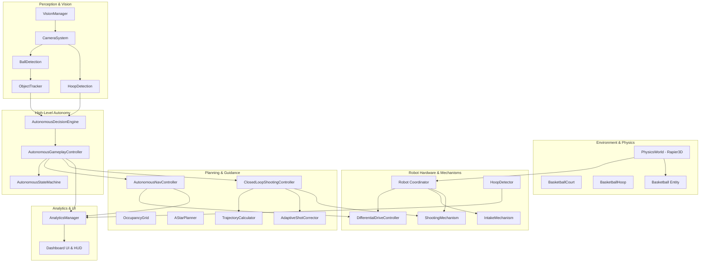

# SMART-BASKETBOT Simulator — Final System Architecture

## 1. Overview and Design Principles

The SMART-BASKETBOT Simulator is designed as an event-driven, decoupled robotics simulation architecture. The system executes client-side within modern WebGL-capable web browsers, coordinating 3D rendering, rigid-body physics simulation, autonomous perception, closed-loop motion control, and analytics.

### Architectural Core Principles:
1. **Separation of Concerns**: Physical dynamics (`PhysicsWorld`), kinematics (`DifferentialDriveController`), high-level autonomy (`AutonomousGameplayController`), perception (`VisionManager`), and metrics (`AnalyticsManager`) operate independently with explicit interface boundaries.
2. **Determinism and Fixed-Timestep Execution**: Physics stepping occurs at a fixed frequency of 60 Hz ($\Delta t = 0.0166\text{s}$) with sub-stepping to prevent temporal aliasing or tunneling.
3. **No Polling Overhead**: Actuator completions, scoring events, optical break-beams, and mode changes propagate through lightweight callback listeners and state transitions.
4. **Graceful Degradation and Headless Portability**: Scene graph and physics components run seamlessly in both rich WebGL browser environments and headless Node.js Vitest test runners.

---

## 2. Global Coordinate Frames & Spatial Conventions

The simulation strictly adheres to the standard right-handed Cartesian coordinate system:

| Frame | Origin | +X Axis | +Y Axis | +Z Axis |
|:---|:---|:---|:---|:---|
| **World Frame ($\mathcal{F}_W$)** | Center of court floor ($Y=0$) | East baseline (+14.0m) | Up (Vertical elevation) | South sideline (+7.5m) |
| **Robot Base Frame ($\mathcal{F}_R$)** | Center of robot drive axle ($Y=0.14\text{m}$) | Forward along robot heading | Up (Chassis normal) | Lateral left (Port) |
| **Camera Frame ($\mathcal{F}_C$)** | Mounted at offset $(+0.14, +0.35, 0.0)$ on chassis | Right in image plane | Up in image plane | Backwards (Optical axis is $-Z$) |
| **Muzzle Frame ($\mathcal{F}_M$)** | Shooter barrel exit point $(+0.20, +0.45, 0.0)$ | Forward along shot trajectory | Perpendicular upward | Lateral cross-track |
| **Hoop Frame ($\mathcal{F}_H$)** | Center of target rim $(+12.425, +3.05, 0.0)$ | East toward backboard | Up through rim opening | Cross-court lateral |

```
                                  +Y (Up)
                                    |
                                    |
                                    +----> +X (East Baseline / Forward)
                                   /
                                  /
                                +Z (South Sideline)
```

---

## 3. Subsystem Breakdown & Component Architecture



### 3.1 Physics Subsystem (`src/simulation/`)
- **`PhysicsWorld.js`**: Initializes Rapier3D Wasm module with standard gravitational acceleration $\mathbf{g} = [0, -9.81, 0]^T$. Maintains active rigid bodies, colliders, and event queues for collision detection.
- **`SimulationConfig.js`**: Central parameters for court dimensions (FIBA standard $28\text{m} \times 15\text{m}$), ball physics ($m = 0.62\text{kg}, r = 0.12\text{m}, e = 0.82$), chassis geometry, and camera settings.

### 3.2 Robot Platform Subsystem (`src/robot/`)
- **`Robot.js`**: Root coordinator for the physical robot entity. Assembles 3D visual groups and Rapier rigid bodies. Manages transitions between `MANUAL` and `AUTONOMOUS` control modes.
- **`DifferentialDriveController.js`**: Enforces wheel speed limits ($v_{\text{max}} = 2.2\text{ m/s}, \omega_{\text{max}} = 3.2\text{ rad/s}$) and acceleration slew rates ($a_{\text{max}} = 3.5\text{ m/s}^2$).
- **`RobotInputController.js`**: Captures keyboard teleoperation (`W/A/S/D`, arrow keys) and routes velocity commands to the drive controller. Automatically yields to manual controls upon user input.
- **`IntakeMechanism.js`**: Counter-rotating rollers that capture basketballs when within front proximity. Implements optical sensor break-beam detection and transforms basketball colliders into kinematic sensor triggers while captured.
- **`ShootingMechanism.js`**: Dual flywheel launcher with variable elevation angle ($35^\circ$ to $75^\circ$). Accelerates flywheels over a calibrated $0.8\text{s}$ spin-up curve and applies 3D launch impulses to the Rapier ball body.
- **`HoopDetector.js`**: Spatial scoring volume detector. Monitors basketball position relative to the rim plane, calculates closest approach distance, detects successful baskets, and triggers score/miss callbacks.

### 3.3 Perception Subsystem (`src/vision/`)
- **`VisionManager.js`**: Coordinates the virtual camera, ball detection, hoop observation, and multi-object tracking. Excludes the robot chassis and court floor from raycast occlusion checks.
- **`CameraSystem.js`**: Virtual pinhole perspective camera ($70^\circ$ FOV, $320 \times 240$ resolution). Renders offscreen perspective feeds at 15 Hz to conserve GPU resources.
- **`BallDetection.js`**: Computes screen bounding boxes and runs raycast line-of-sight checks against court obstacles.
- **`HoopDetection.js`**: Computes rim center azimuth, elevation, distance, and 3D bounding boxes.
- **`ObjectTracker.js`**: Nearest-neighbor tracking with Euclidean association ($1.0\text{m}$ gating threshold) and $\alpha$-$\beta$ position filtering ($\alpha = 0.65$). Maintains stable integer track IDs (`BALL_1`, `BALL_2`).

### 3.4 Planning & Control Subsystem (`src/navigation/`)
- **`OccupancyGrid.js`**: 2D discrete grid ($0.25\text{m}$ cell size) covering the entire court and apron ($128 \times 76$ cells). Inflates obstacles by robot footprint plus safety buffer ($0.52\text{m}$).
- **`AStarPlanner.js`**: 8-connected A* search with Euclidean heuristic.
- **`AutonomousNavController.js`**: Implements line-of-sight string-pulling waypoint reduction and pure pursuit path tracking with cubic deceleration upon goal approach.
- **`TrajectoryCalculator.js`**: Computes closed-form projectile solutions and apparent rim aperture ellipse dimensions ($D_{\text{eff}} = D_{\text{rim}} \sin(\theta_{\text{entry}})$) across elevation angles.
- **`AdaptiveShotCorrector.js`**: Online learning model that updates velocity and azimuth correction offsets based on historical miss displacement vectors.
- **`ClosedLoopShootingController.js`**: High-level workflow that aligns chassis yaw to target hoop, optimizes trajectory, spins up flywheels, fires, and tracks outcome.

### 3.5 Autonomous Intelligence Subsystem (`src/autonomy/`)
- **`AutonomousStateMachine.js`**: Deterministic 18-state finite state machine with state transition callbacks, timers, and pause/resume capability.
- **`AutonomousDecisionEngine.js`**: High-level planner calculating multi-factor ball utility scores, verifying court boundaries, and checking actuator interlocks.
- **`AutonomousGameplayController.js`**: Primary autonomy coordinator managing continuous and fixed-target gameplay modes, recovery retries, and mode arbitration.

### 3.6 Analytics Subsystem (`src/analytics/`)
- **`AnalyticsManager.js`**: Event-driven performance aggregator subscribing to scoring, navigation, motion, and autonomy events.
- **Sub-Modules**: `ShootingAnalytics`, `NavigationAnalytics`, `MotionAnalytics`, `CollectionAnalytics`, `AutonomyAnalytics`.
- **Export Engine**: Generates RFC 4180 compliant CSV tables and ISO 8601 annotated JSON records.

---

## 4. Cross-Subsystem Dataflow & Event Pipeline

```
[Camera System] 
      │ (Raw Detections)
      ▼
[Object Tracker]
      │ (Tracked Basketballs & Hoop Observation)
      ▼
[Autonomous Decision Engine]
      │ (Selected Target & Approach Waypoints)
      ▼
[Autonomous Gameplay Controller]
 ┌────┴──────────────────────────┐
 │ (Approach Goal)               │ (Shooting Goal)
 ▼                               ▼
[Autonomous Nav Controller]     [Closed-Loop Shooting Controller]
 │ (Linear / Angular Cmds)       │ (Flywheel RPM & Launch Impulse)
 ▼                               ▼
[Differential Drive Controller] [Shooting Mechanism]
 │                               │
 └──────────────┬────────────────┘
                ▼
      [PhysicsWorld (Rapier3D)]
                │
                ▼
         [Hoop Detector]
                │ (Score / Miss Events)
                ▼
       [Analytics Manager]
                │
                ▼
          [Dashboard UI]
```

---

## 5. Subsystem Interface Contracts

### 5.1 Robot & Actuator Interface
```typescript
interface IRobot {
  setControlMode(mode: 'MANUAL' | 'AUTONOMOUS'): void;
  getPosition(): { x: number; y: number; z: number };
  getHeading(): number;
  fireShot(ball: Basketball, hoopDetector?: HoopDetector): boolean;
  startAutonomousNavigation(targetX: number, targetZ: number): boolean;
  cancelAutonomousNavigation(): void;
  reset(): void;
}
```

### 5.2 Vision Telemetry Interface
```typescript
interface ITrackedObject {
  id: string;
  worldPosition: { x: number; y: number; z: number };
  relativePosition: { x: number; y: number; z: number };
  distance: number;
  azimuthDeg: number;
  elevationDeg: number;
  confidence: number;
  status: 'TRACKED' | 'COASTING' | 'LOST';
  timeSinceLastSeen: number;
}
```

### 5.3 Autonomy State Machine Contract
```typescript
type AutonomousState = 
  | 'IDLE' | 'SEARCHING_FOR_BALL' | 'SELECTING_TARGET' | 'NAVIGATING_TO_BALL'
  | 'COLLECTING_BALL' | 'SEARCHING_FOR_HOOP' | 'NAVIGATING_TO_SHOOTING_POSITION'
  | 'ALIGNING_WITH_HOOP' | 'OPTIMIZING_TRAJECTORY' | 'SPINNING_UP_FLYWHEELS'
  | 'SHOOTING' | 'EVALUATING_SHOT' | 'REACQUIRING_BALL' | 'PAUSED'
  | 'RECOVERING' | 'COMPLETED' | 'FAILED' | 'CANCELLED';
```

---

## 6. Memory & Lifecycle Management

1. **Geometry & Material Disposal**: All dynamic Three.js meshes (e.g. `PathVisualizer` waypoints, court canvas textures) register explicit `dispose()` routines that release GPU vertex buffers and shader programs upon teardown.
2. **Ring Buffer Bounding**: Historical arrays in `AnalyticsManager` and `ObjectTracker` are bounded ($N \le 100$) using FIFO shifting to guarantee $O(1)$ spatial overhead.
3. **Event Listener Teardown**: `destroy()` methods across `RobotInputController`, `AnalyticsManager`, and `Simulation` unsubscribe all DOM window event listeners and state machine subscriptions to eliminate memory leaks across hot reloads.
