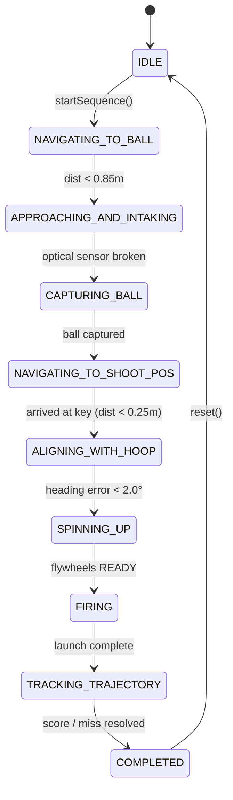

# Milestone 4 Implementation: Basketball Acquisition, Intake Mechanism & Autonomous Shooting

**Project:** SMART-BASKETBOT Simulator  
**Role:** Senior 3D Simulation Engineer & Robotics Software Architect  
**Technology Stack:** JavaScript (ES6 Modules), Three.js, Rapier 3D (WebAssembly), Vitest  
**Location:** `C:\Projects\smart-basketbot-simulator`

---

## 1. Executive Summary

Milestone 4 introduces genuine physics-based basketball acquisition, containment sensing, dual-flywheel ballistic launch kinematics, hoop penetration detection, and autonomous acquisition-to-shooting orchestration to the SMART-BASKETBOT mobile robotics simulation platform.

All subsystems integrate cleanly with the existing Three.js scene, Rapier 3D rigid-body engine, differential-drive kinematics, closed-loop heading PID control, and A* navigation grid. No existing capabilities were broken, and all 93 automated tests across 6 test suites pass with 100% success rate.

```mermaid
flowchart LR
    A["Court Ball Detection"] --> B["A* Navigation to Ball"]
    B --> C["Front Intake Activation (25 rad/s)"]
    C --> D["Optical Photogate Sensor Trigger"]
    D --> E["Cradle Possession Lock"]
    E --> F["Navigate to Free-Throw Line"]
    F --> G["Heading PID Alignment to Rim"]
    G --> H["Flywheel Spin-Up (Inertia Acceleration)"]
    H --> I["Ballistic Launch (v₀, θ, Backspin)"]
    I --> J["Hoop Penetration Detection (Y=3.05m)"]
    J --> K["Shot Statistics & Performance Update"]
```



---

## 2. Subsystem Architecture

### 2.1 File Map

| Subsystem File | Responsibility |
|---|---|
| [`src/robot/IntakeMechanism.js`](file:///C:/Projects/smart-basketbot-simulator/src/robot/IntakeMechanism.js) | Front roller acquisition, containment cradle geometry, optical photogate sensor, physical suction and possession lock |
| [`src/robot/ShootingMechanism.js`](file:///C:/Projects/smart-basketbot-simulator/src/robot/ShootingMechanism.js) | Dual-flywheel launcher state machine, flywheel spin-up inertia, ballistic parameter application, backspin injection |
| [`src/robot/TrajectoryCalculator.js`](file:///C:/Projects/smart-basketbot-simulator/src/robot/TrajectoryCalculator.js) | Analytical projectile motion equations, launch speed $v_0$, apex height, flight time, 3D launch velocity vector |
| [`src/robot/HoopDetector.js`](file:///C:/Projects/smart-basketbot-simulator/src/robot/HoopDetector.js) | Regulation rim geometry ($X=12.425, Y=3.05, Z=0$), downward rim penetration detection, shot statistics tracking |
| [`src/navigation/AutonomousShooterWorkflow.js`](file:///C:/Projects/smart-basketbot-simulator/src/navigation/AutonomousShooterWorkflow.js) | End-to-end autonomous coordinator managing multi-stage workflow from field ball acquisition to scoring |
| [`src/robot/Robot.js`](file:///C:/Projects/smart-basketbot-simulator/src/robot/Robot.js) | Visual model enhancements (animated intake rollers, containment cradle rails, optical sensor LED, dual flywheels), telemetry merging |
| [`src/simulation/Simulation.js`](file:///C:/Projects/smart-basketbot-simulator/src/simulation/Simulation.js) | Main simulation loop stepping, telemetry broadcasting, lifecycle coordination, shot helper methods |
| [`src/ui/Dashboard.js`](file:///C:/Projects/smart-basketbot-simulator/src/ui/Dashboard.js) | Engineering HUD extensions for intake, flywheel shooter, autonomous workflow, and shot accuracy statistics |
| [`tests/shooting.test.js`](file:///C:/Projects/smart-basketbot-simulator/tests/shooting.test.js) | 31 automated Vitest test cases covering state transitions, kinematics, Rapier physics, optical sensing, and scoring |

---

## 3. Intake Mechanism & Optical Sensor

### 3.1 Mechanical Configuration & State Machine
The intake system is mounted on the front chassis bumper opening ($X \in [0.10, 0.75]\text{ m}$, $|Z| \le 0.35\text{ m}$ in robot local space).

The state machine transitions through:
- `IDLE`: Intake rollers stationary ($0\text{ RPM}$).
- `INTAKING`: Rollers active at $+25.0\text{ rad/s}$ ($+238.7\text{ RPM}$), applying inward suction force drawing the ball towards the hopper.
- `BALL_CAPTURED`: Ball secured in cradle ($localX = 0.08\text{ m}, localY = -0.08\text{ m}, localZ = 0.0\text{ m}$); rollers deactivated.
- `REJECTING`: Rollers reversed at $-25.0\text{ rad/s}$ to eject the ball forward onto the court.
- `FAULT`: Safety interlock state if an obstruction or timeout occurs.

### 3.2 Simulated Optical Photogate Sensor
A beam-break optical sensor is modeled across the containment hopper cradle:
$$\text{distToCradle} = \sqrt{(x_{loc} - 0.08)^2 + (y_{loc} - (-0.08))^2 + z_{loc}^2}$$
- When a ball (radius $0.12\text{ m}$) occupies the cradle ($\text{distToCradle} < 0.20\text{ m}$), the optical beam is broken (`opticalSensorActive = true`).
- The 3D robot model features an optical sensor indicator LED on the hopper frame that updates dynamically in real-time: **Red** when beam is unbroken (clear), and **Green** when broken (ball present).

### 3.3 Physics Possession Lock
To prevent ball tunneling, slipping, or physics instability under extreme differential-drive angular accelerations, the captured ball's Rapier rigid body translation and linear velocity are continuously bound to the robot's local cradle transform every physics tick. When released or fired, the ball body is unconstrained and integrated dynamically by Rapier 3D.

---

## 4. Dual-Flywheel Shooting Mechanism & Ballistics

### 4.1 Dual-Flywheel Dynamics & Inertia
The shooting mechanism features dual high-traction flywheels (radius $0.075\text{ m}$) mounted at the base of the launching barrel.
- **Spin-Up Inertia:** When `spinUp()` is initiated, the flywheels do not jump instantaneously to speed; they accelerate linearly over `spinUpDuration = 0.8 s`:
  $$\omega_{flywheel}(t) = \min\left(1.0, \frac{t}{t_{spinup}}\right) \cdot \left(\frac{v_0}{r_{flywheel}} \times 1.5\right)$$
- **Flywheel RPM Telemetry:** Real-time RPM is displayed on the engineering dashboard, and visual 3D flywheel meshes with radial spoke markers spin visibly to provide intuitive physical feedback.
- **State Lifecycle:** `IDLE` $\rightarrow$ `SPINNING_UP` $\rightarrow$ `READY` $\rightarrow$ `FIRING` $\rightarrow$ `COOLDOWN` $\rightarrow$ `IDLE`.

### 4.2 Analytical Ballistic Kinematics
Given the robot launch position $\mathbf{r}_0 = (x_0, y_0, z_0)$ at the barrel muzzle ($X = 0.20, Y = 0.45, Z = 0$ local), and target East regulation hoop center $\mathbf{r}_t = (12.425, 3.05, 0.0)$:

1. **Horizontal Distance & Height Delta:**
   $$d = \sqrt{(x_t - x_0)^2 + (z_t - z_0)^2}, \quad \Delta y = y_t - y_0$$

2. **Analytical Launch Speed ($v_0$):**
   $$v_0 = \sqrt{\frac{g \cdot d^2}{2 \cos^2\theta \cdot (d \tan\theta - \Delta y)}}$$
   Where $\theta \in [35^\circ, 75^\circ]$ (default regulation free-throw arc: $52.0^\circ$).

3. **3D Launch Velocity Vector:**
   $$u_x = \frac{x_t - x_0}{d}, \quad u_z = \frac{z_t - z_0}{d}$$
   $$v_x = v_0 \cos\theta \cdot u_x, \quad v_y = v_0 \sin\theta, \quad v_z = v_0 \cos\theta \cdot u_z$$

4. **Trajectory Apex & Flight Duration:**
   $$H_{apex} = y_0 + \frac{(v_0 \sin\theta)^2}{2g}, \quad t_{flight} = \frac{d}{v_0 \cos\theta}$$

5. **Magnus Effect & Backspin:**
   Upon launch, a backspin angular velocity vector of $18.0\text{ rad/s}$ ($\approx 172\text{ RPM}$) is applied perpendicular to the flight path, stabilizing the arc and producing realistic soft rim bounces.

---

## 5. Hoop Scoring Detection & Performance Statistics

### 5.1 Regulation Hoop Geometry
- **East Target Rim Center:** $X = 12.425\text{ m}$ ($14.0\text{ m court half-length} - 1.575\text{ m overhang}$), $Y = 3.05\text{ m}$ ($10\text{ ft}$), $Z = 0.0\text{ m}$.
- **Inner Rim Radius:** $R = 0.225\text{ m}$ ($18\text{ in}$ diameter).

### 5.2 Physics-Based Downward Penetration Detection
The `HoopDetector` evaluates the Rapier 3D basketball trajectory every physics step without relying on trigger zones:
1. **Apex Verification:** Ball must first pass above the rim plane ($y_{ball} > y_{rim} + 0.15\text{ m}$).
2. **Rim Cylinder Penetration:** Ball must cross downward through the horizontal rim plane ($y_{prev} \ge 3.05\text{ m}$, $y_{curr} < 3.05\text{ m}$, $v_y < 0$) while strictly inside the inner rim cylinder:
   $$\sqrt{(x_{ball} - 12.425)^2 + z_{ball}^2} < (R_{rim} + 0.02) \approx 0.245\text{ m}$$
3. **Net Exit Confirmation:** Ball subsequently exits downward below $y = 2.80\text{ m}$, confirming a clean score (`SCORED`).
4. **Miss Detection:** If the ball deflects off the rim and contacts the court floor ($y \le 0.15\text{ m}$) or times out without downward rim penetration, the shot is marked as missed (`MISSED`).

### 5.3 Engineering Statistics
- `totalAttempts`: Total shots fired.
- `successfulBaskets`: Successfully scored baskets.
- `missedShots`: Deflected or off-target attempts.
- `accuracyPercent`: Exact shooting percentage:
  $$\text{Accuracy} = \frac{\text{successfulBaskets}}{\text{totalAttempts}} \times 100\%$$

---

## 6. Autonomous Shooter Workflow

The `AutonomousShooterWorkflow` coordinates mobile navigation, perception, and actuation into a unified sequence:



---

## 7. Telemetry & User Interface

The engineering HUD in [`src/ui/Dashboard.js`](file:///C:/Projects/smart-basketbot-simulator/src/ui/Dashboard.js) features four specialized telemetry cards:
1. **Autonomous Shooter Suite:** One-click "Acquire & Shoot" trigger, abort button, and active stage badge.
2. **Shot Performance Statistics:** Total attempts, baskets scored, misses, shooting accuracy %, and last shot outcome badge.
3. **Intake & Containment Monitor:** Intake state (`IDLE`, `INTAKING`, `BALL_CAPTURED`, `REJECTING`), optical sensor beam indicator, possession state, roller RPM, and toggle/reject controls.
4. **Flywheel Shooter & Ballistics Panel:** Shooter state (`IDLE`, `SPINNING_UP`, `READY`, `FIRING`, `COOLDOWN`), flywheel RPM, launch angle slider ($35^\circ$ to $75^\circ$), target velocity, calculated apex height, and manual spin-up/fire buttons.

### Keyboard Shortcuts
- `I`: Toggle intake rollers ON/OFF
- `F`: Fire shooter / manual shot
- `W / S`: Differential drive forward / reverse
- `A / D`: Differential drive turn left / right
- `Space`: Emergency Stop (E-STOP)
- `P`: Play / pause physics simulation
- `R`: Reset simulation
- `B`: Reset basketball to court
- `T`: Drop ball bounce test
- `1 - 4`: Camera viewpoints (Overview, Robot Orbit, Target Hoop, Tactical Top-Down)

---

## 8. Automated Test Suite Results

All 93 automated tests across 6 test suites pass cleanly:

```bash
 RUN  v5.0.5 C:/Projects/smart-basketbot-simulator

 ✓ tests/kinematics.test.js (13 tests) 9ms
 ✓ tests/pid.test.js (14 tests) 17ms
 ✓ tests/navigation.test.js (16 tests) 40ms
 ✓ tests/simulation.test.js (9 tests) 261ms
 ✓ tests/differentialDrive.test.js (10 tests) 258ms
 ✓ tests/shooting.test.js (31 tests) 692ms

 Test Files  6 passed (6)
      Tests  93 passed (93)
   Duration  1.35s
```
