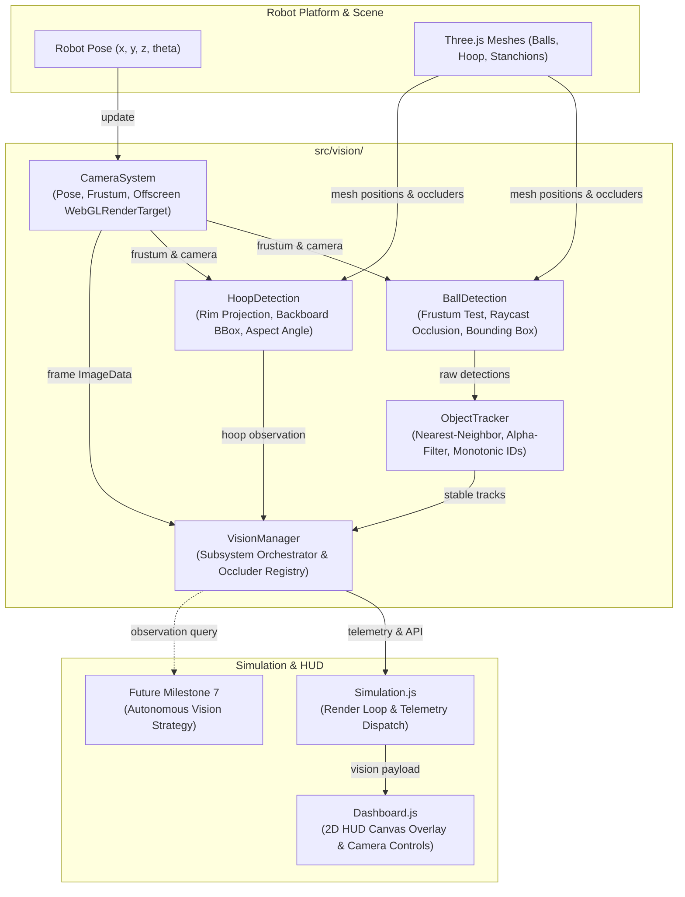

# SMART-BASKETBOT Simulator — Milestone 6 Implementation Report
## Simulated Robot Vision & Object Perception Subsystem

---

## 1. Executive Summary

Milestone 6 implements a physically grounded, real-time simulated robot vision and object perception subsystem for the SMART-BASKETBOT mobile robotics platform. Rather than relying on idealized global oracle coordinates or synthetic bounding boxes, Milestone 6 equips the robot with a virtual, robot-mounted camera sensor that observes the court geometry, detects basketballs and the regulation hoop via camera projection and raycast occlusion, tracks multiple objects with persistent identities across frames, and renders a live HUD camera feed directly to the engineering dashboard.

The subsystem is modularly partitioned into five decoupled components under `src/vision/`:
1. **`CameraSystem`**: 6-DOF robot-mounted virtual camera with configurable FOV, optical pitch, range clipping, frustum calculation, coordinate transformations, and offscreen `WebGLRenderTarget` stream rendering.
2. **`BallDetection`**: Geometric perception pipeline evaluating basketball candidate meshes against camera frustum limits, range gates, raycast line-of-sight occlusions, relative azimuth/elevation angles, and optical confidence scoring. Supports simultaneous multi-ball scenarios.
3. **`HoopDetection`**: Perception pipeline observing regulation rim center and backboard corners, calculating perspective projection bounding boxes, line-of-sight aspect angles, and raycast occlusion.
4. **`ObjectTracker`**: Spatial data association engine using Euclidean nearest-neighbor gating, stable monotonic track IDs (`BALL_1`, `BALL_2`, ...), temporal velocity filtering, dead-reckoning coasting, and track retirement after a configurable timeout.
5. **`VisionManager`**: High-level perception orchestrator providing unified query APIs for future autonomous decision-making (Milestone 7) and broadcasting structured telemetry to the UI dashboard.

### Verification Summary
- **Unit & Integration Tests**: 13 comprehensive test scenarios in `tests/vision.test.js`, covering camera translation/rotation tracking, FOV gating, back/distance rejections, multi-ball handling, hoop visibility, spatial accuracy, track identity persistence, lost object timeouts, and perception disabling.
- **Suite Pass Rate**: 135 passed out of 135 tests across 8 test suites.
- **Production Build**: 0 errors, cleanly compiled via Vite and Rolldown.

---

## 2. System Architecture & Module Breakdown

```
src/vision/
├── CameraSystem.js      # 6-DOF robot-mounted camera & offscreen framebuffer pipeline
├── BallDetection.js     # Three.js frustum projection, occlusion, and confidence scoring
├── HoopDetection.js     # Rim center, backboard corner projection, and aspect angle calculation
├── ObjectTracker.js     # Nearest-neighbor data association, alpha smoothing, track lifecycle
└── VisionManager.js     # Top-level coordinator, occluder discovery, and telemetry hub
```



---

## 3. Mathematical Formulations & Kinematic Transformations

### 3.1 Robot-to-Camera Mount Transformation
The simulated camera is mounted to the robot's front mast structure at local offset $\mathbf{r}_{\text{mount}} = (x_m, y_m, z_m) = (0.14, 0.35, 0.0)$ meters.
For robot world planar position $\mathbf{p}_R = (x_R, y_R, z_R)$ and heading angle $\psi \in (-\pi, \pi]$ (where $\psi = 0$ corresponds to $+X$ and positive $\psi$ rotates counter-clockwise toward $-Z$ in standard Three.js right-handed coordinates):

$$\begin{bmatrix} x_C \\ y_C \\ z_C \end{bmatrix} = \begin{bmatrix} x_R + x_m \cos\psi + z_m \sin\psi \\ y_R + y_m \\ z_R - x_m \sin\psi + z_m \cos\psi \end{bmatrix}$$

The camera optical axis incorporates a default downward pitch angle $\theta_{\text{pitch}} = -4.0^\circ$ ($\phi = \theta_{\text{pitch}} \cdot \frac{\pi}{180}$) to observe both ground-level basketballs and elevated hoops within typical court ranges:

$$\hat{\mathbf{f}}_{\text{cam}} = \begin{bmatrix} \cos\psi \cos\phi \\ \sin\phi \\ -\sin\psi \cos\phi \end{bmatrix}$$

The camera target look-at point in world space is established at:
$$\mathbf{p}_{\text{target}} = \mathbf{p}_C + 10 \cdot \hat{\mathbf{f}}_{\text{cam}}$$

### 3.2 3D Perspective Projection & Screen Space Mapping
Given any world-space point $\mathbf{p}_w = (x_w, y_w, z_w)^T$, its transformation into Normalized Device Coordinates (NDC) $\mathbf{p}_{\text{ndc}} = (x_n, y_n, z_n)^T$ is executed via Three.js view-projection matrices:

$$\mathbf{p}_{\text{clip}} = \mathbf{M}_{\text{proj}} \mathbf{M}_{\text{view}} \begin{bmatrix} x_w \\ y_w \\ z_w \\ 1 \end{bmatrix}, \quad \mathbf{p}_{\text{ndc}} = \frac{1}{w_{\text{clip}}} \begin{bmatrix} x_{\text{clip}} \\ y_{\text{clip}} \\ z_{\text{clip}} \end{bmatrix}$$

Point visibility within the view frustum requires:
$$-1 \le x_n \le 1, \quad -1 \le y_n \le 1, \quad -1 \le z_n \le 1$$

To obtain 2D viewport coordinates $(x_s, y_s)$ on an image buffer of width $W$ and height $H$:
$$x_s = \frac{x_n + 1}{2} \cdot W, \quad y_s = \frac{1 - y_n}{2} \cdot H$$

### 3.3 Camera Relative Azimuth and Elevation
Transforming world coordinates into the camera coordinate frame ($\mathbf{p}_{\text{cam}} = \mathbf{M}_{\text{view}} \mathbf{p}_w$ where $+X$ is right, $+Y$ is up, and $-Z$ is along optical line-of-sight):

$$d = \|\mathbf{p}_{\text{cam}}\| = \sqrt{x_c^2 + y_c^2 + z_c^2}$$
$$\psi_{\text{rel}} = \text{atan2}(x_c, -z_c) \cdot \frac{180}{\pi} \quad [\text{deg}]$$
$$\theta_{\text{rel}} = \text{atan2}(y_c, \sqrt{x_c^2 + z_c^2}) \cdot \frac{180}{\pi} \quad [\text{deg}]$$

### 3.4 Bounding Box Estimation & Optical Confidence
For a spherical basketball of radius $R = 0.12\text{ m}$ at camera distance $d$:
- Angular diameter: $\alpha = 2 \arctan\left(\frac{R}{d}\right)$
- Estimated screen diameter (pixels): $S_{\text{px}} = \frac{\alpha}{\text{FOV}_{\text{vert}}} \cdot H$
- 2D Bounding box: $[x_s - \frac{S_{\text{px}}}{2}, y_s - \frac{S_{\text{px}}}{2}, S_{\text{px}}, S_{\text{px}}]$

The optical confidence metric $C \in [0.05, 0.99]$ accounts for distance attenuation, visual eccentricity from optical center, and pixel resolution:
$$C = \left(1 - \left(\frac{d}{d_{\text{max}}}\right)^{1.3}\right) \cdot \left(1 - 0.45 \sqrt{x_n^2 + y_n^2}\right) \cdot \min\left(1.0, \frac{S_{\text{px}}}{8.0}\right)$$

### 3.5 Line-of-Sight Occlusion Checking
Before registering a detection, a Three.js `Raycaster` fires a ray from camera origin $\mathbf{p}_C$ toward the target center with near cutoff equal to camera near plane ($0.1\text{ m}$) and far cutoff equal to $d - 0.5 R$. If any opaque static mesh (stanchion, backboard, obstacles) intersects the ray closer than the target, the detection is rejected as occluded.

### 3.6 Multi-Object Tracking & Temporal Filtering
`ObjectTracker` implements a spatial nearest-neighbor data association algorithm:
1. **Gating**: Detections are paired with existing tracks having Euclidean distance $\|\mathbf{p}_{\text{det}} - \mathbf{p}_{\text{track}}\| \le D_{\text{match}}$ ($0.85\text{ m}$).
2. **Track Update**: Matched tracks update their state to `TRACKED`, resetting `timeSinceLastSeen = 0`. Position and velocity are updated via exponential smoothing ($\alpha = 0.65$):
   $$\mathbf{v}_t = (1 - \alpha) \mathbf{v}_{t-1} + \alpha \frac{\mathbf{p}_t - \mathbf{p}_{t-1}}{\Delta t}$$
   $$\mathbf{p}_{\text{filtered}} = (1 - \alpha) \mathbf{p}_{t-1} + \alpha \mathbf{p}_t$$
3. **Track Initiation**: Unmatched detections spawn new tracks with monotonic IDs (`BALL_1`, `BALL_2`, ...).
4. **Coasting & Retirement**: Unmatched tracks enter state `LOST`. Positions coast under estimated velocity:
   $$\mathbf{p}_t = \mathbf{p}_{t-1} + \mathbf{v}_{t-1} \Delta t$$
   If `timeSinceLastSeen >= lostTimeout` ($1.5\text{ s}$), the track is retired and pruned from memory.

---

## 4. Engineering Dashboard & Live HUD Canvas Integration

The live robot camera view is rendered alongside all telemetry without occluding or resetting the main user 3D perspective:
- **Offscreen Framebuffer**: `CameraSystem` allocates an offscreen `THREE.WebGLRenderTarget` ($320 \times 240$ default, togglable to $480 \times 360$). Frames are rendered at a throttled 20 FPS to maintain high simulation framerates.
- **Canvas 2D HUD**: The dashboard `<canvas id="vision-feed-canvas">` displays the pixel feed with vector HUD overlays:
  - **Center Reticle**: Cyan targeting crosshair indicating optical bore axis.
  - **Basketball Tags**: Green/cyan bounding boxes showing ID (`BALL_1`), distance (`4.2m`), and confidence (`92%`).
  - **Hoop Reticle**: Vibrant orange box highlighting backboard boundaries with rim distance and aspect percentage.
  - **Controls Strip**: Interactive sliders for FOV ($40^\circ - 110^\circ$), Max Range ($5\text{m} - 30\text{m}$), and Camera Enable/Disable.

---

## 5. Automated Verification & Test Coverage

The test suite in `tests/vision.test.js` covers all 13 core requirements:

| # | Test Scenario | Verified Behavior | Status |
|---|---|---|:---:|
| 1 | Camera follows robot translation | World position updates correctly with local mast offsets under linear translation | **PASS** |
| 2 | Camera follows robot rotation | Forward vector rotates faithfully from $+X$ (heading 0) to $-Z$ (heading $\frac{\pi}{2}$) | **PASS** |
| 3 | Ball inside FOV is detected | Target within frustum generates valid detection, distance, screen coordinates, and bounding box | **PASS** |
| 4 | Ball outside FOV is rejected | Target exceeding camera azimuth limits is rejected | **PASS** |
| 5 | Ball behind camera is rejected | Target at $-X$ relative to forward camera is rejected | **PASS** |
| 6 | Ball beyond max distance rejected | Target at $16\text{ m}$ exceeds $12\text{ m}$ clipping plane and is rejected | **PASS** |
| 7 | Multiple basketballs detected | Array of 3 basketballs yields 3 distinct sorted detections | **PASS** |
| 8 | Hoop visibility determined | Regulation hoop returns `visible: true` facing forward and `false` when facing away | **PASS** |
| 9 | Spatial accuracy verified | Euclidean 3D distance and azimuth angles match ground-truth geometry within $<0.05^\circ$ | **PASS** |
| 10 | Stable object IDs across frames | Tracker maintains `BALL_1` across consecutive frames without creating duplicates | **PASS** |
| 11 | Lost object timeout handling | Unobserved object transitions to `LOST` and is pruned after timeout elapses | **PASS** |
| 12 | Reset clears tracking state | Calling `reset()` clears all tracks and restarts monotonic numbering at `BALL_1` | **PASS** |
| 13 | Disabled vision produces no detections | Setting `enabled: false` halts detections and outputs empty telemetry | **PASS** |

### Vitest Output Summary
```
 Test Files  8 passed (8)
      Tests  135 passed (135)
   Start at  19:50:58
   Duration  1.19s
```

---

## 6. Constraints, Current Scope & Milestone 7 Preparation

1. **Non-Intrusive Integration**: In compliance with the Milestone 6 rules, the autonomous shooting workflow (`AutonomousShooterWorkflow.js`) has **not** been modified to depend on vision observations; it continues to operate under its validated M5 state machine.
2. **Headless Environment Support**: In headless Node.js test environments where WebGL is unavailable, `CameraSystem` gracefully disables framebuffer readback while executing all geometric transformations, frustum projections, and tracking math deterministically.
3. **Milestone 7 Readiness**: `VisionManager` provides a clean query interface:
   - `getVisibleBasketballs()`
   - `getTrackedBasketballs()`
   - `getSelectedBasketball()`
   - `getHoopObservation()`
   - `getCameraState()`
   
   These provide the exact perception inputs needed for Milestone 7's autonomous target selection, visual servoing, and dynamic vision-driven shooting.
