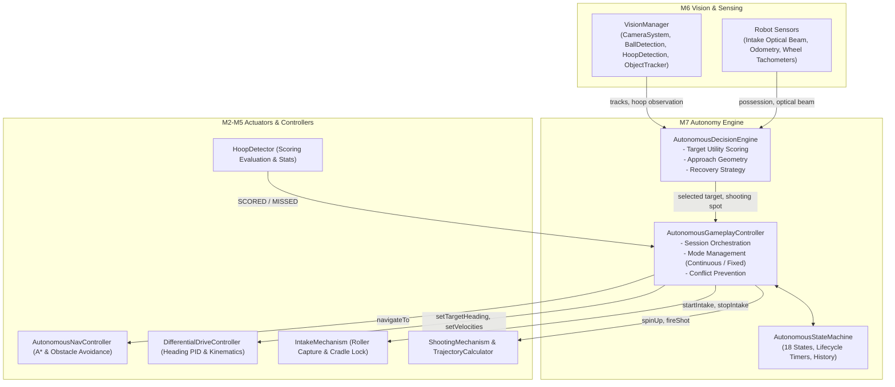
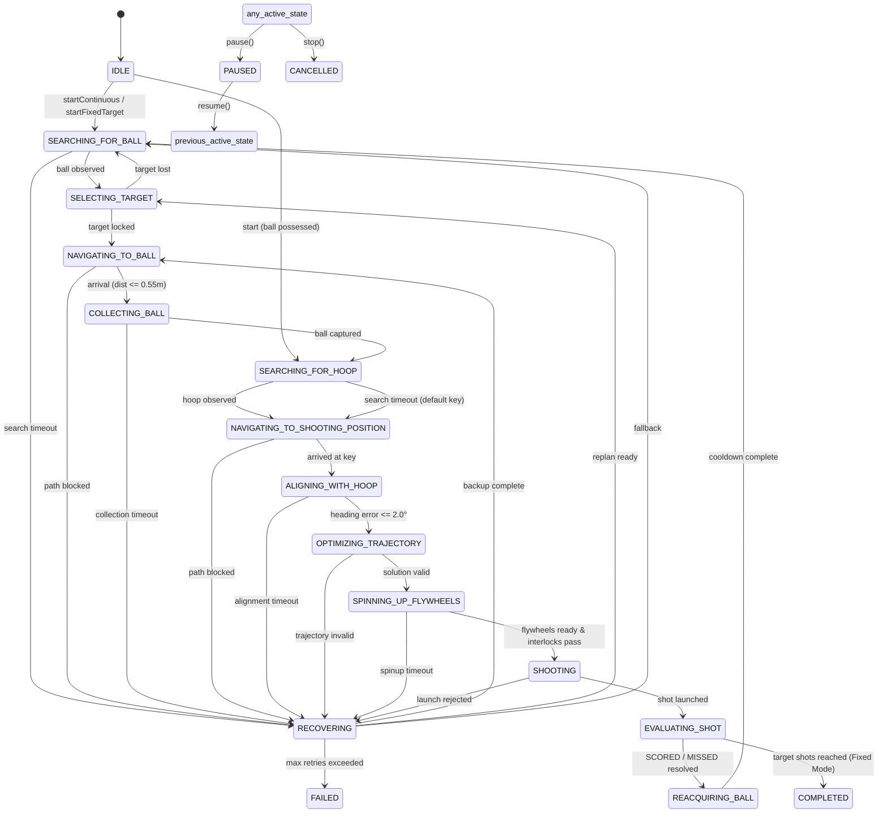

# SMART-BASKETBOT Simulator — Milestone 7 Implementation Report
## Complete Autonomous Basketball Intelligence

---

## 1. Executive Summary

Milestone 7 delivers a comprehensive, self-directing autonomous basketball-playing robotics intelligence for the SMART-BASKETBOT mobile robotics platform. Integrating all preceding subsystems—Milestone 6 simulated vision and multi-object tracking, Milestone 3 A* path planning and obstacle navigation, Milestone 4 front roller intake and dual-flywheel launcher, and Milestone 5 closed-loop ballistic trajectory optimization and adaptive shot correction—Milestone 7 elevates SMART-BASKETBOT from an operator-assisted platform to a fully autonomous basketball competitor.

The intelligence engine operates under a unified perception-decision-action loop:
1. **Perceive**: The robot scans the court using its simulated mast camera (`VisionManager`), detecting basketballs and the regulation hoop via perspective projection and raycast occlusion.
2. **Decide**: The cognitive decision engine (`AutonomousDecisionEngine`) scores candidate targets based on multi-factor utility (range, bearing, track quality), calculates collision-free approach waypoints, and determines optimal shooting positioning relative to the observed hoop.
3. **Act**: The 18-state finite state machine (`AutonomousStateMachine` & `AutonomousGameplayController`) orchestrates sequential navigation, front roller intake, cradle possession confirmation, hoop alignment using heading hold PID, flywheel spin-up, ballistic firing, and physical scoring evaluation.
4. **Learn & Repeat**: Shot results classified by `HoopDetector` update historical statistics and adaptive feedback biases, transitioning smoothly into the next acquisition cycle or achieving target completion.

### Verification Summary
- **Unit & Integration Tests**: 26 specialized test cases in `tests/autonomy.test.js` covering state transitions, multi-factor utility scoring, vision target selection, continuous gameplay, fixed-target goal completion, miss handling with adaptive correction, pause/resume, manual stop, recovery maneuvers, retry ceilings, and controller conflict prevention.
- **Full Suite Pass Rate**: 161 passed out of 161 tests across 9 test suites.
- **Production Build**: 0 errors, compiled in 416ms via Vite and Rolldown.

---

## 2. Autonomous System Architecture

The autonomy subsystem is partitioned under `src/autonomy/`:

```
src/autonomy/
├── AutonomousConfig.js              # State enumerations, gameplay modes, thresholds & timeouts
├── AutonomousStateMachine.js        # 18-state FSM with transition validation & timer tracking
├── AutonomousDecisionEngine.js      # Multi-factor target selection, approach geometry & recovery
└── AutonomousGameplayController.js  # Master orchestrator integrating robot, vision & physics
```



---

## 3. Autonomous State Machine

The state machine implements 18 explicit, robust operational states:



### State Catalog & Transition Contracts

| # | State | Description | Entry Conditions | Exit Conditions | Timeout / Fallback |
|---|---|---|---|---|---|
| 1 | `IDLE` | Subsystem standing by | Default initial state or after `reset()` | User initiates session | N/A |
| 2 | `SEARCHING_FOR_BALL` | Rotates in place scanning court with camera | Session start or after shot completion | Vision detects valid basketball track | 8.0s $\to$ `RECOVERING` |
| 3 | `SELECTING_TARGET` | Multi-factor candidate evaluation and lock | Candidate observed | Approach waypoint calculated | Target lost $\to$ `SEARCHING_FOR_BALL` |
| 4 | `NAVIGATING_TO_BALL` | A* path traversal toward approach point | Waypoints planned | Proximity $\le 0.55\text{m}$ or `GOAL_REACHED` | Path blocked $\to$ `RECOVERING` |
| 5 | `COLLECTING_BALL` | Forward crawl ($0.35\text{m/s}$) with intake rollers active | Proximity trigger satisfied | Ball captured in cradle (`isBallCaptured`) | 5.0s $\to$ `RECOVERING` |
| 6 | `SEARCHING_FOR_HOOP` | Visual scan toward East baseline | Ball possessed in cradle | Hoop detected with confidence $\ge 0.25$ | 6.0s $\to$ default Key |
| 7 | `NAVIGATING_TO_SHOOTING_POSITION` | A* traversal to regulation Free-Throw Key ($8.2, 0.0$) | Hoop located | Distance to key $\le 0.35\text{m}$ | Blocked $\to$ shoot in-range |
| 8 | `ALIGNING_WITH_HOOP` | Heading hold PID yaw rotation toward rim | Position reached | Heading error $\le 0.035\text{ rad}$ ($2.0^\circ$) | 4.5s $\to$ `RECOVERING` |
| 9 | `OPTIMIZING_TRAJECTORY` | Ballistic optimization with adaptive bias | Alignment verified | Valid descending trajectory generated | Invalid $\to$ `RECOVERING` |
| 10 | `SPINNING_UP_FLYWHEELS` | Dual flywheel acceleration to target RPM | Trajectory configured | RPM verified & interlocks satisfied | 3.5s $\to$ `RECOVERING` |
| 11 | `SHOOTING` | Solenoid cradle release into spinning wheels | Interlocks passed | Ball launched into Rapier flight | Rejected $\to$ `RECOVERING` |
| 12 | `EVALUATING_SHOT` | Observation of flight and scoring plane | Shot launched | `HoopDetector` reports `SCORED` or `MISSED` | 6.0s timeout resolution |
| 13 | `REACQUIRING_BALL` | Actuator shutdown and cooldown ($1.0\text{s}$) | Outcome resolved | Cooldown timer elapses | Transition to search |
| 14 | `PAUSED` | Actuators halted; state frozen | User clicks Pause | User clicks Resume $\to$ previous state | N/A |
| 15 | `RECOVERING` | Backs up, replans, or clears obstructions | Subsystem error / timeout | Recovery maneuver finishes | Max retries $\to$ `FAILED` |
| 16 | `COMPLETED` | Goal achieved in Fixed-Target mode | `successfulShots >= targetShots` | Terminal state | N/A |
| 17 | `FAILED` | Unrecoverable error (e.g. E-Stop, retry ceiling) | Retry limit exceeded | Terminal state | N/A |
| 18 | `CANCELLED` | Aborted by operator | User clicks Stop | Terminal state | N/A |

---

## 4. Autonomous Decision Engine & Vision-Driven Perception

### 4.1 Multi-Factor Candidate Utility Scoring
Rather than querying ground-truth simulation positions, `AutonomousDecisionEngine` evaluates the tracked objects list from `VisionManager.getTrackedBasketballs()`. Each candidate track $i$ is scored via:

$$U_i = w_d \cdot \left(1 - \frac{d_i}{d_{\text{max}}}\right) + w_\theta \cdot \max(0, \cos(\Delta\psi_i)) + w_c \cdot C_i + w_f \cdot F_i$$

Where:
- $d_i$: Estimated Euclidean distance to the ball from camera projection ($w_d = 0.40$).
- $\Delta\psi_i$: Angular bearing from robot optical bore line ($w_\theta = 0.30$).
- $C_i$: Optical confidence metric from `BallDetection` ($w_c = 0.15$).
- $F_i$: Track freshness ($1.0$ if actively visible, decaying if coasting, $w_f = 0.15$).

Gating filters discard any tracks with $C_i < 0.35$, coasting time $> 0.8\text{ s}$, or projected coordinates outside court boundaries ($|x| > 14.5\text{ m}, |z| > 7.5\text{ m}$).

### 4.2 Standoff Approach Geometry
To avoid colliding into the ball during rapid transit, the approach waypoint $(x_a, z_a)$ stops $0.45\text{ m}$ short of the ball center along the line of approach:

$$\mathbf{p}_{\text{approach}} = \mathbf{p}_{\text{ball}} - d_{\text{offset}} \cdot \frac{\mathbf{p}_{\text{ball}} - \mathbf{p}_{\text{robot}}}{\|\mathbf{p}_{\text{ball}} - \mathbf{p}_{\text{robot}}\|}$$

Once the robot arrives within $0.55\text{ m}$, `AutonomousGameplayController` cancels high-speed navigation and activates front intake rollers while crawling forward at $0.35\text{ m/s}$.

---

## 5. Gameplay Modes

### Mode A: Continuous Gameplay
- **Objective**: Sustained, autonomous basketball acquisition and scoring loop.
- **Workflow**: The robot continuously scans the court, acquires basketballs, drives to the key, shoots, tracks the result, and immediately resumes searching for the next available ball.
- **Termination**: Runs indefinitely until manually paused or cancelled by the user.

### Mode B: Fixed Successful-Shot Target
- **Objective**: Achieve an operator-specified number of verified scored baskets (e.g. 5 successful shots).
- **Accounting**:
  - `successfulShots`: Incremented only upon physical rim penetration confirmed by `HoopDetector`.
  - `totalAttempts`: Incremented upon every launch.
  - `remainingShots`: Evaluated each shot as $\max(0, \text{targetShots} - \text{successfulShots})$.
  - Missed shots do not advance the counter; the adaptive corrector adjusts flight parameters for the next attempt.
- **Termination**: Automatically transitions to `COMPLETED` when $\text{remainingShots} = 0$, halting all actuators and reporting final session metrics.

---

## 6. Recovery & Failure Handling

| Failure Scenario | Trigger Condition | Autonomous Recovery Procedure | Retry Limit |
|---|---|---|:---:|
| **Missed Ball Intake** | 5.0s in `COLLECTING_BALL` without `isBallCaptured` | Reverses at $-0.30\text{ m/s}$ for $0.8\text{ s}$ to gain clearance, then re-approaches | 3 retries $\to$ scan new target |
| **Lost Target Track** | Ball leaves camera FOV during transit | Initiates $360^\circ$ visual scan (`SEARCHING_FOR_BALL`) at $0.75\text{ rad/s}$ | 8.0s timeout $\to$ reposition |
| **Blocked Navigation** | `AutonomousNavController` reports `BLOCKED` | Halts, clears local dynamic obstacles, and replans A* route | 3 retries $\to$ search new target |
| **Hoop Occluded / Lost** | Hoop invisible upon ball capture | Rotates toward East baseline ($+X$) | 6.0s timeout $\to$ default Key |
| **Heading Drift / Timeout** | Alignment error $> 2.0^\circ$ after 4.5s | Re-engages heading PID with fresh vision bearing | 2 retries $\to$ reposition at Key |
| **Flywheel Lag / Timeout** | Flywheels fail to reach target RPM after 3.5s | Cancels launcher, idles, and retries spin-up sequence | 2 retries $\to$ `FAILED` |
| **Shot Rejected** | Interlock violation at trigger point | Cancels flywheels, re-verifies ball cradle lock, and retries | 2 retries $\to$ `FAILED` |
| **Infinite Loop Guard** | Cumulative session recovery maneuvers $\ge 10$ | Transitions immediately to `FAILED` with safety diagnostics | Ceiling: 10 recoveries |

---

## 7. Controller Conflict Prevention

To guarantee that autonomous intelligence, navigation, heading PID, and manual inputs never fight over robot actuators:
1. **Mode Isolation**: Starting an autonomous session sets `robot.setControlMode('AUTONOMOUS')`, disabling manual keyboard listeners and resetting teleoperation flags.
2. **Sequential Handoff**:
   - During navigation: Heading PID and flywheel controllers are held in standby.
   - During hoop alignment: `navController.cancel()` is called explicitly to prevent linear velocity commands from fighting heading PID yaw rotation.
   - During shooting: Drive velocities are locked at $(0, 0)$.
3. **Graceful Operator Override**: If the user presses WASD keys or activates E-Stop, the autonomous session yields cleanly without leaving actuators in unmanaged states.

---

## 8. Dashboard Engineering HUD Integration

The dashboard incorporates a dedicated **AUTONOMOUS INTELLIGENCE** telemetry suite:
- **Session Indicators**: Current state pill badge (`IDLE`, `COLLECTING_BALL`, `ALIGNING_WITH_HOOP`, `COMPLETED`, `RECOVERING`), active task description, and diagnostic alert banner.
- **Mode Dispatchers**: One-click buttons for Continuous Mode and Target Play with a numeric spinner for target baskets ($1 - 50$).
- **Flow Controls**: Interactive buttons for Pause, Resume, Stop, and Reset.
- **Telemetry Readouts**: Target ball ID, live ball range, hoop visibility, cradle possession status, shooter readiness, scored baskets, total attempts, remaining target, and recovery counts.

---

## 9. Automated Test Coverage (`tests/autonomy.test.js`)

26 comprehensive automated test cases verify all behaviors:

```
 ✓ tests/autonomy.test.js (26 tests)
   ✓ AutonomousStateMachine
     ✓ initializes in IDLE state with zero timer and ready message
     ✓ transitions between valid states and updates timers and history
     ✓ handles pause and resume, restoring the previously active state
     ✓ recognizes terminal states: COMPLETED, FAILED, and CANCELLED
     ✓ reset returns state machine to IDLE with clean history
   ✓ AutonomousDecisionEngine
     ✓ selects the best basketball candidate from vision observations based on multi-factor utility score
     ✓ rejects basketball tracks outside court boundaries or with low confidence
     ✓ calculates shooting position dynamically from vision hoop observations
     ✓ evaluates robot ball possession accurately
     ✓ evaluates shooting interlocks correctly
     ✓ evaluates recovery actions and halts before exceeding safety ceiling
     ✓ evaluates mission completion for Fixed-Target and Continuous modes
   ✓ AutonomousGameplayController
     ✓ starts continuous mode, yields manual control, and initiates visual ball search
     ✓ starts fixed-target mode with specified target shots count
     ✓ transitions smoothly through search, target selection, and navigation
     ✓ engages intake upon arrival at ball and transitions to collecting
     ✓ confirms possession, stops drive, and transitions to hoop search
     ✓ navigates to shooting position, aligns, spins up flywheels, and shoots
     ✓ increments score upon verified basket and completes session in fixed target mode
     ✓ records miss outcome into adaptive corrector and reacquires ball
     ✓ pauses and resumes without losing session statistics or target progress
     ✓ manually stopping halts actuators and transitions to CANCELLED
     ✓ executes collection failure recovery and limits retries
     ✓ handles navigation blockage with path replan recovery
     ✓ prevents conflicting movement controllers during state transitions
     ✓ resets all session statistics and state cleanly
```

---

## 10. Known Limitations & Future Considerations

1. **Stationary Visual Search**: In `SEARCHING_FOR_BALL`, the robot scans by rotating in place. In complex court scenarios with distant balls obscured behind other robots, a coordinated roaming search pattern could further decrease acquisition times.
2. **Single Camera Baseline**: Object depth estimation relies on pinhole camera perspective geometry and known basketball dimensions ($D = 0.24\text{ m}$). Dense clutter or overlapping balls can temporarily degrade confidence until the nearest-neighbor tracker resolves track separation.
