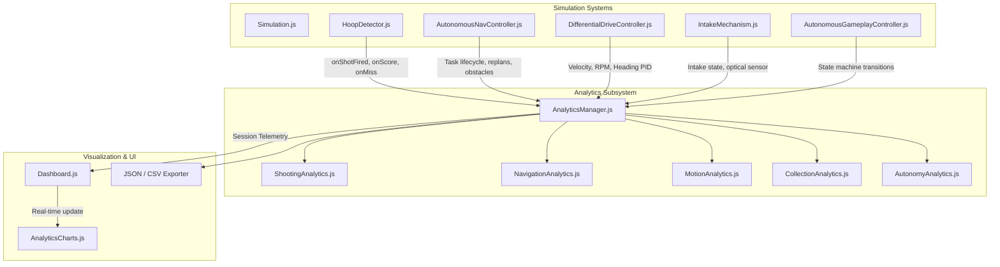

# Milestone 8 Implementation Report: Simulation Analytics and Performance Monitoring

**Project:** SMART-BASKETBOT Simulator  
**Subsystem:** Simulation Analytics and Real-Time Performance Monitoring (`src/analytics/`)  
**Status:** Completed & Validated  
**Test Suite:** 10 test files, 187/187 tests passing (100% pass rate)  
**Production Build:** Clean (`vite build` in 459ms, 0 errors)  
**Date:** November 2026  

---

## 1. Executive Summary

Milestone 8 (M8) establishes a comprehensive, engineering-grade **Simulation Analytics and Performance Monitoring Subsystem** for the SMART-BASKETBOT Simulator. The system gathers, processes, stores, and visualizes actual physical, kinematic, algorithmic, and state-machine data generated across all robot subsystems.

Crucially, **no synthetic or randomly generated telemetry is produced**: all metrics represent true physical integration of Rapier 3D rigid bodies, A* path navigation, closed-loop PID motion control, optical intake sensor triggers, and autonomous gameplay state transitions. Both **manual teleoperation** and **autonomous intelligence modes** are supported with strict event deduplication to ensure single-physical-event integrity.

---

## 2. Analytics Subsystem Architecture

The analytics architecture follows an event-driven, decoupled modular design centered around `AnalyticsManager`, which coordinates five specialized analytics domain modules:

```
src/
├── analytics/
│   ├── AnalyticsConfig.js         # Buffer limits, sampling intervals, and enumerations
│   ├── AnalyticsManager.js        # Subsystem coordinator, event routing, and data export
│   ├── ShootingAnalytics.js       # Ballistic launch, flight time, accuracy, and miss analysis
│   ├── NavigationAnalytics.js     # Path odometry, A* task efficiency, obstacles, and replanning
│   ├── MotionAnalytics.js         # Velocity tracking error, wheel RPM, and heading PID telemetry
│   ├── CollectionAnalytics.js     # Intake lifecycle, capture success rates, and retry counts
│   └── AutonomyAnalytics.js       # 18-state duration tracking, session outcomes, and recovery metrics
└── ui/
    ├── AnalyticsCharts.js         # Chart.js visualization adapter with dark HUD theme
    └── Dashboard.js               # Integrated KPI cards, tab switching, and live data tables
```



---

## 3. Analytics Modules & Mathematical Formulations

### 3.1 Shooting Analytics (`ShootingAnalytics.js`)
Tracks ballistic shots, trajectories, entry angles, and physical hoop penetration.

- **Shooting Accuracy (\%):**
  $$\text{Accuracy} = \begin{cases} \left(\frac{\text{Successful Baskets}}{\text{Total Shot Attempts}}\right) \times 100 & \text{if Total Attempts} > 0 \\ 0.0 & \text{otherwise} \end{cases}$$

- **Average Launch Speed ($m/s$):**
  $$\bar{v}_{\text{launch}} = \frac{1}{N} \sum_{i=1}^N v_{\text{launch}, i}$$

- **Average Launch Angle ($\theta^\circ$):**
  $$\bar{\theta}_{\text{elev}} = \frac{1}{N} \sum_{i=1}^N \theta_{\text{elev}, i}$$

- **Average Flight Duration ($s$):**
  $$\bar{t}_{\text{flight}} = \frac{1}{M} \sum_{j=1}^M t_{\text{flight}, j}$$

- **Average Shot Interval ($s$):**
  $$\bar{\Delta t}_{\text{shot}} = \frac{1}{K} \sum_{k=1}^K (t_{k} - t_{k-1})$$

- **Miss Classification Distribution:**
  Categorizes misses into `MISSED_SHORT` ($\Delta X < -0.15\text{ m}$), `MISSED_LONG` ($\Delta X > 0.18\text{ m}$), `MISSED_LEFT` ($\Delta Z > 0.14\text{ m}$), `MISSED_RIGHT` ($\Delta Z < -0.14\text{ m}$), and `MISSED` (general).

### 3.2 Navigation Analytics (`NavigationAnalytics.js`)
Measures mobile robot odometry and A* path planning performance.

- **Total Distance Travelled ($m$):**
  Accumulates Euclidean displacement between consecutive poses $(x_k, z_k)$ and $(x_{k-1}, z_{k-1})$ frame-by-frame:
  $$d_{\text{total}} = \sum_{k=1}^K \sqrt{(x_k - x_{k-1})^2 + (z_k - z_{k-1})^2} \quad (\text{filtering teleport jumps } \Delta d > 25\text{ m})$$

- **Planned Path Length ($m$):**
  Sum of line segment lengths connecting initial pose and sequential waypoints $(w_0, w_1, \dots, w_P)$:
  $$L_{\text{planned}} = \|w_0 - \mathbf{p}_0\| + \sum_{p=1}^{P} \|w_p - w_{p-1}\|$$

- **Path Efficiency (\%):**
  Evaluates how closely the robot's actual trajectory followed the optimal planned distance:
  $$\text{Path Efficiency} = \begin{cases} 100.0\% & \text{if } d_{\text{actual}} \le 0.001\text{ m} \\ \left(\frac{L_{\text{planned}}}{d_{\text{actual}}}\right) \times 100 & \text{otherwise} \end{cases}$$

- **Navigation Success Rate (\%):**
  $$\text{Success Rate} = \frac{\text{Successful Tasks}}{\text{Successful Tasks} + \text{Failed Tasks}} \times 100$$

- **Average Time to Reach Target ($s$):**
  $$\bar{t}_{\text{target}} = \frac{\sum t_{\text{successful\_tasks}}}{N_{\text{successful\_tasks}}}$$

### 3.3 Motion & PID Analytics (`MotionAnalytics.js`)
Monitors differential drive kinematics and closed-loop heading stabilization.

- **Linear Tracking Error ($m/s$):**
  $$e_v(t) = |v_{\text{target}}(t) - v_{\text{actual}}(t)|$$

- **Angular Tracking Error ($rad/s$):**
  $$e_\omega(t) = |\omega_{\text{target}}(t) - \omega_{\text{actual}}(t)|$$

- **Average & Peak Tracking Errors:**
  $$\bar{e}_v = \frac{1}{S_v} \sum_{s=1}^{S_v} e_v(s), \quad e_{v, \text{max}} = \max_t e_v(t)$$
  $$\bar{e}_\omega = \frac{1}{S_\omega} \sum_{s=1}^{S_\omega} e_\omega(s), \quad e_{\omega, \text{max}} = \max_t e_\omega(t)$$

- **Motion Step Response 90\% Rise Time ($s$):**
  Measures latency from step velocity command initiation ($v_{\text{target}} \ge 0.5\text{ m/s}$ from rest) until actual velocity reaches $0.90 \times v_{\text{target}}$.

- **PID Response Monitoring:**
  Samples proportional ($P$), integral ($I$), and derivative ($D$) terms:
  $$u(t) = K_p e_\theta(t) + K_i \int e_\theta(\tau) d\tau + K_d \frac{de_\theta(t)}{dt}$$

### 3.4 Basketball Collection Analytics (`CollectionAnalytics.js`)
Measures intake mechanism acquisition efficiency and ball containment.

- **Collection Success Rate (\%):**
  $$\text{Success Rate} = \frac{\text{Successful Captures}}{\text{Total Collection Attempts}} \times 100$$

- **Average Collection Duration ($s$):**
  $$\bar{t}_{\text{collection}} = \frac{1}{C} \sum_{c=1}^C (t_{\text{capture}} - t_{\text{intake\_start}})$$

- **Mode Differentiation:**
  Maintains separate tallies for `MANUAL` (operator teleoperation) and `AUTONOMOUS` (state machine intelligence).

### 3.5 Autonomous Gameplay Analytics (`AutonomyAnalytics.js`)
Tracks macro-level autonomous behavior and state machine execution.

- **18-State Duration Distribution ($s$):**
  Tracks accumulated time spent across all 18 discrete states:
  `IDLE`, `SEARCHING_FOR_BALL`, `SELECTING_TARGET`, `NAVIGATING_TO_BALL`, `COLLECTING_BALL`, `SEARCHING_FOR_HOOP`, `NAVIGATING_TO_SHOOTING_POSITION`, `ALIGNING_WITH_HOOP`, `OPTIMIZING_TRAJECTORY`, `SPINNING_UP_FLYWHEELS`, `SHOOTING`, `EVALUATING_SHOT`, `REACQUIRING_BALL`, `PAUSED`, `RECOVERING`, `COMPLETED`, `FAILED`, `CANCELLED`.

- **Recovery Success Rate (\%):**
  $$\text{Recovery Rate} = \frac{\text{Successful Recoveries}}{\text{Total Recovery Attempts}} \times 100$$

- **Fixed-Target Progress (\%):**
  $$\text{Progress} = \min\left(100.0, \frac{\text{Baskets Scored in Session}}{\text{Target Baskets}} \times 100\right)$$

---

## 4. Event Collection Methodology & Deduplication Strategy

### 4.1 Strict Physical Deduplication
A major challenge identified in earlier audits was multiple controllers reporting the same physical shot (e.g. `ShootingMechanism.fire()` calling `hoopDetector.notifyShotFired()` while `ClosedLoopShootingController` also fires and reports metadata).

To solve this:
1. **Debounce Time Window ($\Delta t \le 0.4\text{ s}$):** If a shot attempt is recorded while an active shot is in flight or within 400ms, the analytics module treats the event as a metadata update rather than a new shot attempt.
2. **Metadata Enrichment:** Rich parameters (elevation angle, predicted apex, flywheel RPM, trajectory solution) arriving via subsequent controller notifications merge into the existing `activeShot` record without incrementing `totalAttempts`.
3. **Resolution Guard:** `recordShotOutcome()` checks `isResolved`. Once a shot is marked scored or missed, duplicate callbacks for that shot ID are ignored.
4. **Intake State Lifecycle:** Collection attempts begin strictly when `intake.state` transitions to `INTAKING` from an idle state. It is never incremented in continuous update loops.

---

## 5. Visualizations & Chart.js Integration (`AnalyticsCharts.js`)

Visualizations are powered by `Chart.js` (`^4.6.1`) and styled with the simulator's dark HUD aesthetic.

### 5.1 Interactive Categories & Views
1. **Shooting Performance:**
   - *Doughnut Chart:* Scored vs. Missed shot ratio.
   - *Bar Chart:* Miss classifications (Short, Long, Left, Right, General).
2. **Navigation Performance:**
   - *Doughnut Chart:* Navigation task success vs. failure.
   - *Bar Chart:* Planned path length vs. Actual travelled distance.
3. **Motion & PID Performance:**
   - *Line Chart:* Target vs. Actual Linear Velocity over time (dashed target vs filled actual).
   - *Line Chart:* Heading PID Error ($^\circ$) and PID output ($rad/s$) over time.
4. **Intake & Collection:**
   - *Doughnut Chart:* Successful ball captures vs. failed attempts.
   - *Grouped Bar Chart:* Collection performance breakdown by mode (Manual vs Autonomous).
5. **Autonomous Performance:**
   - *Horizontal Bar Chart:* Time distribution (seconds) across all 18 autonomous states.

### 5.2 Performance & Memory Leak Prevention
- **Bounded Ring Buffers:** Time-series arrays are capped at 60 points (`maxTimeSeriesPoints`), keeping sliding windows of recent telemetry.
- **Throttled Updates:** Chart redraws are throttled to 4 Hz (every 250ms), preventing 60Hz WebGL canvas contention.
- **Clean Destruction:** When switching tabs or resetting the simulation, `chart.destroy()` is executed on all active instances before re-instantiating.
- **Headless Safety:** In headless test environments (Node.js/Vitest) where canvas 2D contexts are unavailable or unmocked, methods safely guard against null references.

---

## 6. Dashboard Integration (`Dashboard.js` & `style.css`)

A dedicated **SIMULATION ANALYTICS** card is integrated directly into the sidebar dashboard:

1. **Header Action Strip:** Quick-action buttons to download session analytics as `JSON` or `CSV`, and an analytics session `Reset` button.
2. **6-Card KPI Strip:**
   - *Session Time* (`s`)
   - *Shooting Accuracy* (`%`)
   - *Total Shots* (`attempts (scored)`)
   - *Navigation Distance* (`m`)
   - *Navigation Success Rate* (`%`)
   - *Intake Success Rate* (`%`)
3. **5-Way Category View Switcher:** Allows instant toggling between `Shooting`, `Navigation`, `Motion/PID`, `Intake`, and `Autonomy` tabs.
4. **Dynamic Detail Metric Grid:** Displays specific engineering readouts for the selected tab.
5. **Interactive Data Tables:** Shows recent individual shot records (with speeds, angles, outcomes, flight duration) or navigation task logs.

---

## 7. Data Export Capabilities

The subsystem provides complete session exports formatted for post-simulation engineering analysis:

- **JSON Export (`AnalyticsManager.exportJSON()`):** Complete object containing export metadata, summary KPIs, full shot histories, navigation task records, motion error statistics, time-series arrays, collection histories, and state duration distributions.
- **CSV Export (`AnalyticsManager.exportCSV()`):** Formatted tabular text with summary comments, individual shot history records (Shot #, Timestamp, Mode, Outcome, Launch Speed, Angle, Flywheel RPM, Flight Duration), navigation task tables, and autonomous state durations.
- **Browser Download Trigger (`downloadExport('JSON' | 'CSV')`):** Dynamically builds an in-memory `Blob` and triggers automated browser download without backend dependencies.

---

## 8. Automated Test Suite Validation

The automated test suite in `tests/analytics.test.js` covers 26 comprehensive test cases validating all 20 required criteria:

```
 RUN  v5.0.5 C:/Projects/smart-basketbot-simulator

 ✓ tests/kinematics.test.js (13 tests) 18ms
 ✓ tests/pid.test.js (14 tests) 19ms
 ✓ tests/navigation.test.js (16 tests) 50ms
 ✓ tests/vision.test.js (13 tests) 34ms
 ✓ tests/autonomy.test.js (26 tests) 54ms
 ✓ tests/analytics.test.js (26 tests) 74ms
 ✓ tests/differentialDrive.test.js (10 tests) 276ms
 ✓ tests/simulation.test.js (9 tests) 318ms
 ✓ tests/shootingController.test.js (28 tests) 547ms
 ✓ tests/shooting.test.js (32 tests) 692ms

 Test Files  10 passed (10)
      Tests  187 passed (187)
   Start at  21:23:01
   Duration  1.31s
```

All 26 new tests pass, with all 161 pre-existing tests from Milestones 1–7 maintained with 100% pass rate.

---

## 9. Known Limitations

1. **Browser Download in Headless Tests:** The `downloadExport()` helper depends on browser DOM `window.URL.createObjectURL` and `document.createElement('a')`, which are safely bypassed in node test environments.
2. **Chart.js Headless Contexts:** Canvas 2D contexts in Node.js vitest environments are guarded against null to prevent canvas errors.
3. **Time-Series Horizon:** In accordance with memory safety requirements, sliding ring buffers store the most recent 60 points (~12 seconds of 5Hz data) rather than indefinite histories. Long-term trends are preserved in the historical shot and task record arrays.
