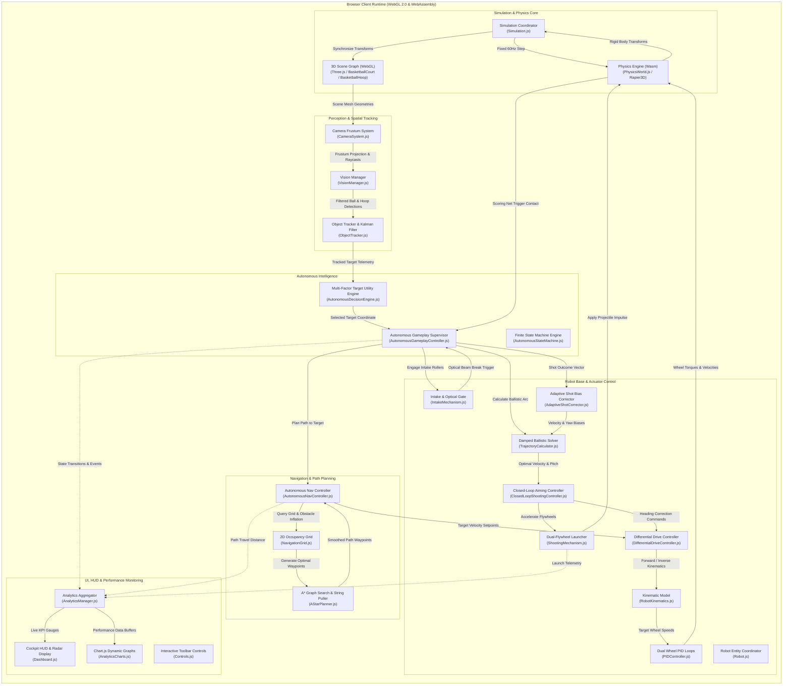
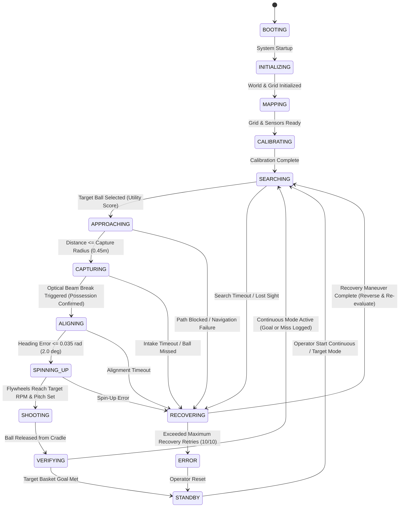
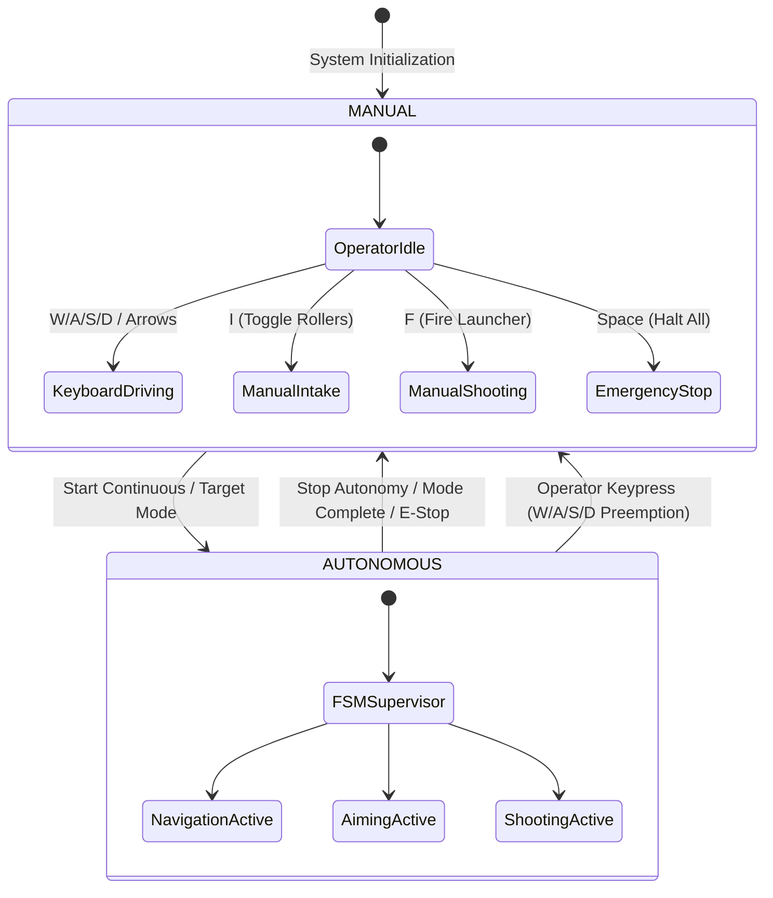

# SMART-BASKETBOT — System Architecture

**Document ID:** SBB-ARCH-2026-FINAL  
**System:** SMART-BASKETBOT Autonomous Robotics Basketball Simulator  
**Architecture Style:** Decoupled, Event-Driven Cyber-Physical Digital Twin  

---

## 1. High-Level Architecture Overview

The SMART-BASKETBOT platform is structured as an event-driven, modular cyber-physical robotics simulator. The system enforces strict separation of concerns across physical simulation, graphical rendering, kinematic control, spatial perception, global motion planning, autonomous decision logic, and user telemetry.

All core modules reside under `src/` and communicate through documented public interfaces, immutable telemetry descriptors, and centralized event dispatchers:

---

## 2. Major Modules and Responsibilities

### 2.1 Simulation & Physics Core (`src/simulation/`)
- **`PhysicsWorld.js`**: Wraps the Rapier3D WebAssembly physics engine. Operates a fixed-timestep discrete loop ($\Delta t = 1/60\text{ s} \approx 16.667\text{ ms}$) with an accumulator buffer to handle variable browser refresh rates (e.g. 60 Hz to 144 Hz) and prevent the 'spiral of death' via a maximum sub-step accumulator cap ($0.1\text{ s}$).
- **`Simulation.js`**: Central application lifecycle manager. Coordinates the main requestAnimationFrame loop, initializes the Three.js scene, binds physics rigid bodies to graphical meshes, handles camera preset switching, and routes keyboard teleoperation inputs.
- **`SimulationConfig.js`**: Centralized configuration store defining physical constants (gravity $-9.81\text{ m/s}^2$, air density, friction coefficients, dimensions).

### 2.2 Environment Subsystem (`src/environment/`)
- **`BasketballCourt.js`**: Generates standard FIBA court geometry ($28\text{m} \times 15\text{m}$), boundary colliders, wood floor shaders, 3-point arcs, key markings, and perimeter aprons.
- **`BasketballHoop.js`**: Constructs the hoop stanchion, backboard ($1.8\text{m} \times 1.05\text{m}$), and a **16-segment compound rotated rigid-body collider** matching the circular $0.45\text{m}$ inner-diameter rim. Incorporates an invisible sensor trigger beneath the net to detect descending scoring trajectories ($v_y < -0.5\text{ m/s}$).
- **`Basketball.js`**: Manages FIBA Size 7 rigid bodies ($r = 0.12\text{m}$, $m = 0.62\text{kg}$, restitution $e = 0.82$, Coulomb friction $\mu = 0.65$) with dynamic trail rendering.
- **`BallTrajectoryTracker.js`**: Samples the basketball's rigid body center of mass at 60 Hz to render a real-time 3D ribbon trajectory showing actual physical flight paths.

### 2.3 Robot Base & Actuators (`src/robot/`)
- **`Robot.js`**: Top-level mechatronic entity uniting chassis geometry, drive wheels, intake rollers, launcher turret, camera mast, and sensors.
- **`RobotKinematics.js`**: Computes forward and inverse differential-drive kinematics between linear/angular velocities $(v, \omega)$ and individual wheel speeds $(\omega_L, \omega_R)$ for wheel radius $r = 0.08\text{m}$ and track width $L = 0.45\text{m}$.
- **`PIDController.js`**: Discrete proportional-integral-derivative controller featuring trapezoidal integration, anti-windup accumulator clamping, output saturation limits, and angular wrapping for heading regulation.
- **`DifferentialDriveController.js`**: Trajectory tracker executing pure pursuit lookahead guidance, velocity ramping, and closed-loop heading alignment.
- **`IntakeMechanism.js`**: Simulates the front-mounted counter-rotating roller scoop ($25\text{ rad/s}$ spin, $3.2\text{ m/s}$ suction) and a photoelectric optical beam-break proximity sensor ($0.45\text{m}$ trigger range). Latches the ball into a cradle constraint and shuts off rollers upon confirmed possession.
- **`ShootingMechanism.js`**: Controls the dual counter-rotating launcher flywheels and elevation pitch actuator ($40^\circ \text{ to } 70^\circ$). Implements flywheel spin-up acceleration ramps and impulse transfer upon projectile release.
- **`TrajectoryCalculator.js`**: Analytical and numerical ballistic solver incorporating linear aerodynamic drag ($\gamma = 0.08\text{ s}^{-1}$). Uses Newton-Raphson iteration to solve for flight time and launch velocity while enforcing an apparent rim entry angle constraint $\theta_{\text{entry}} \ge 32^\circ$.
- **`ClosedLoopShootingController.js`**: Manages the multi-stage shooting sequence: in-place chassis alignment within heading tolerance ($\le 0.035\text{ rad} \approx 2^\circ$), flywheel spin-up verification, and ball release.
- **`AdaptiveShotCorrector.js`**: Closed-loop empirical bias feedback loop that adjusts subsequent launch velocity and heading setpoints based on recorded miss displacement vectors.

### 2.4 Navigation Subsystem (`src/navigation/`)
- **`NavigationGrid.js`**: Maps the court into a 2D occupancy grid ($0.25\text{m}$ cell pitch, $112 \times 60$ cells). Inflates static obstacles (stanchions, perimeter boundaries) by robot radius plus safety clearance ($0.42\text{m}$).
- **`AStarPlanner.js`**: Executes 8-connected A\* graph search using Euclidean distance heuristics. Applies post-search raycast string-pulling smoothing to eliminate grid-staircasing and prune intermediate collinear waypoints by over 70%.
- **`AutonomousNavController.js`**: Commands differential-drive waypoint following, dynamic deceleration at path endpoints, and path replanning upon dynamic obstruction.
- **`PathVisualizer.js`**: Renders 3D colored waypoint ribbons and breadcrumbs in the WebGL viewport.

### 2.5 Simulated Vision Subsystem (`src/vision/`)
- **`VisionManager.js`**: Coordinates synthetic visual perception. Evaluates candidate targets against the virtual camera frustum, computes line-of-sight raycasts to detect occlusions by court stanchions, and outputs structured target telemetry.
- **`CameraSystem.js`**: Simulates an elevated sensor mast camera ($h = 0.75\text{m}$, $75^\circ$ horizontal FOV, $-12^\circ$ pitch tilt). Projects 3D world coordinates to Normalized Device Coordinates (NDC) and 2D cockpit HUD overlays.
- **`ObjectTracker.js`**: Associates sequential detections using Euclidean gating and smooths position and velocity vectors via discrete Kalman filtering.

### 2.6 Autonomous Intelligence (`src/autonomy/`)
- **`AutonomousGameplayController.js`**: Central supervisor managing continuous autonomous basketball play.
- **`AutonomousStateMachine.js`**: Deterministic finite state machine tracking operational states, state entry/exit actions, transition guards, and timeout triggers.
- **`AutonomousDecisionEngine.js`**: Multi-factor utility engine scoring visible basketballs to prioritize collection targets based on distance, heading error, tracking confidence, and boundary proximity with hysteresis latching.

### 2.7 UI & Performance Analytics (`src/ui/` & `src/analytics/`)
- **`Dashboard.js`**: High-performance cockpit overlay displaying live velocity gauges, motor RPMs, FSM state banners, targeting reticles, 2D radar court display, and telemetry cards.
- **`Controls.js`**: Interactive toolbar handling simulation play/pause, full reset, object drop tests, camera view switching, and trajectory toggling.
- **`AnalyticsManager.js`**: Subsystem event listener aggregating session statistics across shooting, navigation, motion, and autonomy.
- **`AnalyticsCharts.js`**: Renders real-time Chart.js visual telemetry (accuracy percentages, velocity scatter plots, FSM state dwell times).

---

## 3. Data Flow & Subsystem Interactions

### 3.1 The 60 Hz Simulation Step Loop
At each frame of the animation loop:
1. `Simulation.js` calculates elapsed wall-clock time $\Delta t_{\text{wall}}$ and feeds it to `PhysicsWorld.js`.
2. `PhysicsWorld.js` accumulates time and steps the Rapier3D physics world in discrete $\Delta t = 1/60\text{ s}$ increments.
3. Rigid body translation coordinates $(x, y, z)$ and rotation quaternions $(q_x, q_y, q_z, q_w)$ are read from WebAssembly memory buffers and applied to Three.js meshes.
4. Active controllers (`DifferentialDriveController`, `IntakeMechanism`, `ShootingMechanism`) update actuator forces and velocity constraints.
5. `VisionManager` computes synthetic camera projections and raycasts at throttled intervals ($15\text{ Hz}$).
6. `AutonomousGameplayController` evaluates state machine transitions and issues motion or shooting commands.
7. `Dashboard` throttles DOM updates to $4\text{ Hz}$ ($250\text{ ms}$) to ensure zero rendering jank.

---

## 4. Autonomous Gameplay State Machine

The autonomous gameplay supervisor executes a deterministic state machine managing the continuous cycle of athletic play:

### State Machine Transition Table

| State Name | Entry Conditions | Primary Activity | Exit Transition Target |
| :--- | :--- | :--- | :--- |
| **`BOOTING`** | Simulator initialized. | Loads Three.js and initializes Rapier3D Wasm module. | `INITIALIZING` |
| **`INITIALIZING`** | Physics world loaded. | Spawns court geometry, basketballs, robot chassis, and colliders. | `MAPPING` |
| **`MAPPING`** | Environment spawned. | Builds $112 \times 60$ 2D occupancy grid with $0.42\text{m}$ obstacle inflation. | `CALIBRATING` |
| **`CALIBRATING`** | Grid constructed. | Verifies camera frustum, resets wheel encoders, zeroes PID accumulators. | `SEARCHING` |
| **`SEARCHING`** | Robot ready on court. | Rotates robot base in place; vision manager tracks visible basketballs; utility engine evaluates best target. | `APPROACHING` |
| **`APPROACHING`** | Target ball selected. | A\* planner computes path; differential drive executes lookahead trajectory tracking. | `CAPTURING` |
| **`CAPTURING`** | Arrived within $0.45\text{m}$. | Lowers intake scoop; runs counter-rotating rollers at $25\text{ rad/s}$; monitors optical beam-break sensor. | `ALIGNING` |
| **`ALIGNING`** | Ball possession confirmed. | Computes line-of-sight azimuth to target hoop center; executes closed-loop heading turn ($\le 2^\circ$). | `SPINNING_UP` |
| **`SPINNING_UP`** | Heading aligned. | Trajectory solver calculates launch velocity and pitch angle; flywheels accelerate to setpoint RPM. | `SHOOTING` |
| **`SHOOTING`** | Flywheel velocity verified. | De-latches cradle constraint; applies calculated ballistic impulse to basketball rigid body. | `VERIFYING` |
| **`VERIFYING`** | Ball in flight. | Monitors downward entry through net scoring trigger volume; records goal / miss in analytics and bias corrector. | `SEARCHING` / `STANDBY` |
| **`RECOVERING`** | Navigation blocked or timeout. | Reverses robot $1.2\text{m}$ at $-0.8\text{ m/s}$; clears target latch; re-evaluates court targets. | `SEARCHING` / `ERROR` |
| **`STANDBY`** | Task completed or stopped. | Halts all drive motors and flywheel actuators; awaits operator command. | `SEARCHING` |
| **`ERROR`** | Exceeded 10 recovery retries. | Emits diagnostic alarm; halts autonomous loop; alerts operator. | `STANDBY` |

---

## 5. Control Arbitration & Mode Preemption

To prevent conflicting actuator commands, the architecture enforces strict operational mode arbitration between **Manual Teleoperation** and **Autonomous Gameplay**:

1. **Autonomous Preemption:** When the operator engages autonomous mode, all manual driving flags are zeroed, and `RobotInputController` is muted.
2. **Manual Override Safety:** If an operator presses any manual teleoperation key (`W`, `A`, `S`, `D`) while autonomous gameplay is actively running, the supervisor immediately yields control, cancels path tracking, halts motors, and transitions smoothly into manual teleoperation mode.
